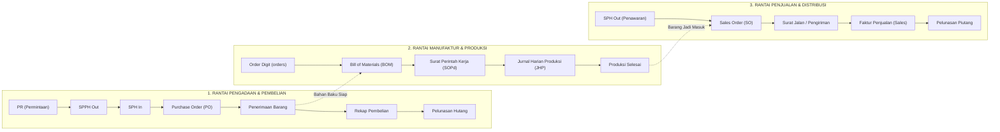
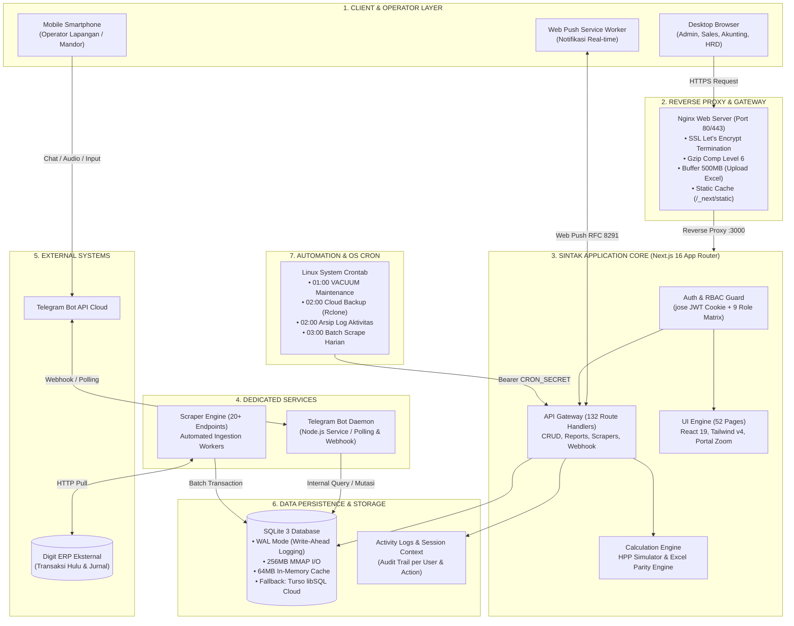
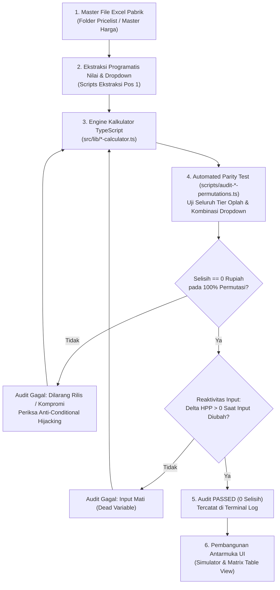
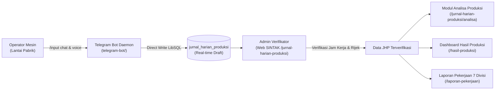

# DOKUMEN ARSITEKTUR KESELURUHAN SISTEM SINTAK
> **Sistem Informasi Cetak & Manajemen Terpadu — PT Buya Barokah**  
> Status Dokumen: *Resmi, Lengkap & Menggunakan Standar Visual Mermaid*  
> Tech Stack: `Next.js 16 (App Router) | React 19 | TypeScript | Tailwind CSS v4 | SQLite 3 (WAL / MMAP) / Turso | Telegram Bot API`

---

## DAFTAR ISI
1. [Ringkasan Eksekutif & Ruang Lingkup Sistem](#1-ringkasan-eksekutif--ruang-lingkup-sistem)
2. [Diagram Topologi Arsitektur End-to-End](#2-diagram-topologi-arsitektur-end-to-end)
3. [Dekomposisi 6 Lapisan Arsitektur (Layer Breakdown)](#3-dekomposisi-6-lapisan-arsitektur-layer-breakdown)
   - [3.1 Presentation & UI Layer](#31-presentation--ui-layer)
   - [3.2 API & Routing Layer](#32-api--routing-layer)
   - [3.3 Security, Session & RBAC Layer](#33-security-session--rbac-layer)
   - [3.4 Core Domain & Calculation Engine](#34-core-domain--calculation-engine)
   - [3.5 Ingestion & Automated Scraper Pipeline](#35-ingestion--automated-scraper-pipeline)
   - [3.6 Data Persistence & Storage Layer](#36-data-persistence--storage-layer)
4. [Sub-Sistem Lapangan: Telegram Bot Daemon](#4-sub-sistem-lapangan-telegram-bot-daemon)
5. [Infrastruktur Server, PM2 & Otomasi Cron](#5-infrastruktur-server-pm2--otomasi-cron)
6. [Matriks Peran Pengguna (RBAC) & Batas Akses](#6-matriks-peran-pengguna-rbac--batas-akses)
7. [Invarian Kritis & Pedoman Pemeliharaan Kode](#7-invarian-kritis--pedoman-pemeliharaan-kode)

---

## 1. RINGKASAN EKSEKUTIF & RUANG LINGKUP SISTEM

**SINTAK (Sistem Informasi Cetak)** adalah platform ERP terintegrasi yang dirancang khusus untuk operasional industri percetakan buku, majalah, kemasan obat, dan atribut sekuriti pada PT Buya Barokah.

Sistem ini mengonsolidasikan seluruh siklus operasional pabrik dalam satu ekosistem:
1. **Sinkronisasi Hulu (Upstream Ingestion)**: Mengambil data transaksi pembelian, penjualan, master barang, dan jurnal akuntansi dari ERP Digit eksternal via scraper otomatis.
2. **Kalkulasi Biaya & HPP Presisi Tinggi**: Menyediakan 20+ simulator harga cetak (`/pricelist`) dengan toleransi selisih 0 rupiah terhadap master formula Excel pabrik.
3. **Pelacakan Manufaktur 3 Rantai**: Menghubungkan alur Surat Permintaan Penawaran Harga (SPPH), Purchase Order (PO), Bill of Materials (BOM), Perintah Kerja Produksi (SOPd), hingga Pengiriman dan Pelunasan Piutang.
4. **Operasional Lapangan & Pabrik**: Mengintegrasikan laporan kerja 7 divisi teknis (Setting, QC, Cetak, Finishing, Gudang, Teknisi, Mesin) dengan pelaporan langsung via Bot Telegram.
5. **Akuntansi Terpadu**: Mengelola pencatatan kas, buku besar, neraca lajur, dan analisis jurnal umum berbasis ribuan transaksi harian.

### Diagram Aliran 3 Rantai Dokumen Manufaktur (Tracking Manufaktur)


---

## 2. DIAGRAM TOPOLOGI ARSITEKTUR END-TO-END



---

## 3. DEKOMPOSISI 6 LAPISAN ARSITEKTUR (LAYER BREAKDOWN)

### 3.1 Presentation & UI Layer
* **Framework**: Next.js 16 App Router dengan React 19 (`package.json:35-38`).
* **Styling**: Tailwind CSS v4 (`package.json:54`).
* **Peta Halaman (52 Pages)**:
  * *Dashboard*: Utama (`/dashboard`), HRD (`/dashboard-hrd`), Akunting (`/dashboard-akunting`), Manufaktur (`/dashboard-manufaktur`).
  * *Pricelist & Kalkulasi*: 20+ varian simulator cetak (`/pricelist`), rekaman kalkulasi (`/hpp-kalkulasi`), dan rekap SO (`/rekap-sales-order`).
  * *Operasional & JHP*: Jurnal Harian Produksi (`/jurnal-harian-produksi`), Laporan Pekerjaan (`/laporan-pekerjaan`), Hasil Produksi (`/hasil-produksi`).
  * *Pelacakan Manufaktur*: Tracking terpadu 3 rantai dokumen (`/tracking-manufaktur`).
  * *Data Digit (Master)*: Master barang, bahan baku, barang jadi, orders, BOM, PO, PR, SPPH, SPH, pengiriman, pelunasan hutang/piutang.
* **Komponen & Arsitektur Khusus**:
  * **Portal Zoom System (`src/components/Portal.tsx`)**: Mengatur rendering dropdown dan modal portal agar presisi saat antarmuka di-zoom (80% skala laptop/tablet).
  * **Dual Scroll Layout (`AGENTS.md:29`)**: Standar split view pada tab simulator (`h-[calc(100vh-140px)] min-h-0` dengan independen scroll kolom input kiri dan kolom breakdown kanan).
  * **Data Virtualization**: Menggunakan `@tanstack/react-virtual` (`package.json:22`) untuk merender puluhan ribu baris data tabel transaksi tanpa degradasi frame rate.

### 3.2 API & Routing Layer
* **Struktur**: 132 file `route.ts` yang dikelompokkan berdasarkan domain fungsional di `src/app/api/`.
* **Payload Boundary**: `next.config.ts:11-15` mengonfigurasi batas payload `500mb` untuk mengakomodasi upload file Excel master dan batch data transaksi berukuran besar.
* **Komunikasi Internal**: Komunikasi antar rute server menggunakan internal database execute atau fetch internal terlindungi.

### 3.3 Security, Session & RBAC Layer
* **Stateless Session Token**:
  * Menggunakan JWT yang diverifikasi via library `jose` (`src/proxy.ts:46`).
  * Disimpan di browser via HTTP-Only cookie `sintak_session` (`src/proxy.ts:9`).
* **Public Route Whitelist (`src/proxy.ts:12-23`)**:
  * Akses publik diizinkan hanya untuk: `/login`, `/api/auth/me`, `/api/telegram`, `/api/cron`, `/api/maintenance`, font, icon, dan aset statis `/_next`.
* **Proteksi Internal Cron & Worker (`src/proxy.ts:34-37`)**:
  * Request mesin (crontab VPS atau worker background) dapat melewati autentikasi sesi menggunakan token `Authorization: Bearer ${CRON_SECRET}`.
* **Role-Based Access Control (RBAC)**:
  * Matriks hak akses disimpan di tabel `app_roles` dan `role_permissions` (`src/lib/schema.ts:195-211`).
  * `getFirstAccessibleRoute()` (`src/lib/permissions.ts:56-66`) mengarahkan pengguna secara dinamis ke halaman pertama yang diizinkan untuk rolenya segera setelah login.
* **Endpoint-Level API Guard (`src/lib/api-guard.ts`)**:
  * `requireApiPermission(permission)`: Memvalidasi izin per modul di Route Handler (mencegah bypass otorisasi / IDOR).
  * `requireScraperAuth(request)`: Melindungi seluruh 21 rute sinkronisasi `/api/scrape-*` (hanya dapat diakses melalui Bearer `CRON_SECRET` atau sesi login aktif).
### 3.4 Core Domain & Calculation Engine
* **Lokasi Kode**: `src/lib/*-calculator.ts`.
* **Cakupan Produk Cetak**:
  * Buku Soft Cover (Unified, Offset, Custom) — `src/lib/buku-soft-cover-unified.ts`.
  * Buku Tabungan Security & Buku Tabungan NS — `src/lib/buku-tabungan-security-calculator.ts`.
  * Kartu Koperasi Promise — `src/lib/kartu-koperasi-promise-calculator.ts`.
  * Label Kartu Obat — `src/lib/lebel-kartu-obat-calculator.ts`.
  * Sertifikat & Piagam — `src/lib/sertifikat-calculator.ts`.
  * Master Parameter Global — `src/lib/global-master-params.ts`.
* **Invarian Kritis Audit Excel (`PANDUAN_AUDIT_EXCEL_SINTAK.md`)**:
  * **Test-Driven Parity**: Dilarang merilis kalkulator tanpa bukti log terminal lulus benchmark otomatis dengan **0 selisih pada 100% tier oplah** (`AGENTS.md:25`).
  * **Anti-Conditional Hijacking**: Setiap variabel formula Excel harus diikat 1:1 ke parameter dinamis di `MasterParams` & UI, dilarang hardcode atau kompromi buatan (`AGENTS.md:26`).
  * **Reaktivitas Parameter**: Setiap input wajib menghasilkan perubahan HPP nyata ($\Delta HPP > 0$) saat nilainya diubah (`AGENTS.md:27`).

#### Diagram Alur Audit & Benchmark Parity Kalkulator HPP


### 3.5 Ingestion & Automated Scraper Pipeline
* **20+ Endpoint Scraper**: Mengambil data transaksi dari ERP Digit (`src/app/api/scrape-*/`).
* **Optimasi Mutasi Massal (`AGENTS.md:44-52`)**:
  * Trigger otomatis `activity_logs` dinonaktifkan pada tabel-tabel scraper bervolume tinggi (`jurnal_harian_produksi`, `jurnal_umum`, `orders`, `sopd`, `bahan_baku`, `barang_jadi`, dll.).
  * Setiap modul scraper wajib melakukan pencatatan log aktivitas secara teragregasi setelah mutasi batch selesai via `logActivity()` (`src/lib/activity.ts:4-40`).
* **Scraper Period Management (`src/lib/server-scraped-period.ts` & `src/lib/scraper-period.ts`)**:
  * Pengaturan rentang tanggal scraping dikelola per entitas secara dinamis di `system_settings` untuk menghindari tarikan data yang redundan.

### 3.6 Data Persistence & Storage Layer
* **Dual Storage Strategy (`src/lib/db.ts:8-18`)**:
  * *Mode Lokal*: SQLite lokal file (`database.sqlite` / `database_dev.sqlite`) dengan performa microsecond.
  * *Mode Cloud*: Turso libSQL over HTTP/WebSocket saat `USE_REMOTE_DB=true`.
* **Konfigurasi Mesin SQLite (`src/lib/schema.ts:9-13`)**:
  ```sql
  PRAGMA journal_mode = WAL;         -- Menghilangkan lock read vs write
  PRAGMA cache_size = -64000;        -- Alokasi cache 64MB di RAM
  PRAGMA mmap_size = 268435456;      -- 256MB memory-mapped disk I/O
  PRAGMA busy_timeout = 5000;        -- Toleransi antrean tulis 5 detik
  ```
* **Optimasi Skema Tunggal `jurnal_umum` (`src/lib/jurnal-umum-schema.ts`)**:
  * Menggunakan **Virtual Generated Columns** (`create_date`, `rek_head`, `rek_kode`).
  * Memiliki indeks komposit khusus (`idx_jurnal_umum_terbaru`, `idx_jurnal_umum_child_parent`) yang mengubah pencarian 70.000+ baris transaksi menjadi *direct index seek* instan (`src/lib/jurnal-umum-schema.ts:130-144`).
* **Self-Healing Schema**: Fungsi `initSchema(db)` secara otomatis mendeteksi kolom yang kurang via `PRAGMA table_info` dan melakukan patch skema saat aplikasi boot tanpa downtime (`src/lib/schema.ts:20-64`).

---

## 4. SUB-SISTEM LAPANGAN: TELEGRAM BOT DAEMON

Sistem SINTAK menyertakan service terdedikasi di direktori `telegram-bot/` yang berjalan sebagai *Node.js long-running daemon*:
* **Tujuan**: Memfasilitasi operator lantai produksi yang bekerja dengan sarung tangan atau perangkat mobile tanpa akses ke PC desktop.
* **Fitur Utama (`telegram-bot/src/handlers/`)**:
  * `/input`: Form interaktif untuk mencatat realisasi pengerjaan mesin, nomor order, jam mulai-selesai, jumlah inscheet, dan lembar rijek.
  * `/input-target`: Melihat antrean dan target kuantitas pengerjaan harian.
  * `/search` & `/searchorder`: Menampilkan status real-time pesanan kerja dari database SINTAK.
  * `/history`: Melihat rekap pengerjaan yang telah diinput pada sesi aktif.
  * `voice.ts`: Pengurai pesan suara (Voice Note) untuk pelaporan kendala teknis mesin secara cepat.
* **Keamanan & Persetujuan (`telegram-bot/src/approve-user.ts`)**:
  * Operator baru wajib melalui proses registrasi dan disetujui oleh Super Admin di web `/settings/telegram-users` sebelum bot dapat menerima input data operasional.

#### Diagram Alur Operasional Lapangan (Telegram Bot ke Laporan Produksi)


---

## 5. INFRASTRUKTUR SERVER, PM2 & OTOMASI CRON

Berdasarkan `docs/04-PANDUAN-DEPLOYMENT-DAN-ARSITEKTUR-SERVER.md`:
* **Process Manager (PM2)**:
  * Nama aplikasi: `sintak-prod` (`ecosystem.config.js`).
  * Port internal: `127.0.0.1:3000` (terisolasi dari jaringan luar).
  * Auto-restart pada threshold crash / memory spike.
* **Web Server Gateway (Nginx)**:
  * Reverse proxy meneruskan request port 80/443 ke port 3000 internal.
  * Kompresi Gzip level 6 untuk payload JSON dan JavaScript bundle.
  * Caching agresif untuk aset statis `/_next/static` (1 tahun cache-control).
* **Jadwal Crontab VPS (Otomasi 24 Jam)**:
  * `01:00 WIB`: Pemeliharaan database (VACUUM & WAL checkpointing) untuk mencegah fragmentasi SQLite.
  * `02:00 WIB`: Pencadangan snapshot database ke Google Drive via Rclone (`sintak-backup.sh`).
  * `02:00 WIB`: Pengarsipan log aktivitas lama ke tabel `activity_logs_archive`.
  * `03:00 WIB`: Batch scraping sinkronisasi data transaksi harian dari Digit ERP.

---

## 6. MATRIKS PERAN PENGGUNA (RBAC) & BATAS AKSES

Berdasarkan `docs/01-DATA-FLOW-DIAGRAM.md:21-32` dan `src/lib/permissions.ts`:

| No | Peran Resmi (Role) | Ruang Lingkup Akses & Tanggung Jawab Utama |
|:---:|---|---|
| **1** | **Super Admin** | Akses penuh seluruh sistem, manajemen akun pengguna (`/users`), matriks hak akses (`/roles`), persetujuan Bot Telegram (`/settings/telegram-users`), dan audit log sistem (`/log-aktivitas`). |
| **2** | **Role Kalkulasi** | Pengelolaan simulator harga 20+ produk di `/pricelist`, pencatatan nilai HPP di `/hpp-kalkulasi`, modal Rekap Lookup harga bahan, dan analisis pesanan di `/rekap-sales-order`. |
| **3** | **Admin Realisasi** | Verifikator Jurnal Harian Produksi (JHP): validasi jam kerja, kuantitas realisasi, lembar inscheet, lembar rijek, dan kendala operasional. |
| **4** | **Operator Lapangan & Kepala Seksi** | Staf teknis dari 7 divisi (Setting, QC, Cetak, Finishing, Gudang, Teknisi, Mesin): pembaruan tugas di `/laporan-pekerjaan`, pemantauan `/hasil-produksi`, dan input via Bot Telegram. |
| **5** | **Admin Penjadwalan** | Pembuatan target jadwal produksi harian di JHP, pemantauan `/target`, serta referensi data master pekerjaan dan kapasitas mesin. |
| **6** | **Role Akunting** | Sinkronisasi data akuntansi dari Digit, visualisasi kas dan tren laba rugi di `/dashboard-akunting`, Analisis Jurnal Umum, dan ekspor keuangan. |
| **7** | **Role HRD** | Pengelolaan master data karyawan (`/employees`), pencatatan pelanggaran/kesalahan kerja (`/records`), dan pemantauan tren di `/dashboard-hrd`. |
| **8** | **Role Sales** | Pelacakan pesanan pelanggan, monitoring status SPPH/SPH, faktur penjualan, dan penagihan piutang. |
| **9** | **Role Gudang** | Monitoring stok bahan baku kertas/tinta, penerimaan barang dari supplier (PO), dan mutasi barang jadi. |

---

## 7. INVARIAN KRITIS & PEDOMAN PEMELIHARAAN KODE

1. **Integritas Database**:
   * Jangan mengubah struktur database secara manual di file SQLite produksi. Seluruh modifikasi skema wajib didaftarkan melalui fungsi `initSchema()` di `src/lib/schema.ts` atau skema spesifik seperti `src/lib/jurnal-umum-schema.ts`.
2. **Audit Engine Kalkulator HPP**:
   * Setiap penambahan atau perubahan rumus kalkulator wajib menyertakan skrip pengujian permutasi di `scripts/audit-*-permutations.ts` dan diverifikasi lulus dengan **0 selisih** sebelum di-deploy.
3. **Penyelarasan Log Aktivitas**:
   * Jangan mengaktifkan database trigger otomatis pada tabel scraper volume tinggi. Selalu gunakan `logActivity()` teragregasi setelah mutasi massal.
4. **Keamanan Rute Baru**:
   * Setiap route baru di `src/app/api/` otomatis dilindungi oleh `src/proxy.ts`. Untuk rute bisnis dan scraper, terapkan guard modular eksplisit menggunakan `requireApiPermission()` atau `requireScraperAuth()` (`src/lib/api-guard.ts`). Jika route membutuhkan akses publik tanpa login, daftarkan secara eksplisit di array `PUBLIC_PATHS` pada `src/proxy.ts`.
5. **Kebiasaan Build & Deployment**:
   * Perintah `npm run build` otomatis memicu `init-db` via `prebuild`. Jangan menjalankan build di lingkungan lokal tanpa instruksi eksplisit pengguna (`AGENTS.md:10-18`).

---
> *Dokumen ini disinkronkan langsung dari basis kode aktif SINTAK pada 25 Oktober 2026.*
