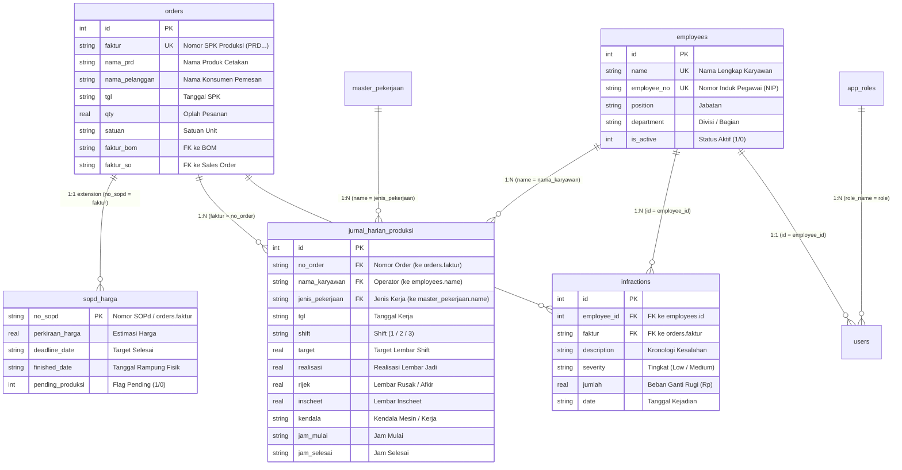
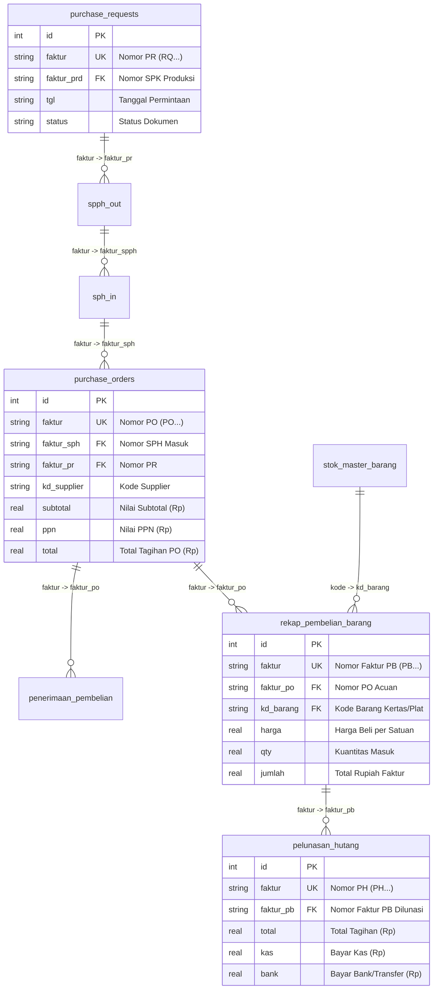
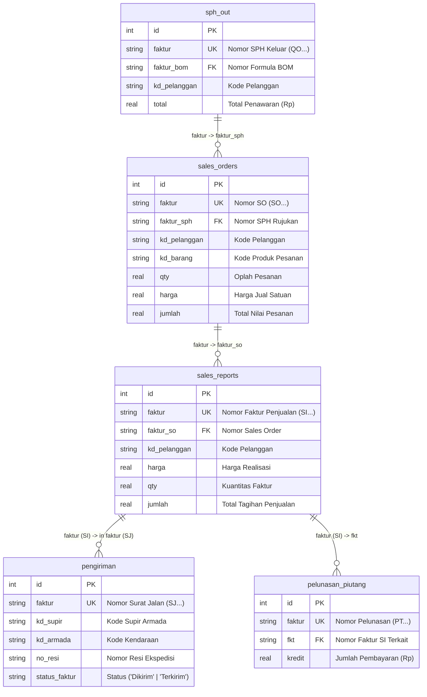
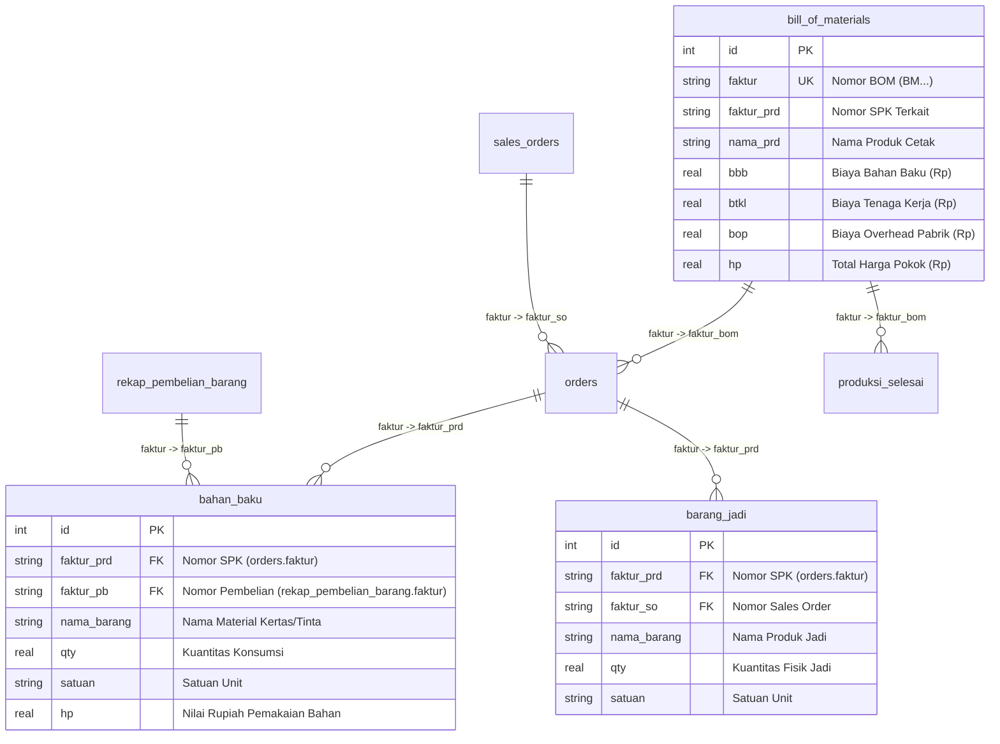
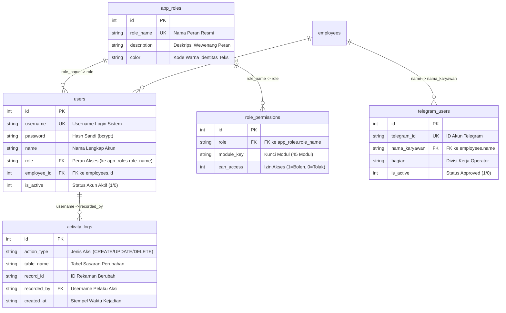
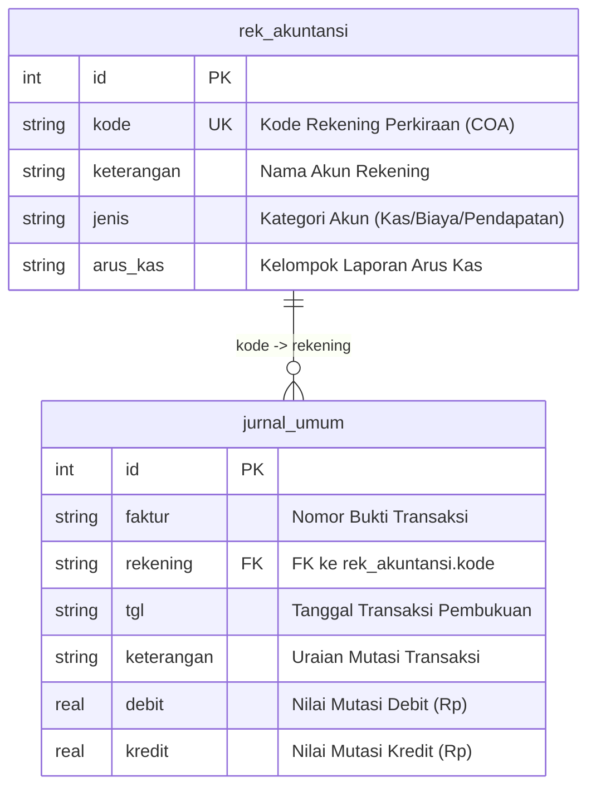

# DOKUMEN ARSITEKTUR DATABASE SINTAK: KAMUS DATA & ENTITY RELATIONSHIP DIAGRAM (ERD)
> **Sistem Informasi & Manajemen Terpadu Percetakan — PT Buya Barokah**  
> Status Dokumen: *Resmi, Lengkap & Tervalidasi* | Mesin Database: `SQLite 3 (WAL Mode)` | File Database: `database_dev.sqlite`

---

## DAFTAR ISI
1. [Gambaran Umum & Arsitektur Dual-Tier Database](#1-gambaran-umum--arsitektur-dual-tier-database)
2. [Entity Relationship Diagram (ERD) Lintas Modul](#2-entity-relationship-diagram-erd-lintas-modul)
   - [2.1 ERD Inti Manufaktur Percetakan & SDM](#21-erd-inti-manufaktur-percetakan--sdm)
   - [2.2 ERD Rantai Pengadaan Bahan Baku Digit](#22-erd-rantai-pengadaan-bahan-baku-digit)
   - [2.3 ERD Rantai Penjualan & Distribusi Digit](#23-erd-rantai-penjualan--distribusi-digit)
   - [2.4 ERD Rantai Manufaktur Digit & Pemakaian Bahan](#24-erd-rantai-manufaktur-digit--pemakaian-bahan)
   - [2.5 ERD Tata Kelola Pengguna, Hak Akses (RBAC) & Bot Telegram](#25-erd-tata-kelola-pengguna-hak-akses-rbac--bot-telegram)
   - [2.6 ERD Akuntansi & Pembukuan Digit](#26-erd-akuntansi--pembukuan-digit)
3. [Kamus Data Teknis: Tabel Native SINTAK (Active Read/Write)](#3-kamus-data-teknis-tabel-native-sintak-active-readwrite)
   - [3.1 Operasional Manufaktur & JHP Pabrik](#31-operasional-manufaktur--jhp-pabrik)
   - [3.2 Pelaporan Tugas Lapangan (Laporan Pekerjaan 7 Divisi)](#32-pelaporan-tugas-lapangan-laporan-pekerjaan-7-divisi)
   - [3.3 Kalkulasi Biaya & Simulator Pricelist](#33-kalkulasi-biaya--simulator-pricelist)
   - [3.4 SDM & Kedisiplinan Karyawan](#34-sdm--kedisiplinan-karyawan)
   - [3.5 Tata Kelola Sistem, Keamanan (RBAC) & Bot Telegram](#35-tata-kelola-sistem-keamanan-rbac--bot-telegram)
4. [Kamus Data Teknis: Tabel Pencerminan Data Digit ERP (Read-Only Mirror)](#4-kamus-data-teknis-tabel-pencerminan-data-digit-erp-read-only-mirror)
   - [4.1 Rantai Pengadaan Bahan Baku (7 Tabel)](#41-rantai-pengadaan-bahan-baku-7-tabel)
   - [4.2 Rantai Penjualan & Piutang (5 Tabel)](#42-rantai-penjualan--piutang-5-tabel)
   - [4.3 Rantai Produksi Manufaktur Digit (5 Tabel)](#43-rantai-produksi-manufaktur-digit-5-tabel)
   - [4.4 Master Stok, Akuntansi & Audit Log Digit (4 Tabel)](#44-master-stok-akuntansi--audit-log-digit-4-tabel)
5. [Matriks Foreign Key & Kunci Relasi Antar-Entitas (Cross-Table Logical Foreign Keys)](#5-matriks-foreign-key--kunci-relasi-antar-entitas-cross-table-logical-foreign-keys)
6. [Strategi Indeks Kinerja Database (Performance Indexing Strategy)](#6-strategi-indeks-kinerja-database-performance-indexing-strategy)

---

## 1. GAMBARAN UMUM & ARSITEKTUR DUAL-TIER DATABASE
Database SINTAK dioperasikan menggunakan mesin **SQLite 3** dengan arsitektur **Dual-Tier Data Model** yang memisahkan secara tegas antara data operasional mandiri (*Native SINTAK*) dan data hasil sinkronisasi sistem luar (*Pencerminan Digit ERP*):

```
+------------------------------------------------------------------------------------------------+
|                            ARSITEKTUR DUAL-TIER DATABASE SINTAK                                |
+------------------------------------------------------------------------------------------------+
|  TIER 1: TABEL NATIVE SINTAK (READ / WRITE)      |  TIER 2: PENCERMINAN DATA DIGIT ERP         |
|  (Dikelola & diinput langsung oleh user SINTAK)  |  (Read-Only via Scraper & Batch Sync)       |
|                                                  |                                             |
|  1. Penjadwalan & Realisasi JHP Shift Pabrik     |  1. Pengadaan Bahan Baku (PR s/d Hutang)    |
|  2. Manajemen Lembar Kerja Tugas 7 Divisi        |  2. Penjualan & Piutang (SPH Out s/d PT)    |
|  3. Simulator Kalkulasi Cetak & Nilai HPP        |  3. Manufaktur Digit (BOM, SPK, BBB, Hasil) |
|  4. Master Karyawan & Log Catat Kesalahan        |  4. Katalog Master Stok Bahan & Barang Jadi |
|  5. Tata Kelola User, RBAC & Bot Telegram        |  5. Transaksi Jurnal Umum & COA Akuntansi   |
|  6. Perekaman Audit Trail (Activity Logs)        |  6. Log Aktivitas User Digit (usr_log)      |
+--------------------------------------------------+---------------------------------------------+
```

### Konfigurasi Performa Mesin SQLite:
Sesuai kode sumber inisialisasi pada `src/lib/schema.ts`, koneksi database dikonfigurasi untuk menangani throughput tinggi:
- **`PRAGMA journal_mode = WAL;`** — Write-Ahead Logging untuk akses pembacaan paralel bebas blokir (*non-blocking concurrent reads*).
- **`PRAGMA busy_timeout = 5000;`** — Penanganan antrean kunci transaksi hingga 5.000 ms.
- **`PRAGMA cache_size = -64000;`** — Alokasi memori cache RAM sebesar 64 MB.
- **`PRAGMA mmap_size = 268435456;`** — Memory-mapped I/O sebesar 256 MB untuk kecepatan pencarian tabel besar.

---

## 2. ENTITY RELATIONSHIP DIAGRAM (ERD) LINTAS MODUL

### 2.1 ERD Inti Manufaktur Percetakan & SDM
Hubungan antara pesanan produksi dari Digit (`orders`), penjadwalan & realisasi shift (`jurnal_harian_produksi`), referensi standar pengerjaan (`master_pekerjaan`), master pegawai (`employees`), dan log kesalahan kerja (`infractions`):



---

### 2.2 ERD Rantai Pengadaan Bahan Baku Digit
Rantai dokumen pembelian bahan baku dari pengajuan awal hingga pelunasan hutang ke supplier vendor:



---

### 2.3 ERD Rantai Penjualan & Distribusi Digit
Rantai komersial penjualan pesanan dari penawaran harga keluar hingga pelunasan piutang pelanggan:



---

### 2.4 ERD Rantai Manufaktur Digit & Pemakaian Bahan
Keterkaitan formula manufaktur BOM, eksekusi SPK, alokasi bahan baku (BBB), dan serah terima hasil barang jadi:



---

### 2.5 ERD Tata Kelola Pengguna, Hak Akses (RBAC) & Bot Telegram
Arsitektur keamanan, otentikasi akun, matriks izin peran (RBAC), persetujuan bot Telegram operator, dan pencatatan jejak audit:



---

### 2.6 ERD Akuntansi & Pembukuan Digit
Hubungan bagan akun perkiraan COA dengan catatan mutasi debit/kredit pembukuan umum:



---

## 3. KAMUS DATA TEKNIS: TABEL NATIVE SINTAK (ACTIVE READ/WRITE)
Tabel-tabel di bawah ini berstatus **Read / Write** yang dibuat, diinput, dan dikelola secara mandiri oleh pengguna dan modul internal sistem SINTAK:

### 3.1 Operasional Manufaktur & JHP Pabrik

### `jurnal_harian_produksi`
- **Kategori Arsitektur**: Native SINTAK — Operasional Pabrik
- **Jumlah Data Aktif**: **198,270 baris**
- **Deskripsi & Peruntukan**: Tabel transaksi utama operasional pabrik. Mencatat jadwal target shift dan realisasi kerja operator mesin harian (jam kerja, lembar jadi, lembar inscheet, lembar rijek afdruk/jalan, kendala mesin).

| No | Nama Kolom | Tipe Data | Nullable | PK | Keterangan & Relasi Bisnis |
| :-: | :--- | :--- | :-: | :-: | :--- |
| 1 | `id` | `INTEGER` | Ya | **✓ PK** | Primary Key (Auto-Increment / Kunci Unik) |
| 2 | `posisi` | `TEXT` | Ya |  | Atribut data operasional tabel |
| 3 | `absensi` | `REAL` | Ya |  | Atribut data operasional tabel |
| 4 | `tgl` | `TEXT` | Ya |  | Tanggal resmi terjadinya transaksi dokumen |
| 5 | `shift` | `TEXT` | Ya |  | Shift kerja operator ('1' | '2' | '3') |
| 6 | `nama_karyawan` | `TEXT` | Ya |  | Nama operator shift (Relasi logis ke employees.name) |
| 7 | `no_order` | `TEXT` | Ya |  | Nomor order produksi acuan (Relasi logis ke orders.faktur / sopd.no_sopd) |
| 8 | `nama_order` | `TEXT` | Ya |  | Atribut data operasional tabel |
| 9 | `jenis_pekerjaan` | `TEXT` | Ya |  | Jenis pengerjaan mesin (Relasi logis ke master_pekerjaan.name) |
| 10 | `keterangan` | `TEXT` | Ya |  | Atribut data operasional tabel |
| 11 | `target` | `REAL` | Ya |  | Target kuantitas lembar pengerjaan shift |
| 12 | `realisasi` | `REAL` | Ya |  | Realisasi lembar cetak/finishing yang berhasil diselesaikan |
| 13 | `created_at` | `DATETIME` | Ya |  | Stempel waktu perekaman / pembaruan data sistem |
| 14 | `no_order_2` | `TEXT` | Ya |  | Atribut data operasional tabel |
| 15 | `nama_order_2` | `TEXT` | Ya |  | Atribut data operasional tabel |
| 16 | `jenis_pekerjaan_2` | `TEXT` | Ya |  | Atribut data operasional tabel |
| 17 | `bahan_kertas` | `TEXT` | Ya |  | Atribut data operasional tabel |
| 18 | `jml_plate` | `REAL` | Ya |  | Atribut data operasional tabel |
| 19 | `warna` | `TEXT` | Ya |  | Atribut data operasional tabel |
| 20 | `inscheet` | `REAL` | Ya |  | Atribut data operasional tabel |
| 21 | `rijek` | `REAL` | Ya |  | Atribut data operasional tabel |
| 22 | `jam` | `TEXT` | Ya |  | Atribut data operasional tabel |
| 23 | `kendala` | `TEXT` | Ya |  | Atribut data operasional tabel |
| 24 | `bagian` | `TEXT` | Ya |  | Atribut data operasional tabel |
| 25 | `is_manual_input` | `INTEGER` | Ya |  | Atribut data operasional tabel |
| 26 | `updated_at` | `DATETIME` | Ya |  | Stempel waktu perekaman / pembaruan data sistem |
| 27 | `deleted_at` | `DATETIME` | Ya |  | Atribut data operasional tabel |
| 28 | `created_by` | `TEXT` | Ya |  | Atribut data operasional tabel |
| 29 | `updated_by` | `TEXT` | Ya |  | Atribut data operasional tabel |
| 30 | `nama_order_manual` | `TEXT` | Ya |  | Atribut data operasional tabel |
| 31 | `nama_order_manual_2` | `TEXT` | Ya |  | Atribut data operasional tabel |
| 32 | `deleted_by` | `TEXT` | Ya |  | Atribut data operasional tabel |

### `sopd`
- **Kategori Arsitektur**: Native SINTAK — Operasional Pabrik
- **Jumlah Data Aktif**: **6,603 baris**
- **Deskripsi & Peruntukan**: Arsip antrean order cetak dan nomor SOPd (Surat Order Produksi Percetakan). Memuat pesanan historis <=2024 dari migrasi Excel dan terintegrasi dengan orders Digit (2025+).

| No | Nama Kolom | Tipe Data | Nullable | PK | Keterangan & Relasi Bisnis |
| :-: | :--- | :--- | :-: | :-: | :--- |
| 1 | `id` | `INTEGER` | Ya | **✓ PK** | Primary Key (Auto-Increment / Kunci Unik) |
| 2 | `no_sopd` | `TEXT` | Tidak |  | Atribut data operasional tabel |
| 3 | `nama_order` | `TEXT` | Tidak |  | Atribut data operasional tabel |
| 4 | `qty_sopd` | `REAL` | Tidak |  | Atribut data operasional tabel |
| 5 | `unit` | `TEXT` | Ya |  | Atribut data operasional tabel |
| 6 | `created_at` | `DATETIME` | Ya |  | Stempel waktu perekaman / pembaruan data sistem |
| 7 | `tgl` | `TEXT` | Ya |  | Tanggal resmi terjadinya transaksi dokumen |

### `sopd_harga`
- **Kategori Arsitektur**: Native SINTAK — Operasional Pabrik
- **Jumlah Data Aktif**: **6,041 baris**
- **Deskripsi & Peruntukan**: Tabel ekstensi operasional SOPd. Menyimpan estimasi harga pesanan, deadline target penyelesaian, status selesai (finished_date), status pending produksi, dan alasan pending.

| No | Nama Kolom | Tipe Data | Nullable | PK | Keterangan & Relasi Bisnis |
| :-: | :--- | :--- | :-: | :-: | :--- |
| 1 | `no_sopd` | `TEXT` | Ya | **✓ PK** | Primary Key (Auto-Increment / Kunci Unik) |
| 2 | `perkiraan_harga` | `TEXT` | Ya |  | Atribut data operasional tabel |
| 3 | `keterangan` | `TEXT` | Ya |  | Atribut data operasional tabel |
| 4 | `deadline_date` | `TEXT` | Ya |  | Tenggat waktu penyelesaian order dari pemesan |
| 5 | `finished_date` | `TEXT` | Ya |  | Tanggal rampung produksi fisik ('DD-MM-YYYY') |
| 6 | `updated_at` | `DATETIME` | Ya |  | Stempel waktu perekaman / pembaruan data sistem |
| 7 | `pending_produksi` | `INTEGER` | Ya |  | Flag penanda pesanan ditahan/pending (1=Pending, 0=Aktif) |
| 8 | `alasan_pending` | `TEXT` | Ya |  | Atribut data operasional tabel |

### `master_pekerjaan`
- **Kategori Arsitektur**: Native SINTAK — Operasional Pabrik
- **Jumlah Data Aktif**: **2,459 baris**
- **Deskripsi & Peruntukan**: Katalog standar waktu dan kapasitas mesin percetakan. Menyimpan target per jam, persiapan mesin (setup), waktu ganti plate CTP, dan jumlah gosok plate.

| No | Nama Kolom | Tipe Data | Nullable | PK | Keterangan & Relasi Bisnis |
| :-: | :--- | :--- | :-: | :-: | :--- |
| 1 | `id` | `INTEGER` | Ya | **✓ PK** | Primary Key (Auto-Increment / Kunci Unik) |
| 2 | `code` | `TEXT` | Tidak |  | Atribut data operasional tabel |
| 3 | `name` | `TEXT` | Tidak |  | Atribut data operasional tabel |
| 4 | `category` | `TEXT` | Ya |  | Atribut data operasional tabel |
| 5 | `sub_category` | `TEXT` | Ya |  | Atribut data operasional tabel |
| 6 | `created_at` | `DATETIME` | Ya |  | Stempel waktu perekaman / pembaruan data sistem |
| 7 | `target_value` | `REAL` | Ya |  | Atribut data operasional tabel |
| 8 | `group_pekerjaan` | `TEXT` | Ya |  | Atribut data operasional tabel |
| 9 | `standart_target` | `REAL` | Ya |  | Atribut data operasional tabel |
| 10 | `unit_mesin` | `TEXT` | Ya |  | Atribut data operasional tabel |
| 11 | `jumlah_plate` | `REAL` | Ya |  | Atribut data operasional tabel |
| 12 | `target_per_jam_plate` | `REAL` | Ya |  | Atribut data operasional tabel |
| 13 | `persiapan_mesin` | `REAL` | Ya |  | Atribut data operasional tabel |
| 14 | `waktu_ganti_plate` | `REAL` | Ya |  | Atribut data operasional tabel |
| 15 | `jml_gosok_plate` | `REAL` | Ya |  | Atribut data operasional tabel |
| 16 | `waktu_gosok_plate` | `REAL` | Ya |  | Atribut data operasional tabel |
| 17 | `asumsi_target_per_hari` | `REAL` | Ya |  | Atribut data operasional tabel |
| 18 | `target_per_hari` | `REAL` | Ya |  | Atribut data operasional tabel |
| 19 | `target_per_jam` | `REAL` | Ya |  | Atribut data operasional tabel |
| 20 | `efektif_jam_kerja` | `REAL` | Ya |  | Atribut data operasional tabel |
| 21 | `keterangan` | `TEXT` | Ya |  | Atribut data operasional tabel |
| 22 | `ket_1` | `TEXT` | Ya |  | Atribut data operasional tabel |
| 23 | `ket_2` | `TEXT` | Ya |  | Atribut data operasional tabel |
| 24 | `ket_3` | `TEXT` | Ya |  | Atribut data operasional tabel |
| 25 | `ket_4` | `TEXT` | Ya |  | Atribut data operasional tabel |
| 26 | `ket_5` | `TEXT` | Ya |  | Atribut data operasional tabel |
| 27 | `ket_6` | `TEXT` | Ya |  | Atribut data operasional tabel |
| 28 | `ket_7` | `TEXT` | Ya |  | Atribut data operasional tabel |

### `master_pekerjaan_jurnal_produksi`
- **Kategori Arsitektur**: Native SINTAK — Operasional Pabrik
- **Jumlah Data Aktif**: **1,436 baris**
- **Deskripsi & Peruntukan**: Katalog referensi pilihan dropdown jenis pekerjaan per bagian (Setting, Cetak, Pond, Lipat, Lem, Jahit, dll.) yang digunakan pada antarmuka formulir JHP.

| No | Nama Kolom | Tipe Data | Nullable | PK | Keterangan & Relasi Bisnis |
| :-: | :--- | :--- | :-: | :-: | :--- |
| 1 | `id` | `INTEGER` | Ya | **✓ PK** | Primary Key (Auto-Increment / Kunci Unik) |
| 2 | `category` | `TEXT` | Tidak |  | Atribut data operasional tabel |
| 3 | `name` | `TEXT` | Tidak |  | Atribut data operasional tabel |
| 4 | `created_at` | `DATETIME` | Ya |  | Stempel waktu perekaman / pembaruan data sistem |

### `master_target_pekerjaan`
- **Kategori Arsitektur**: Native SINTAK — Operasional Pabrik
- **Jumlah Data Aktif**: **461 baris**
- **Deskripsi & Peruntukan**: Standar nilai target produksi dan satuan unit pengerjaan untuk evaluasi performa shift.

| No | Nama Kolom | Tipe Data | Nullable | PK | Keterangan & Relasi Bisnis |
| :-: | :--- | :--- | :-: | :-: | :--- |
| 1 | `id` | `INTEGER` | Ya | **✓ PK** | Primary Key (Auto-Increment / Kunci Unik) |
| 2 | `name` | `TEXT` | Tidak |  | Atribut data operasional tabel |
| 3 | `target_value` | `REAL` | Ya |  | Atribut data operasional tabel |
| 4 | `unit` | `TEXT` | Ya |  | Atribut data operasional tabel |
| 5 | `created_at` | `DATETIME` | Ya |  | Stempel waktu perekaman / pembaruan data sistem |

### 3.2 Pelaporan Tugas Lapangan (Laporan Pekerjaan 7 Divisi)

### `laporan_pekerjaan`
- **Kategori Arsitektur**: Native SINTAK — Tugas Lapangan
- **Jumlah Data Aktif**: **5,194 baris**
- **Deskripsi & Peruntukan**: Sistem lembar kerja tugas mandiri untuk 7 divisi teknis pabrik (Setting, QC, Cetak, Finishing, Gudang, Teknisi, Mesin). Mencatat progres, tanggal mulai/selesai, durasi pengerjaan, dan status tugas.

| No | Nama Kolom | Tipe Data | Nullable | PK | Keterangan & Relasi Bisnis |
| :-: | :--- | :--- | :-: | :-: | :--- |
| 1 | `id` | `INTEGER` | Ya | **✓ PK** | Primary Key (Auto-Increment / Kunci Unik) |
| 2 | `task` | `TEXT` | Tidak |  | Atribut data operasional tabel |
| 3 | `project` | `TEXT` | Ya |  | Atribut data operasional tabel |
| 4 | `division` | `TEXT` | Ya |  | Divisi pengerjaan tugas (SETTING, QC, CETAK, FINISHING, GUDANG, TEKNISI, MESIN) |
| 5 | `bagian` | `TEXT` | Ya |  | Atribut data operasional tabel |
| 6 | `pic` | `TEXT` | Ya |  | Atribut data operasional tabel |
| 7 | `priority` | `TEXT` | Ya |  | Tingkat prioritas pengerjaan ('Normal', 'Urgent', 'High') |
| 8 | `start_date` | `TEXT` | Ya |  | Atribut data operasional tabel |
| 9 | `end_date` | `TEXT` | Ya |  | Atribut data operasional tabel |
| 10 | `work_days` | `TEXT` | Ya |  | Durasi pengerjaan aktual tugas dalam satuan hari kerja |
| 11 | `note` | `TEXT` | Ya |  | Atribut data operasional tabel |
| 12 | `status` | `TEXT` | Ya |  | Status siklus tugas ('BELUM DIKERJAKAN', 'IN PROGRESS', 'SELESAI', 'CANCEL') |
| 13 | `source` | `TEXT` | Ya |  | Atribut data operasional tabel |
| 14 | `sheet_sync_at` | `DATETIME` | Ya |  | Stempel waktu perekaman / pembaruan data sistem |
| 15 | `created_at` | `DATETIME` | Ya |  | Stempel waktu perekaman / pembaruan data sistem |
| 16 | `updated_at` | `DATETIME` | Ya |  | Stempel waktu perekaman / pembaruan data sistem |
| 17 | `tgl_order` | `TEXT` | Ya |  | Atribut data operasional tabel |
| 18 | `start_time` | `TEXT` | Ya |  | Atribut data operasional tabel |
| 19 | `end_time` | `TEXT` | Ya |  | Atribut data operasional tabel |
| 20 | `sort_order` | `INTEGER` | Ya |  | Atribut data operasional tabel |
| 21 | `start_date_norm` | `TEXT` | Ya |  | Atribut data operasional tabel |
| 22 | `end_date_norm` | `TEXT` | Ya |  | Atribut data operasional tabel |
| 23 | `tgl_order_norm` | `TEXT` | Ya |  | Atribut data operasional tabel |

### `role_laporan_pekerjaan_config`
- **Kategori Arsitektur**: Native SINTAK — Tugas Lapangan
- **Jumlah Data Aktif**: **3 baris**
- **Deskripsi & Peruntukan**: Matriks konfigurasi pembatasan divisi yang boleh dilihat atau dikelola oleh masing-masing peran pengguna di modul Laporan Pekerjaan.

| No | Nama Kolom | Tipe Data | Nullable | PK | Keterangan & Relasi Bisnis |
| :-: | :--- | :--- | :-: | :-: | :--- |
| 1 | `id` | `INTEGER` | Ya | **✓ PK** | Primary Key (Auto-Increment / Kunci Unik) |
| 2 | `role` | `TEXT` | Tidak |  | Atribut data operasional tabel |
| 3 | `allowed_bagian` | `TEXT` | Ya |  | Atribut data operasional tabel |
| 4 | `allowed_pic` | `TEXT` | Ya |  | Atribut data operasional tabel |
| 5 | `visible_columns` | `TEXT` | Ya |  | Atribut data operasional tabel |
| 6 | `can_add` | `INTEGER` | Ya |  | Atribut data operasional tabel |
| 7 | `can_edit` | `INTEGER` | Ya |  | Atribut data operasional tabel |
| 8 | `can_delete` | `INTEGER` | Ya |  | Atribut data operasional tabel |
| 9 | `created_at` | `DATETIME` | Ya |  | Stempel waktu perekaman / pembaruan data sistem |
| 10 | `updated_at` | `DATETIME` | Ya |  | Stempel waktu perekaman / pembaruan data sistem |
| 11 | `excluded_pic` | `TEXT` | Ya |  | Atribut data operasional tabel |
| 12 | `delete_scope` | `TEXT` | Ya |  | Atribut data operasional tabel |

### 3.3 Kalkulasi Biaya & Simulator Pricelist

### `hpp_kalkulasi`
- **Kategori Arsitektur**: Native SINTAK — Biaya & Kalkulasi
- **Jumlah Data Aktif**: **2,442 baris**
- **Deskripsi & Peruntukan**: Master nilai rupiah HPP (Harga Pokok Produksi) acuan per pesanan produksi. Sumber nama produk disinkronkan otomatis dari orders Digit, dengan nilai rupiah diinput oleh tim Kalkulasi via web / impor Excel.

| No | Nama Kolom | Tipe Data | Nullable | PK | Keterangan & Relasi Bisnis |
| :-: | :--- | :--- | :-: | :-: | :--- |
| 1 | `id` | `INTEGER` | Ya | **✓ PK** | Primary Key (Auto-Increment / Kunci Unik) |
| 2 | `nama_order` | `TEXT` | Tidak |  | Atribut data operasional tabel |
| 3 | `hpp_kalkulasi` | `REAL` | Tidak |  | Atribut data operasional tabel |
| 4 | `created_at` | `DATETIME` | Ya |  | Stempel waktu perekaman / pembaruan data sistem |
| 5 | `keterangan` | `TEXT` | Ya |  | Atribut data operasional tabel |

### `pricelist_items`
- **Kategori Arsitektur**: Native SINTAK — Biaya & Kalkulasi
- **Jumlah Data Aktif**: **216 baris**
- **Deskripsi & Peruntukan**: Katalog matriks harga standar dan simulasi penawaran harga produk percetakan (kalender, buku, dll.) berdasarkan oplah, bahan, ukuran, dan margin keuntungan.

| No | Nama Kolom | Tipe Data | Nullable | PK | Keterangan & Relasi Bisnis |
| :-: | :--- | :--- | :-: | :-: | :--- |
| 1 | `id` | `INTEGER` | Ya | **✓ PK** | Primary Key (Auto-Increment / Kunci Unik) |
| 2 | `jenis_kalender` | `TEXT` | Tidak |  | Atribut data operasional tabel |
| 3 | `oplah` | `INTEGER` | Tidak |  | Atribut data operasional tabel |
| 4 | `proses` | `TEXT` | Tidak |  | Atribut data operasional tabel |
| 5 | `bahan` | `TEXT` | Tidak |  | Atribut data operasional tabel |
| 6 | `ukuran` | `TEXT` | Tidak |  | Atribut data operasional tabel |
| 7 | `hpp` | `REAL` | Tidak |  | Atribut data operasional tabel |
| 8 | `harga` | `REAL` | Tidak |  | Nilai harga satuan barang / tarif pengerjaan (Rp) |
| 9 | `harga_nego` | `REAL` | Tidak |  | Atribut data operasional tabel |
| 10 | `profit_pct` | `REAL` | Tidak |  | Atribut data operasional tabel |
| 11 | `profit_pct_nego` | `REAL` | Tidak |  | Atribut data operasional tabel |
| 12 | `profit_tot` | `REAL` | Tidak |  | Atribut data operasional tabel |
| 13 | `profit_tot_nego` | `REAL` | Tidak |  | Atribut data operasional tabel |
| 14 | `created_at` | `DATETIME` | Ya |  | Stempel waktu perekaman / pembaruan data sistem |

### `pricelist_saved_calculations`
- **Kategori Arsitektur**: Native SINTAK — Biaya & Kalkulasi
- **Jumlah Data Aktif**: **5 baris**
- **Deskripsi & Peruntukan**: Riwayat penyimpanan hasil kalkulasi kustom pengguna dari 20+ simulator produk percetakan di modul /pricelist.

| No | Nama Kolom | Tipe Data | Nullable | PK | Keterangan & Relasi Bisnis |
| :-: | :--- | :--- | :-: | :-: | :--- |
| 1 | `id` | `TEXT` | Ya | **✓ PK** | Primary Key (Auto-Increment / Kunci Unik) |
| 2 | `category` | `TEXT` | Tidak |  | Atribut data operasional tabel |
| 3 | `title` | `TEXT` | Tidak |  | Atribut data operasional tabel |
| 4 | `oplah` | `INTEGER` | Tidak |  | Atribut data operasional tabel |
| 5 | `data` | `TEXT` | Tidak |  | Atribut data operasional tabel |
| 6 | `params_snapshot` | `TEXT` | Ya |  | Atribut data operasional tabel |
| 7 | `user_id` | `INTEGER` | Ya |  | Atribut data operasional tabel |
| 8 | `created_by` | `TEXT` | Ya |  | Atribut data operasional tabel |
| 9 | `created_at` | `DATETIME` | Ya |  | Stempel waktu perekaman / pembaruan data sistem |
| 10 | `updated_at` | `DATETIME` | Ya |  | Stempel waktu perekaman / pembaruan data sistem |

### 3.4 SDM & Kedisiplinan Karyawan

### `employees`
- **Kategori Arsitektur**: Native SINTAK — SDM & Personalia
- **Jumlah Data Aktif**: **154 baris**
- **Deskripsi & Peruntukan**: Master data personalia seluruh karyawan PT Buya Barokah. Menyimpan NIP (employee_no), nama lengkap, jabatan, departemen/divisi, dan status aktif sebagai referensi dropdown operator JHP.

| No | Nama Kolom | Tipe Data | Nullable | PK | Keterangan & Relasi Bisnis |
| :-: | :--- | :--- | :-: | :-: | :--- |
| 1 | `id` | `INTEGER` | Ya | **✓ PK** | Primary Key (Auto-Increment / Kunci Unik) |
| 2 | `name` | `TEXT` | Tidak |  | Atribut data operasional tabel |
| 3 | `position` | `TEXT` | Tidak |  | Atribut data operasional tabel |
| 4 | `department` | `TEXT` | Tidak |  | Atribut data operasional tabel |
| 5 | `employee_no` | `TEXT` | Ya |  | Nomor Induk Pegawai (NIP unik karyawan) |
| 6 | `is_active` | `INTEGER` | Ya |  | Status aktif karyawan (1 = Aktif, 0 = Non-Aktif) |
| 7 | `created_at` | `DATETIME` | Ya |  | Stempel waktu perekaman / pembaruan data sistem |
| 8 | `recorded_by` | `TEXT` | Ya |  | Atribut data operasional tabel |

### `infractions`
- **Kategori Arsitektur**: Native SINTAK — SDM & Personalia
- **Jumlah Data Aktif**: **17 baris**
- **Deskripsi & Peruntukan**: Catatan insiden kesalahan kerja operasional staf lapangan yang terikat ke nomor order produksi. Menyimpan deskripsi insiden, tingkat keparahan (severity), rincian bahan rusak, dan beban nominal ganti rugi.

| No | Nama Kolom | Tipe Data | Nullable | PK | Keterangan & Relasi Bisnis |
| :-: | :--- | :--- | :-: | :-: | :--- |
| 1 | `id` | `INTEGER` | Ya | **✓ PK** | Primary Key (Auto-Increment / Kunci Unik) |
| 2 | `employee_id` | `INTEGER` | Tidak |  | Foreign Key ke employees.id (Karyawan pelaku pelanggaran) |
| 3 | `description` | `TEXT` | Tidak |  | Atribut data operasional tabel |
| 4 | `severity` | `TEXT` | Tidak |  | Tingkat keparahan kesalahan ('Low': Teguran, 'Medium': Ganti Rugi) |
| 5 | `date` | `TEXT` | Tidak |  | Atribut data operasional tabel |
| 6 | `recorded_by` | `TEXT` | Tidak |  | Atribut data operasional tabel |
| 7 | `order_name` | `TEXT` | Ya |  | Atribut data operasional tabel |
| 8 | `created_at` | `DATETIME` | Ya |  | Stempel waktu perekaman / pembaruan data sistem |
| 9 | `updated_at` | `DATETIME` | Ya |  | Stempel waktu perekaman / pembaruan data sistem |
| 10 | `faktur` | `TEXT` | Ya |  | Nomor order produksi terkait kejadian insiden (ke orders.faktur) |
| 11 | `jenis_barang` | `TEXT` | Ya |  | Atribut data operasional tabel |
| 12 | `nama_barang` | `TEXT` | Ya |  | Atribut data operasional tabel |
| 13 | `jenis_harga` | `TEXT` | Ya |  | Atribut data operasional tabel |
| 14 | `jumlah` | `REAL` | Ya |  | Nilai nominal rupiah beban ganti rugi atau biaya afkir bahan |
| 15 | `harga` | `REAL` | Ya |  | Nilai harga satuan barang / tarif pengerjaan (Rp) |
| 16 | `total` | `REAL` | Ya |  | Nilai total nominal akhir transaksi (Rp) |
| 17 | `employee_name` | `TEXT` | Ya |  | Atribut data operasional tabel |
| 18 | `employee_position` | `TEXT` | Ya |  | Atribut data operasional tabel |
| 19 | `recorded_by_name` | `TEXT` | Ya |  | Atribut data operasional tabel |
| 20 | `recorded_by_position` | `TEXT` | Ya |  | Atribut data operasional tabel |
| 21 | `employee_no` | `TEXT` | Ya |  | Atribut data operasional tabel |
| 22 | `recorded_by_id` | `INTEGER` | Ya |  | Atribut data operasional tabel |
| 23 | `recorded_by_no` | `TEXT` | Ya |  | Atribut data operasional tabel |
| 24 | `order_faktur` | `TEXT` | Ya |  | Atribut data operasional tabel |
| 25 | `item_code` | `TEXT` | Ya |  | Atribut data operasional tabel |
| 26 | `item_faktur` | `TEXT` | Ya |  | Atribut data operasional tabel |

### 3.5 Tata Kelola Sistem, Keamanan (RBAC) & Bot Telegram

### `users`
- **Kategori Arsitektur**: Native SINTAK — Tata Kelola & Keamanan
- **Jumlah Data Aktif**: **24 baris**
- **Deskripsi & Peruntukan**: Tabel otentikasi akun pengguna sistem SINTAK. Menyimpan username, hash password bcrypt, foto profil, nama lengkap, penautan ke ID karyawan (employees), status aktif, dan peran akses utama.

| No | Nama Kolom | Tipe Data | Nullable | PK | Keterangan & Relasi Bisnis |
| :-: | :--- | :--- | :-: | :-: | :--- |
| 1 | `id` | `INTEGER` | Ya | **✓ PK** | Primary Key (Auto-Increment / Kunci Unik) |
| 2 | `username` | `TEXT` | Tidak |  | Username staf operator/admin pencatat transaksi |
| 3 | `password` | `TEXT` | Tidak |  | Hash kata sandi terenkripsi (algoritma bcrypt) |
| 4 | `name` | `TEXT` | Tidak |  | Atribut data operasional tabel |
| 5 | `photo` | `TEXT` | Ya |  | Atribut data operasional tabel |
| 6 | `role` | `TEXT` | Ya |  | Peran pengguna sistem (Relasi ke app_roles.role_name) |
| 7 | `created_at` | `DATETIME` | Ya |  | Stempel waktu perekaman / pembaruan data sistem |
| 8 | `recorded_by` | `TEXT` | Ya |  | Atribut data operasional tabel |
| 9 | `is_active` | `INTEGER` | Ya |  | Atribut data operasional tabel |
| 10 | `employee_id` | `INTEGER` | Ya |  | Foreign Key ke employees.id (Penautan akun ke pegawai) |

### `app_roles`
- **Kategori Arsitektur**: Native SINTAK — Tata Kelola & Keamanan
- **Jumlah Data Aktif**: **15 baris**
- **Deskripsi & Peruntukan**: Master daftar peran pengguna sistem (Super Admin, Penjadwalan, Realisasi, Operator, HRD, Akunting, Kalkulasi, dll.) beserta kode warna tampilan visual.

| No | Nama Kolom | Tipe Data | Nullable | PK | Keterangan & Relasi Bisnis |
| :-: | :--- | :--- | :-: | :-: | :--- |
| 1 | `id` | `INTEGER` | Ya | **✓ PK** | Primary Key (Auto-Increment / Kunci Unik) |
| 2 | `role_name` | `TEXT` | Tidak |  | Atribut data operasional tabel |
| 3 | `description` | `TEXT` | Ya |  | Atribut data operasional tabel |
| 4 | `color` | `TEXT` | Ya |  | Atribut data operasional tabel |
| 5 | `bg` | `TEXT` | Ya |  | Atribut data operasional tabel |
| 6 | `border` | `TEXT` | Ya |  | Atribut data operasional tabel |
| 7 | `created_at` | `DATETIME` | Ya |  | Stempel waktu perekaman / pembaruan data sistem |

### `role_permissions`
- **Kategori Arsitektur**: Native SINTAK — Tata Kelola & Keamanan
- **Jumlah Data Aktif**: **692 baris**
- **Deskripsi & Peruntukan**: Matriks hak akses granular berbasis RBAC (Role-Based Access Control) yang memetakan izin modul (45 modul terdaftar) untuk masing-masing peran pengguna.

| No | Nama Kolom | Tipe Data | Nullable | PK | Keterangan & Relasi Bisnis |
| :-: | :--- | :--- | :-: | :-: | :--- |
| 1 | `id` | `INTEGER` | Ya | **✓ PK** | Primary Key (Auto-Increment / Kunci Unik) |
| 2 | `role` | `TEXT` | Tidak |  | Nama peran pengguna (Relasi ke app_roles.role_name) |
| 3 | `module_key` | `TEXT` | Tidak |  | Kunci modul yang diizinkan (Relasi ke MODULE_REGISTRY) |
| 4 | `can_access` | `INTEGER` | Ya |  | Flag izin hak akses modul (1 = Boleh, 0 = Ditolak) |
| 5 | `updated_at` | `DATETIME` | Ya |  | Stempel waktu perekaman / pembaruan data sistem |

### `telegram_users`
- **Kategori Arsitektur**: Native SINTAK — Tata Kelola & Keamanan
- **Jumlah Data Aktif**: **0 baris**
- **Deskripsi & Peruntukan**: Tabel otorisasi bot Telegram operator lapangan (@SintakSettingBot). Menyimpan ID Telegram pengguna, penautan ke nama karyawan, bagian, stempel registrasi, dan status persetujuan Super Admin.

| No | Nama Kolom | Tipe Data | Nullable | PK | Keterangan & Relasi Bisnis |
| :-: | :--- | :--- | :-: | :-: | :--- |
| 1 | `id` | `INTEGER` | Ya | **✓ PK** | Primary Key (Auto-Increment / Kunci Unik) |
| 2 | `telegram_id` | `TEXT` | Tidak |  | ID unik akun Telegram operator lapangan |
| 3 | `telegram_username` | `TEXT` | Ya |  | Atribut data operasional tabel |
| 4 | `nama_karyawan` | `TEXT` | Tidak |  | Nama pegawai operator (Relasi ke employees.name) |
| 5 | `posisi` | `TEXT` | Ya |  | Atribut data operasional tabel |
| 6 | `absensi` | `TEXT` | Ya |  | Atribut data operasional tabel |
| 7 | `bagian` | `TEXT` | Tidak |  | Atribut data operasional tabel |
| 8 | `is_active` | `INTEGER` | Ya |  | Status persetujuan akses bot (1 = Approved, 0 = Pending) |
| 9 | `registered_at` | `DATETIME` | Ya |  | Atribut data operasional tabel |
| 10 | `approved_at` | `DATETIME` | Ya |  | Atribut data operasional tabel |
| 11 | `approved_by` | `TEXT` | Ya |  | Atribut data operasional tabel |

### `activity_logs`
- **Kategori Arsitektur**: Native SINTAK — Tata Kelola & Keamanan
- **Jumlah Data Aktif**: **16,885 baris**
- **Deskripsi & Peruntukan**: Audit trail lokal sistem SINTAK. Mencatat otomatis seluruh riwayat aktivitas CRUD (tambah, ubah, hapus, status), ID rekaman, perubahan data, stempel waktu, dan user penanggung jawab.

| No | Nama Kolom | Tipe Data | Nullable | PK | Keterangan & Relasi Bisnis |
| :-: | :--- | :--- | :-: | :-: | :--- |
| 1 | `id` | `INTEGER` | Ya | **✓ PK** | Primary Key (Auto-Increment / Kunci Unik) |
| 2 | `action_type` | `TEXT` | Tidak |  | Atribut data operasional tabel |
| 3 | `table_name` | `TEXT` | Tidak |  | Atribut data operasional tabel |
| 4 | `record_id` | `INTEGER` | Tidak |  | Atribut data operasional tabel |
| 5 | `message` | `TEXT` | Tidak |  | Atribut data operasional tabel |
| 6 | `raw_data` | `TEXT` | Ya |  | Salinan payload JSON mentah dari sumber asli Digit |
| 7 | `recorded_by` | `TEXT` | Ya |  | Atribut data operasional tabel |
| 8 | `created_at` | `DATETIME` | Ya |  | Stempel waktu perekaman / pembaruan data sistem |
| 9 | `user_id` | `INTEGER` | Ya |  | Atribut data operasional tabel |
| 10 | `changed_data` | `TEXT` | Ya |  | Atribut data operasional tabel |

### `system_settings`
- **Kategori Arsitektur**: Native SINTAK — Tata Kelola & Keamanan
- **Jumlah Data Aktif**: **41 baris**
- **Deskripsi & Peruntukan**: Tabel konfigurasi parameter global sistem SINTAK (key-value store).

| No | Nama Kolom | Tipe Data | Nullable | PK | Keterangan & Relasi Bisnis |
| :-: | :--- | :--- | :-: | :-: | :--- |
| 1 | `key` | `TEXT` | Ya | **✓ PK** | Primary Key (Auto-Increment / Kunci Unik) |
| 2 | `value` | `TEXT` | Ya |  | Atribut data operasional tabel |
| 3 | `updated_at` | `DATETIME` | Ya |  | Stempel waktu perekaman / pembaruan data sistem |

### `faktur_sequences`
- **Kategori Arsitektur**: Native SINTAK — Tata Kelola & Keamanan
- **Jumlah Data Aktif**: **12 baris**
- **Deskripsi & Peruntukan**: Tabel pengendali urutan penomoran otomatis faktur transaksi lokal sistem.

| No | Nama Kolom | Tipe Data | Nullable | PK | Keterangan & Relasi Bisnis |
| :-: | :--- | :--- | :-: | :-: | :--- |
| 1 | `prefix` | `TEXT` | Ya | **✓ PK** | Primary Key (Auto-Increment / Kunci Unik) |
| 2 | `last_seq` | `INTEGER` | Tidak |  | Atribut data operasional tabel |
| 3 | `updated_at` | `DATETIME` | Ya |  | Stempel waktu perekaman / pembaruan data sistem |

--- 

## 4. KAMUS DATA TEKNIS: TABEL PENCERMINAN DATA DIGIT ERP (READ-ONLY MIRROR)
Tabel-tabel di bawah ini berstatus **Read-Only** di dalam SINTAK. Data diisi secara otomatis melalui live scraper dan batch sinkronisasi dari software ERP Digit. Pengguna SINTAK tidak dapat menambah atau mengedit transaksi pada tabel-tabel ini secara langsung:

### 4.1 Rantai Pengadaan Bahan Baku (7 Tabel)

### `purchase_requests`
- **Kategori Arsitektur**: Digit ERP Mirror (Read-Only) — Pengadaan
- **Jumlah Data Aktif**: **4,598 baris**
- **Deskripsi & Peruntukan**: Pencerminan dokumen Purchase Request (PR) dari Digit. Mencatat pengajuan permohonan pengadaan bahan baku yang diterbitkan dari lantai produksi pabrik (faktur RQ...).

| No | Nama Kolom | Tipe Data | Nullable | PK | Keterangan & Relasi Bisnis |
| :-: | :--- | :--- | :-: | :-: | :--- |
| 1 | `id` | `INTEGER` | Ya | **✓ PK** | Primary Key (Auto-Increment / Kunci Unik) |
| 2 | `faktur` | `TEXT` | Tidak |  | Nomor unik faktur transaksi dokumen resmi |
| 3 | `tgl` | `TEXT` | Ya |  | Tanggal resmi terjadinya transaksi dokumen |
| 4 | `tgl_dibutuhkan` | `TEXT` | Ya |  | Atribut data operasional tabel |
| 5 | `faktur_prd` | `TEXT` | Ya |  | Nomor Order Produksi pemohon bahan (ke orders.faktur) |
| 6 | `kd_gudang` | `TEXT` | Ya |  | Kode lokasi gudang penyimpanan material / produk |
| 7 | `kd_cabang` | `TEXT` | Ya |  | Kode unit cabang operasional PT Buya Barokah |
| 8 | `status` | `TEXT` | Ya |  | Atribut data operasional tabel |
| 9 | `username` | `TEXT` | Ya |  | Username staf operator/admin pencatat transaksi |
| 10 | `keterangan` | `TEXT` | Ya |  | Atribut data operasional tabel |
| 11 | `faktur_spph` | `TEXT` | Ya |  | Kunci relasi nomor dokumen faktur (faktur_spph) |
| 12 | `faktur_po` | `TEXT` | Ya |  | Kunci relasi nomor dokumen faktur (faktur_po) |
| 13 | `raw_data` | `TEXT` | Ya |  | Salinan payload JSON mentah dari sumber asli Digit |
| 14 | `created_at` | `DATETIME` | Ya |  | Stempel waktu perekaman / pembaruan data sistem |

### `spph_out`
- **Kategori Arsitektur**: Digit ERP Mirror (Read-Only) — Pengadaan
- **Jumlah Data Aktif**: **5,843 baris**
- **Deskripsi & Peruntukan**: Pencerminan Surat Permintaan Penawaran Harga (SPPH) keluar ke vendor supplier rekanan percetakan (faktur SQ...).

| No | Nama Kolom | Tipe Data | Nullable | PK | Keterangan & Relasi Bisnis |
| :-: | :--- | :--- | :-: | :-: | :--- |
| 1 | `id` | `INTEGER` | Ya | **✓ PK** | Primary Key (Auto-Increment / Kunci Unik) |
| 2 | `faktur` | `TEXT` | Tidak |  | Nomor unik faktur transaksi dokumen resmi |
| 3 | `tgl` | `TEXT` | Ya |  | Tanggal resmi terjadinya transaksi dokumen |
| 4 | `faktur_pr` | `TEXT` | Ya |  | Nomor Purchase Request rujukan (ke purchase_requests.faktur) |
| 5 | `faktur_prd` | `TEXT` | Ya |  | Kunci relasi nomor dokumen faktur (faktur_prd) |
| 6 | `kd_gudang` | `TEXT` | Ya |  | Kode lokasi gudang penyimpanan material / produk |
| 7 | `kd_cabang` | `TEXT` | Ya |  | Kode unit cabang operasional PT Buya Barokah |
| 8 | `kd_supplier` | `TEXT` | Ya |  | Kode identitas rekanan vendor / supplier pengadaan |
| 9 | `status` | `TEXT` | Ya |  | Atribut data operasional tabel |
| 10 | `keterangan` | `TEXT` | Ya |  | Atribut data operasional tabel |
| 11 | `faktur_sph` | `TEXT` | Ya |  | Kunci relasi nomor dokumen faktur (faktur_sph) |
| 12 | `raw_data` | `TEXT` | Ya |  | Salinan payload JSON mentah dari sumber asli Digit |
| 13 | `created_at` | `DATETIME` | Ya |  | Stempel waktu perekaman / pembaruan data sistem |

### `sph_in`
- **Kategori Arsitektur**: Digit ERP Mirror (Read-Only) — Pengadaan
- **Jumlah Data Aktif**: **5,418 baris**
- **Deskripsi & Peruntukan**: Pencerminan Surat Penawaran Harga (SPH) masuk dari vendor supplier terpilih beserta rincian subtotal, PPN, dan termin pembayaran (faktur QI...).

| No | Nama Kolom | Tipe Data | Nullable | PK | Keterangan & Relasi Bisnis |
| :-: | :--- | :--- | :-: | :-: | :--- |
| 1 | `id` | `INTEGER` | Ya | **✓ PK** | Primary Key (Auto-Increment / Kunci Unik) |
| 2 | `faktur` | `TEXT` | Tidak |  | Nomor unik faktur transaksi dokumen resmi |
| 3 | `tgl` | `TEXT` | Ya |  | Tanggal resmi terjadinya transaksi dokumen |
| 4 | `top_hari` | `TEXT` | Ya |  | Atribut data operasional tabel |
| 5 | `faktur_spph` | `TEXT` | Ya |  | Nomor SPPH keluar rujukan (ke spph_out.faktur) |
| 6 | `faktur_prd` | `TEXT` | Ya |  | Kunci relasi nomor dokumen faktur (faktur_prd) |
| 7 | `kd_gudang` | `TEXT` | Ya |  | Kode lokasi gudang penyimpanan material / produk |
| 8 | `kd_cabang` | `TEXT` | Ya |  | Kode unit cabang operasional PT Buya Barokah |
| 9 | `kd_supplier` | `TEXT` | Ya |  | Kode identitas rekanan vendor / supplier pengadaan |
| 10 | `subtotal` | `REAL` | Ya |  | Nilai subtotal nominal sebelum pajak dan diskon (Rp) |
| 11 | `persppn` | `REAL` | Ya |  | Nilai pajak pertambahan nilai / persentase PPN |
| 12 | `ppn` | `REAL` | Ya |  | Nilai pajak pertambahan nilai / persentase PPN |
| 13 | `total` | `REAL` | Ya |  | Nilai total nominal akhir transaksi (Rp) |
| 14 | `status` | `TEXT` | Ya |  | Atribut data operasional tabel |
| 15 | `username` | `TEXT` | Ya |  | Username staf operator/admin pencatat transaksi |
| 16 | `faktur_po` | `TEXT` | Ya |  | Kunci relasi nomor dokumen faktur (faktur_po) |
| 17 | `raw_data` | `TEXT` | Ya |  | Salinan payload JSON mentah dari sumber asli Digit |
| 18 | `created_at` | `DATETIME` | Ya |  | Stempel waktu perekaman / pembaruan data sistem |

### `purchase_orders`
- **Kategori Arsitektur**: Digit ERP Mirror (Read-Only) — Pengadaan
- **Jumlah Data Aktif**: **5,319 baris**
- **Deskripsi & Peruntukan**: Pencerminan Purchase Order (PO) resmi ke pihak supplier vendor bahan baku kertas, tinta, dan kimia (faktur PO...).

| No | Nama Kolom | Tipe Data | Nullable | PK | Keterangan & Relasi Bisnis |
| :-: | :--- | :--- | :-: | :-: | :--- |
| 1 | `id` | `INTEGER` | Ya | **✓ PK** | Primary Key (Auto-Increment / Kunci Unik) |
| 2 | `faktur` | `TEXT` | Tidak |  | Nomor unik faktur transaksi dokumen resmi |
| 3 | `tgl` | `TEXT` | Ya |  | Tanggal resmi terjadinya transaksi dokumen |
| 4 | `top_hari` | `TEXT` | Ya |  | Atribut data operasional tabel |
| 5 | `faktur_pr` | `TEXT` | Ya |  | Nomor Purchase Request terkait (ke purchase_requests.faktur) |
| 6 | `faktur_sph` | `TEXT` | Ya |  | Nomor SPH masuk rujukan (ke sph_in.faktur) |
| 7 | `kd_gudang` | `TEXT` | Ya |  | Kode lokasi gudang penyimpanan material / produk |
| 8 | `kd_cabang` | `TEXT` | Ya |  | Kode unit cabang operasional PT Buya Barokah |
| 9 | `kd_supplier` | `TEXT` | Ya |  | Kode identitas rekanan vendor / supplier pengadaan |
| 10 | `subtotal` | `REAL` | Ya |  | Nilai subtotal nominal sebelum pajak dan diskon (Rp) |
| 11 | `persppn` | `REAL` | Ya |  | Nilai pajak pertambahan nilai / persentase PPN |
| 12 | `ppn` | `REAL` | Ya |  | Nilai pajak pertambahan nilai / persentase PPN |
| 13 | `biaya_kirim` | `REAL` | Ya |  | Atribut data operasional tabel |
| 14 | `total` | `REAL` | Ya |  | Nilai total nominal akhir transaksi (Rp) |
| 15 | `status` | `TEXT` | Ya |  | Atribut data operasional tabel |
| 16 | `tgl_close` | `TEXT` | Ya |  | Atribut data operasional tabel |
| 17 | `status_close` | `TEXT` | Ya |  | Atribut data operasional tabel |
| 18 | `mydata` | `TEXT` | Ya |  | Atribut data operasional tabel |
| 19 | `ket_pr` | `TEXT` | Ya |  | Atribut data operasional tabel |
| 20 | `faktur_pb` | `TEXT` | Ya |  | Kunci relasi nomor dokumen faktur (faktur_pb) |
| 21 | `raw_data` | `TEXT` | Ya |  | Salinan payload JSON mentah dari sumber asli Digit |
| 22 | `created_at` | `DATETIME` | Ya |  | Stempel waktu perekaman / pembaruan data sistem |

### `penerimaan_pembelian`
- **Kategori Arsitektur**: Digit ERP Mirror (Read-Only) — Pengadaan
- **Jumlah Data Aktif**: **7,699 baris**
- **Deskripsi & Peruntukan**: Pencerminan dokumen verifikasi kedatangan fisik barang pesanan dari supplier di gudang (faktur RI...).

| No | Nama Kolom | Tipe Data | Nullable | PK | Keterangan & Relasi Bisnis |
| :-: | :--- | :--- | :-: | :-: | :--- |
| 1 | `id` | `INTEGER` | Ya | **✓ PK** | Primary Key (Auto-Increment / Kunci Unik) |
| 2 | `faktur` | `TEXT` | Tidak |  | Nomor unik faktur transaksi dokumen resmi |
| 3 | `tgl` | `TEXT` | Ya |  | Tanggal resmi terjadinya transaksi dokumen |
| 4 | `top_hari` | `TEXT` | Ya |  | Atribut data operasional tabel |
| 5 | `jthtmp` | `TEXT` | Ya |  | Atribut data operasional tabel |
| 6 | `faktur_po` | `TEXT` | Ya |  | Nomor Purchase Order acuan kedatangan barang (ke purchase_orders.faktur) |
| 7 | `faktur_prd` | `TEXT` | Ya |  | Kunci relasi nomor dokumen faktur (faktur_prd) |
| 8 | `faktur_supplier` | `TEXT` | Ya |  | Kunci relasi nomor dokumen faktur (faktur_supplier) |
| 9 | `kd_gudang` | `TEXT` | Ya |  | Kode lokasi gudang penyimpanan material / produk |
| 10 | `kd_cabang` | `TEXT` | Ya |  | Kode unit cabang operasional PT Buya Barokah |
| 11 | `kd_supplier` | `TEXT` | Ya |  | Kode identitas rekanan vendor / supplier pengadaan |
| 12 | `subtotal` | `REAL` | Ya |  | Nilai subtotal nominal sebelum pajak dan diskon (Rp) |
| 13 | `diskon` | `REAL` | Ya |  | Atribut data operasional tabel |
| 14 | `pembulatan` | `REAL` | Ya |  | Atribut data operasional tabel |
| 15 | `persppn` | `REAL` | Ya |  | Nilai pajak pertambahan nilai / persentase PPN |
| 16 | `ppn` | `REAL` | Ya |  | Nilai pajak pertambahan nilai / persentase PPN |
| 17 | `biaya_kirim` | `REAL` | Ya |  | Atribut data operasional tabel |
| 18 | `total` | `REAL` | Ya |  | Nilai total nominal akhir transaksi (Rp) |
| 19 | `porsekot` | `REAL` | Ya |  | Atribut data operasional tabel |
| 20 | `hutang` | `REAL` | Ya |  | Atribut data operasional tabel |
| 21 | `kas` | `REAL` | Ya |  | Atribut data operasional tabel |
| 22 | `status` | `TEXT` | Ya |  | Status penerimaan fisik (0 = Sebagian, 1 = Lengkap) |
| 23 | `tgl_lunas` | `TEXT` | Ya |  | Atribut data operasional tabel |
| 24 | `username` | `TEXT` | Ya |  | Username staf operator/admin pencatat transaksi |
| 25 | `keterangan_pr` | `TEXT` | Ya |  | Atribut data operasional tabel |
| 26 | `raw_data` | `TEXT` | Ya |  | Salinan payload JSON mentah dari sumber asli Digit |
| 27 | `created_at` | `DATETIME` | Ya |  | Stempel waktu perekaman / pembaruan data sistem |

### `rekap_pembelian_barang`
- **Kategori Arsitektur**: Digit ERP Mirror (Read-Only) — Pengadaan
- **Jumlah Data Aktif**: **9,623 baris**
- **Deskripsi & Peruntukan**: Pencerminan faktur pembelian bahan baku (PB...) yang merinci harga beli, kuantitas, dan nilai tagihan. Menjadi referensi lookup tarif pada kalkulator Pricelist.

| No | Nama Kolom | Tipe Data | Nullable | PK | Keterangan & Relasi Bisnis |
| :-: | :--- | :--- | :-: | :-: | :--- |
| 1 | `id` | `INTEGER` | Ya | **✓ PK** | Primary Key (Auto-Increment / Kunci Unik) |
| 2 | `faktur` | `TEXT` | Ya |  | Nomor unik faktur transaksi dokumen resmi |
| 3 | `kd_supplier` | `TEXT` | Ya |  | Kode identitas rekanan vendor / supplier pengadaan |
| 4 | `tgl` | `TEXT` | Ya |  | Tanggal resmi terjadinya transaksi dokumen |
| 5 | `kd_barang` | `TEXT` | Ya |  | Kode barang material / produk cetak |
| 6 | `faktur_po` | `TEXT` | Ya |  | Nomor Purchase Order terkait pembelian (ke purchase_orders.faktur) |
| 7 | `jthtmp` | `TEXT` | Ya |  | Atribut data operasional tabel |
| 8 | `harga` | `REAL` | Ya |  | Nilai harga satuan barang / tarif pengerjaan (Rp) |
| 9 | `qty` | `REAL` | Ya |  | Kuantitas / jumlah volume barang fisik |
| 10 | `kd_cabang` | `TEXT` | Ya |  | Kode unit cabang operasional PT Buya Barokah |
| 11 | `pers_diskon1` | `REAL` | Ya |  | Atribut data operasional tabel |
| 12 | `diskon_item` | `REAL` | Ya |  | Atribut data operasional tabel |
| 13 | `jumlah` | `REAL` | Ya |  | Atribut data operasional tabel |
| 14 | `ppn` | `REAL` | Ya |  | Nilai pajak pertambahan nilai / persentase PPN |
| 15 | `username` | `TEXT` | Ya |  | Username staf operator/admin pencatat transaksi |
| 16 | `total_item` | `REAL` | Ya |  | Atribut data operasional tabel |
| 17 | `hj` | `REAL` | Ya |  | Atribut data operasional tabel |
| 18 | `gol_barang` | `TEXT` | Ya |  | Atribut data operasional tabel |
| 19 | `diskon` | `REAL` | Ya |  | Atribut data operasional tabel |
| 20 | `margin` | `REAL` | Ya |  | Atribut data operasional tabel |
| 21 | `recid` | `TEXT` | Ya |  | Atribut data operasional tabel |
| 22 | `raw_data` | `TEXT` | Ya |  | Salinan payload JSON mentah dari sumber asli Digit |
| 23 | `created_at` | `DATETIME` | Ya |  | Stempel waktu perekaman / pembaruan data sistem |

### `pelunasan_hutang`
- **Kategori Arsitektur**: Digit ERP Mirror (Read-Only) — Pengadaan
- **Jumlah Data Aktif**: **6,388 baris**
- **Deskripsi & Peruntukan**: Pencerminan bukti pembayaran kas/bank dan pelunasan invoice pembelian ke supplier vendor (faktur PH...).

| No | Nama Kolom | Tipe Data | Nullable | PK | Keterangan & Relasi Bisnis |
| :-: | :--- | :--- | :-: | :-: | :--- |
| 1 | `id` | `INTEGER` | Ya | **✓ PK** | Primary Key (Auto-Increment / Kunci Unik) |
| 2 | `faktur` | `TEXT` | Tidak |  | Nomor unik faktur transaksi dokumen resmi |
| 3 | `tgl` | `TEXT` | Ya |  | Tanggal resmi terjadinya transaksi dokumen |
| 4 | `kd_cabang` | `TEXT` | Ya |  | Kode unit cabang operasional PT Buya Barokah |
| 5 | `kd_supplier` | `TEXT` | Ya |  | Kode identitas rekanan vendor / supplier pengadaan |
| 6 | `pembelian` | `REAL` | Ya |  | Atribut data operasional tabel |
| 7 | `retur` | `REAL` | Ya |  | Atribut data operasional tabel |
| 8 | `subtotal` | `REAL` | Ya |  | Nilai subtotal nominal sebelum pajak dan diskon (Rp) |
| 9 | `diskon` | `REAL` | Ya |  | Atribut data operasional tabel |
| 10 | `pembulatan` | `REAL` | Ya |  | Atribut data operasional tabel |
| 11 | `total` | `REAL` | Ya |  | Nilai total nominal akhir transaksi (Rp) |
| 12 | `kas` | `REAL` | Ya |  | Atribut data operasional tabel |
| 13 | `bgcek` | `REAL` | Ya |  | Atribut data operasional tabel |
| 14 | `bank` | `REAL` | Ya |  | Atribut data operasional tabel |
| 15 | `porsekot` | `REAL` | Ya |  | Atribut data operasional tabel |
| 16 | `kd_porsekot` | `TEXT` | Ya |  | Atribut data operasional tabel |
| 17 | `kd_bank` | `TEXT` | Ya |  | Atribut data operasional tabel |
| 18 | `status` | `TEXT` | Ya |  | Atribut data operasional tabel |
| 19 | `faktur_pb` | `TEXT` | Ya |  | Nomor faktur penerimaan pembelian yang dilunasi (ke rekap_pembelian_barang.faktur) |
| 20 | `keterangan` | `TEXT` | Ya |  | Atribut data operasional tabel |
| 21 | `username` | `TEXT` | Ya |  | Username staf operator/admin pencatat transaksi |
| 22 | `recid` | `TEXT` | Ya |  | Atribut data operasional tabel |
| 23 | `raw_data` | `TEXT` | Ya |  | Salinan payload JSON mentah dari sumber asli Digit |
| 24 | `created_at` | `DATETIME` | Ya |  | Stempel waktu perekaman / pembaruan data sistem |

### 4.2 Rantai Penjualan & Piutang (5 Tabel)

### `sph_out`
- **Kategori Arsitektur**: Digit ERP Mirror (Read-Only) — Penjualan
- **Jumlah Data Aktif**: **6,602 baris**
- **Deskripsi & Peruntukan**: Pencerminan Surat Penawaran Harga (SPH) keluar yang diterbitkan oleh bagian Sales kepada pelanggan pemesan produk cetak (faktur QO...).

| No | Nama Kolom | Tipe Data | Nullable | PK | Keterangan & Relasi Bisnis |
| :-: | :--- | :--- | :-: | :-: | :--- |
| 1 | `id` | `INTEGER` | Ya | **✓ PK** | Primary Key (Auto-Increment / Kunci Unik) |
| 2 | `faktur` | `TEXT` | Tidak |  | Nomor unik faktur transaksi dokumen resmi |
| 3 | `tgl` | `TEXT` | Ya |  | Tanggal resmi terjadinya transaksi dokumen |
| 4 | `kd_pelanggan` | `TEXT` | Ya |  | Kode identitas pelanggan / pemesan produk cetak |
| 5 | `barang` | `TEXT` | Ya |  | Atribut data operasional tabel |
| 6 | `total` | `REAL` | Ya |  | Nilai total nominal akhir transaksi (Rp) |
| 7 | `status` | `TEXT` | Ya |  | Atribut data operasional tabel |
| 8 | `faktur_so` | `TEXT` | Ya |  | Kunci relasi nomor dokumen faktur (faktur_so) |
| 9 | `raw_data` | `TEXT` | Ya |  | Salinan payload JSON mentah dari sumber asli Digit |
| 10 | `created_at` | `DATETIME` | Ya |  | Stempel waktu perekaman / pembaruan data sistem |
| 11 | `faktur_bom` | `TEXT` | Ya |  | Nomor formula BOM acuan penawaran (ke bill_of_materials.faktur) |

### `sales_orders`
- **Kategori Arsitektur**: Digit ERP Mirror (Read-Only) — Penjualan
- **Jumlah Data Aktif**: **2,321 baris**
- **Deskripsi & Peruntukan**: Pencerminan dokumen Sales Order (SO) pesanan resmi dari pemesan di ERP Digit (faktur SO...).

| No | Nama Kolom | Tipe Data | Nullable | PK | Keterangan & Relasi Bisnis |
| :-: | :--- | :--- | :-: | :-: | :--- |
| 1 | `id` | `INTEGER` | Ya | **✓ PK** | Primary Key (Auto-Increment / Kunci Unik) |
| 2 | `faktur` | `TEXT` | Tidak |  | Nomor unik faktur transaksi dokumen resmi |
| 3 | `kd_pelanggan` | `TEXT` | Ya |  | Kode identitas pelanggan / pemesan produk cetak |
| 4 | `tgl` | `TEXT` | Ya |  | Tanggal resmi terjadinya transaksi dokumen |
| 5 | `kd_barang` | `TEXT` | Ya |  | Kode barang material / produk cetak |
| 6 | `faktur_sph` | `TEXT` | Ya |  | Nomor SPH penawaran disetujui konsumen (ke sph_out.faktur) |
| 7 | `top_hari` | `TEXT` | Ya |  | Atribut data operasional tabel |
| 8 | `harga` | `REAL` | Ya |  | Nilai harga satuan barang / tarif pengerjaan (Rp) |
| 9 | `qty` | `REAL` | Ya |  | Kuantitas / jumlah volume barang fisik |
| 10 | `satuan` | `TEXT` | Ya |  | Atribut data operasional tabel |
| 11 | `jumlah` | `REAL` | Ya |  | Atribut data operasional tabel |
| 12 | `ppn` | `REAL` | Ya |  | Nilai pajak pertambahan nilai / persentase PPN |
| 13 | `faktur_prd` | `TEXT` | Ya |  | Kunci relasi nomor dokumen faktur (faktur_prd) |
| 14 | `nama_prd` | `TEXT` | Ya |  | Atribut data operasional tabel |
| 15 | `nama_pelanggan` | `TEXT` | Ya |  | Atribut data operasional tabel |
| 16 | `dati_2` | `TEXT` | Ya |  | Atribut data operasional tabel |
| 17 | `gol_barang` | `TEXT` | Ya |  | Atribut data operasional tabel |
| 18 | `spesifikasi` | `TEXT` | Ya |  | Atribut data operasional tabel |
| 19 | `keterangan` | `TEXT` | Ya |  | Atribut data operasional tabel |
| 20 | `raw_data` | `TEXT` | Ya |  | Salinan payload JSON mentah dari sumber asli Digit |
| 21 | `created_at` | `DATETIME` | Ya |  | Stempel waktu perekaman / pembaruan data sistem |
| 22 | `recid` | `TEXT` | Ya |  | Atribut data operasional tabel |

### `sales_reports`
- **Kategori Arsitektur**: Digit ERP Mirror (Read-Only) — Penjualan
- **Jumlah Data Aktif**: **5,056 baris**
- **Deskripsi & Peruntukan**: Pencerminan faktur penjualan resmi (SI...) dari ERP Digit. Menjadi dokumen pengakuan piutang dagang dan dasar penagihan komersial.

| No | Nama Kolom | Tipe Data | Nullable | PK | Keterangan & Relasi Bisnis |
| :-: | :--- | :--- | :-: | :-: | :--- |
| 1 | `id` | `INTEGER` | Ya | **✓ PK** | Primary Key (Auto-Increment / Kunci Unik) |
| 2 | `tgl` | `TEXT` | Ya |  | Tanggal resmi terjadinya transaksi dokumen |
| 3 | `kd_barang` | `TEXT` | Ya |  | Kode barang material / produk cetak |
| 4 | `nama_prd` | `TEXT` | Ya |  | Atribut data operasional tabel |
| 5 | `nama_pelanggan` | `TEXT` | Ya |  | Atribut data operasional tabel |
| 6 | `dati_2` | `TEXT` | Ya |  | Atribut data operasional tabel |
| 7 | `qty` | `REAL` | Ya |  | Kuantitas / jumlah volume barang fisik |
| 8 | `harga` | `REAL` | Ya |  | Nilai harga satuan barang / tarif pengerjaan (Rp) |
| 9 | `jumlah` | `REAL` | Ya |  | Atribut data operasional tabel |
| 10 | `raw_data` | `TEXT` | Ya |  | Salinan payload JSON mentah dari sumber asli Digit |
| 11 | `created_at` | `DATETIME` | Ya |  | Stempel waktu perekaman / pembaruan data sistem |
| 12 | `faktur` | `TEXT` | Ya |  | Nomor unik faktur transaksi dokumen resmi |
| 13 | `kd_pelanggan` | `TEXT` | Ya |  | Kode identitas pelanggan / pemesan produk cetak |
| 14 | `faktur_so` | `TEXT` | Ya |  | Nomor Sales Order pesanan resmi (ke sales_orders.faktur) |
| 15 | `jthtmp` | `TEXT` | Ya |  | Atribut data operasional tabel |
| 16 | `ppn` | `REAL` | Ya |  | Nilai pajak pertambahan nilai / persentase PPN |
| 17 | `faktur_prd` | `TEXT` | Ya |  | Kunci relasi nomor dokumen faktur (faktur_prd) |
| 18 | `no_ref_pelanggan` | `TEXT` | Ya |  | Atribut data operasional tabel |
| 19 | `gol_barang` | `TEXT` | Ya |  | Atribut data operasional tabel |
| 20 | `keterangan_so` | `TEXT` | Ya |  | Atribut data operasional tabel |
| 21 | `recid` | `TEXT` | Ya |  | Atribut data operasional tabel |

### `pengiriman`
- **Kategori Arsitektur**: Digit ERP Mirror (Read-Only) — Penjualan
- **Jumlah Data Aktif**: **4,086 baris**
- **Deskripsi & Peruntukan**: Pencerminan dokumen Surat Jalan (SJ) ekspedisi logistik pengiriman barang jadi cetakan ke pemesan, mencakup supir, armada, dan status pengiriman.

| No | Nama Kolom | Tipe Data | Nullable | PK | Keterangan & Relasi Bisnis |
| :-: | :--- | :--- | :-: | :-: | :--- |
| 1 | `id` | `INTEGER` | Ya | **✓ PK** | Primary Key (Auto-Increment / Kunci Unik) |
| 2 | `faktur` | `TEXT` | Ya |  | Nomor Surat Jalan (SJ...) memuat faktur SI (sales_reports) |
| 3 | `tgl` | `TEXT` | Ya |  | Tanggal resmi terjadinya transaksi dokumen |
| 4 | `kd_supir` | `TEXT` | Ya |  | Atribut data operasional tabel |
| 5 | `kd_armada` | `TEXT` | Ya |  | Atribut data operasional tabel |
| 6 | `kd_eks` | `TEXT` | Ya |  | Atribut data operasional tabel |
| 7 | `no_resi` | `TEXT` | Ya |  | Atribut data operasional tabel |
| 8 | `status` | `TEXT` | Ya |  | Atribut data operasional tabel |
| 9 | `status_faktur` | `TEXT` | Ya |  | Status eksekusi surat jalan ('Dikirim' | 'Terkirim') |
| 10 | `keterangan` | `TEXT` | Ya |  | Atribut data operasional tabel |
| 11 | `username` | `TEXT` | Ya |  | Username staf operator/admin pencatat transaksi |
| 12 | `waktu_kirim` | `TEXT` | Ya |  | Atribut data operasional tabel |
| 13 | `waktu_selesai` | `TEXT` | Ya |  | Atribut data operasional tabel |
| 14 | `total_faktur` | `INTEGER` | Ya |  | Atribut data operasional tabel |
| 15 | `recid` | `TEXT` | Tidak |  | Atribut data operasional tabel |
| 16 | `raw_data` | `TEXT` | Ya |  | Salinan payload JSON mentah dari sumber asli Digit |
| 17 | `created_at` | `DATETIME` | Ya |  | Stempel waktu perekaman / pembaruan data sistem |

### `pelunasan_piutang`
- **Kategori Arsitektur**: Digit ERP Mirror (Read-Only) — Penjualan
- **Jumlah Data Aktif**: **3,909 baris**
- **Deskripsi & Peruntukan**: Pencerminan rekapitulasi pembayaran kas/transfer dan pelunasan piutang pelanggan atas faktur penjualan (faktur PT...).

| No | Nama Kolom | Tipe Data | Nullable | PK | Keterangan & Relasi Bisnis |
| :-: | :--- | :--- | :-: | :-: | :--- |
| 1 | `id` | `INTEGER` | Ya | **✓ PK** | Primary Key (Auto-Increment / Kunci Unik) |
| 2 | `faktur` | `TEXT` | Tidak |  | Nomor unik faktur transaksi dokumen resmi |
| 3 | `fkt` | `TEXT` | Ya |  | Nomor faktur penjualan yang dibayar (ke sales_reports.faktur) |
| 4 | `tgl` | `TEXT` | Ya |  | Tanggal resmi terjadinya transaksi dokumen |
| 5 | `kredit` | `REAL` | Ya |  | Atribut data operasional tabel |
| 6 | `kd_pelanggan` | `TEXT` | Ya |  | Kode identitas pelanggan / pemesan produk cetak |
| 7 | `kd_gudang` | `TEXT` | Ya |  | Kode lokasi gudang penyimpanan material / produk |
| 8 | `kd_sales` | `TEXT` | Ya |  | Atribut data operasional tabel |
| 9 | `recid` | `TEXT` | Ya |  | Atribut data operasional tabel |
| 10 | `raw_data` | `TEXT` | Ya |  | Salinan payload JSON mentah dari sumber asli Digit |
| 11 | `created_at` | `DATETIME` | Ya |  | Stempel waktu perekaman / pembaruan data sistem |

### 4.3 Rantai Produksi Manufaktur Digit (5 Tabel)

### `bill_of_materials`
- **Kategori Arsitektur**: Digit ERP Mirror (Read-Only) — Produksi Digit
- **Jumlah Data Aktif**: **6,959 baris**
- **Deskripsi & Peruntukan**: Pencerminan formula Bill of Material (BOM) pesanan cetak dari Digit. Menyimpan resep kebutuhan kertas, plat CTP, ongkos cetak, dan biaya bahan (faktur BM...).

| No | Nama Kolom | Tipe Data | Nullable | PK | Keterangan & Relasi Bisnis |
| :-: | :--- | :--- | :-: | :-: | :--- |
| 1 | `id` | `INTEGER` | Ya | **✓ PK** | Primary Key (Auto-Increment / Kunci Unik) |
| 2 | `faktur` | `TEXT` | Tidak |  | Nomor unik faktur transaksi dokumen resmi |
| 3 | `tgl` | `TEXT` | Ya |  | Tanggal resmi terjadinya transaksi dokumen |
| 4 | `kd_mtd` | `TEXT` | Ya |  | Atribut data operasional tabel |
| 5 | `nama_prd` | `TEXT` | Ya |  | Atribut data operasional tabel |
| 6 | `kd_pelanggan` | `TEXT` | Ya |  | Kode identitas pelanggan / pemesan produk cetak |
| 7 | `bbb` | `REAL` | Ya |  | Atribut data operasional tabel |
| 8 | `btkl` | `REAL` | Ya |  | Atribut data operasional tabel |
| 9 | `bop` | `REAL` | Ya |  | Atribut data operasional tabel |
| 10 | `hp` | `REAL` | Ya |  | Nilai harga satuan barang / tarif pengerjaan (Rp) |
| 11 | `spesifikasi` | `TEXT` | Ya |  | Atribut data operasional tabel |
| 12 | `kd_barang` | `TEXT` | Ya |  | Kode barang material / produk cetak |
| 13 | `qty_order` | `REAL` | Ya |  | Atribut data operasional tabel |
| 14 | `faktur_sph` | `TEXT` | Ya |  | Kunci relasi nomor dokumen faktur (faktur_sph) |
| 15 | `faktur_prd` | `TEXT` | Ya |  | Nomor Order Produksi peruntukan formula (ke orders.faktur) |
| 16 | `raw_data` | `TEXT` | Ya |  | Salinan payload JSON mentah dari sumber asli Digit |
| 17 | `created_at` | `DATETIME` | Ya |  | Stempel waktu perekaman / pembaruan data sistem |
| 18 | `satuan` | `TEXT` | Ya |  | Atribut data operasional tabel |

### `orders`
- **Kategori Arsitektur**: Digit ERP Mirror (Read-Only) — Produksi Digit
- **Jumlah Data Aktif**: **2,673 baris**
- **Deskripsi & Peruntukan**: Pencerminan dokumen Order Produksi (SPK) pesanan cetak resmi dari ERP Digit (faktur PRD...). Merupakan poros utama integrasi seluruh alur manufaktur.

| No | Nama Kolom | Tipe Data | Nullable | PK | Keterangan & Relasi Bisnis |
| :-: | :--- | :--- | :-: | :-: | :--- |
| 1 | `id` | `INTEGER` | Ya | **✓ PK** | Primary Key (Auto-Increment / Kunci Unik) |
| 2 | `faktur` | `TEXT` | Tidak |  | Nomor unik faktur transaksi dokumen resmi |
| 3 | `nama_prd` | `TEXT` | Tidak |  | Atribut data operasional tabel |
| 4 | `nama_pelanggan` | `TEXT` | Ya |  | Atribut data operasional tabel |
| 5 | `tgl` | `TEXT` | Ya |  | Tanggal resmi terjadinya transaksi dokumen |
| 6 | `qty` | `REAL` | Ya |  | Kuantitas / jumlah volume barang fisik |
| 7 | `harga` | `REAL` | Ya |  | Nilai harga satuan barang / tarif pengerjaan (Rp) |
| 8 | `jumlah` | `REAL` | Ya |  | Atribut data operasional tabel |
| 9 | `raw_data` | `TEXT` | Ya |  | Salinan payload JSON mentah dari sumber asli Digit |
| 10 | `created_at` | `DATETIME` | Ya |  | Stempel waktu perekaman / pembaruan data sistem |
| 11 | `satuan` | `TEXT` | Ya |  | Atribut data operasional tabel |
| 12 | `faktur_bom` | `TEXT` | Ya |  | Nomor formula BOM rujukan spesifikasi cetak (ke bill_of_materials.faktur) |
| 13 | `faktur_so` | `TEXT` | Ya |  | Nomor Sales Order komersial rujukan (ke sales_orders.faktur) |

### `bahan_baku`
- **Kategori Arsitektur**: Digit ERP Mirror (Read-Only) — Produksi Digit
- **Jumlah Data Aktif**: **19,145 baris**
- **Deskripsi & Peruntukan**: Pencerminan pemakaian bahan baku riil di pabrik (Biaya Bahan Baku / BBB) untuk setiap pengerjaan order produksi cetak.

| No | Nama Kolom | Tipe Data | Nullable | PK | Keterangan & Relasi Bisnis |
| :-: | :--- | :--- | :-: | :-: | :--- |
| 1 | `id` | `INTEGER` | Ya | **✓ PK** | Primary Key (Auto-Increment / Kunci Unik) |
| 2 | `tgl` | `TEXT` | Ya |  | Tanggal resmi terjadinya transaksi dokumen |
| 3 | `nama_barang` | `TEXT` | Tidak |  | Atribut data operasional tabel |
| 4 | `qty` | `REAL` | Ya |  | Kuantitas / jumlah volume barang fisik |
| 5 | `satuan` | `TEXT` | Ya |  | Atribut data operasional tabel |
| 6 | `nama_prd` | `TEXT` | Tidak |  | Atribut data operasional tabel |
| 7 | `hp` | `REAL` | Ya |  | Nilai harga satuan barang / tarif pengerjaan (Rp) |
| 8 | `raw_data` | `TEXT` | Ya |  | Salinan payload JSON mentah dari sumber asli Digit |
| 9 | `created_at` | `DATETIME` | Ya |  | Stempel waktu perekaman / pembaruan data sistem |
| 10 | `kd_barang` | `TEXT` | Ya |  | Kode barang material / produk cetak |
| 11 | `faktur` | `TEXT` | Ya |  | Nomor unik faktur transaksi dokumen resmi |
| 12 | `faktur_prd` | `TEXT` | Ya |  | Nomor Order Produksi pemakai bahan (ke orders.faktur) |
| 13 | `faktur_aktifitas` | `TEXT` | Ya |  | Kunci relasi nomor dokumen faktur (faktur_aktifitas) |
| 14 | `kd_cabang` | `TEXT` | Ya |  | Kode unit cabang operasional PT Buya Barokah |
| 15 | `kd_gudang` | `TEXT` | Ya |  | Kode lokasi gudang penyimpanan material / produk |
| 16 | `status` | `TEXT` | Ya |  | Atribut data operasional tabel |
| 17 | `hp_total` | `REAL` | Ya |  | Atribut data operasional tabel |
| 18 | `keterangan` | `TEXT` | Ya |  | Atribut data operasional tabel |
| 19 | `fkt_hasil` | `TEXT` | Ya |  | Atribut data operasional tabel |
| 20 | `aktifitas` | `TEXT` | Ya |  | Atribut data operasional tabel |
| 21 | `username` | `TEXT` | Ya |  | Username staf operator/admin pencatat transaksi |
| 22 | `kd_pelanggan` | `TEXT` | Ya |  | Kode identitas pelanggan / pemesan produk cetak |
| 23 | `recid` | `TEXT` | Ya |  | Atribut data operasional tabel |
| 24 | `faktur_pb` | `TEXT` | Ya |  | Nomor faktur pembelian bahan baku rujukan (ke rekap_pembelian_barang.faktur) |

### `barang_jadi`
- **Kategori Arsitektur**: Digit ERP Mirror (Read-Only) — Produksi Digit
- **Jumlah Data Aktif**: **4,984 baris**
- **Deskripsi & Peruntukan**: Pencerminan bukti serah terima fisik produk cetak yang telah tuntas diproduksi ke gudang barang jadi atau divisi pengiriman.

| No | Nama Kolom | Tipe Data | Nullable | PK | Keterangan & Relasi Bisnis |
| :-: | :--- | :--- | :-: | :-: | :--- |
| 1 | `id` | `INTEGER` | Ya | **✓ PK** | Primary Key (Auto-Increment / Kunci Unik) |
| 2 | `tgl` | `TEXT` | Ya |  | Tanggal resmi terjadinya transaksi dokumen |
| 3 | `nama_barang` | `TEXT` | Tidak |  | Atribut data operasional tabel |
| 4 | `qty` | `REAL` | Ya |  | Kuantitas / jumlah volume barang fisik |
| 5 | `satuan` | `TEXT` | Ya |  | Atribut data operasional tabel |
| 6 | `nama_prd` | `TEXT` | Tidak |  | Atribut data operasional tabel |
| 7 | `hp` | `REAL` | Ya |  | Nilai harga satuan barang / tarif pengerjaan (Rp) |
| 8 | `raw_data` | `TEXT` | Ya |  | Salinan payload JSON mentah dari sumber asli Digit |
| 9 | `created_at` | `DATETIME` | Ya |  | Stempel waktu perekaman / pembaruan data sistem |
| 10 | `kd_barang` | `TEXT` | Ya |  | Kode barang material / produk cetak |
| 11 | `faktur` | `TEXT` | Ya |  | Nomor unik faktur transaksi dokumen resmi |
| 12 | `faktur_prd` | `TEXT` | Ya |  | Nomor Order Produksi penghasil barang (ke orders.faktur) |
| 13 | `faktur_so` | `TEXT` | Ya |  | Nomor Sales Order tujuan pemesan (ke sales_orders.faktur) |
| 14 | `kd_cabang` | `TEXT` | Ya |  | Kode unit cabang operasional PT Buya Barokah |
| 15 | `kd_gudang` | `TEXT` | Ya |  | Kode lokasi gudang penyimpanan material / produk |
| 16 | `qty_wip_awal` | `REAL` | Ya |  | Atribut data operasional tabel |
| 17 | `qty_wip_akhir` | `REAL` | Ya |  | Atribut data operasional tabel |
| 18 | `total_berat_kg` | `REAL` | Ya |  | Atribut data operasional tabel |
| 19 | `pers_alokasi_hp` | `REAL` | Ya |  | Atribut data operasional tabel |
| 20 | `mtd_alokasi_hp` | `TEXT` | Ya |  | Atribut data operasional tabel |
| 21 | `tgl_expired` | `TEXT` | Ya |  | Atribut data operasional tabel |
| 22 | `selesai` | `INTEGER` | Ya |  | Atribut data operasional tabel |
| 23 | `status` | `INTEGER` | Ya |  | Atribut data operasional tabel |
| 24 | `hp_total` | `REAL` | Ya |  | Atribut data operasional tabel |
| 25 | `bbb` | `REAL` | Ya |  | Atribut data operasional tabel |
| 26 | `btkl` | `REAL` | Ya |  | Atribut data operasional tabel |
| 27 | `bop` | `REAL` | Ya |  | Atribut data operasional tabel |
| 28 | `keterangan` | `TEXT` | Ya |  | Atribut data operasional tabel |
| 29 | `username` | `TEXT` | Ya |  | Username staf operator/admin pencatat transaksi |
| 30 | `kd_pelanggan` | `TEXT` | Ya |  | Kode identitas pelanggan / pemesan produk cetak |
| 31 | `qty_order` | `REAL` | Ya |  | Atribut data operasional tabel |
| 32 | `qty_so` | `REAL` | Ya |  | Atribut data operasional tabel |
| 33 | `recid` | `TEXT` | Ya |  | Atribut data operasional tabel |

### `produksi_selesai`
- **Kategori Arsitektur**: Digit ERP Mirror (Read-Only) — Produksi Digit
- **Jumlah Data Aktif**: **2,486 baris**
- **Deskripsi & Peruntukan**: Pencerminan status Order Produksi yang telah dinyatakan selesai secara administratif di sistem Digit ERP.

| No | Nama Kolom | Tipe Data | Nullable | PK | Keterangan & Relasi Bisnis |
| :-: | :--- | :--- | :-: | :-: | :--- |
| 1 | `id` | `INTEGER` | Ya | **✓ PK** | Primary Key (Auto-Increment / Kunci Unik) |
| 2 | `faktur` | `TEXT` | Tidak |  | Nomor unik faktur transaksi dokumen resmi |
| 3 | `faktur_bom` | `TEXT` | Ya |  | Nomor BOM order yang telah rampung (ke bill_of_materials.faktur) |
| 4 | `faktur_so` | `TEXT` | Ya |  | Kunci relasi nomor dokumen faktur (faktur_so) |
| 5 | `faktur_pb` | `TEXT` | Ya |  | Kunci relasi nomor dokumen faktur (faktur_pb) |
| 6 | `kd_cabang` | `TEXT` | Ya |  | Kode unit cabang operasional PT Buya Barokah |
| 7 | `kd_gudang` | `TEXT` | Ya |  | Kode lokasi gudang penyimpanan material / produk |
| 8 | `tgl` | `TEXT` | Ya |  | Tanggal resmi terjadinya transaksi dokumen |
| 9 | `kd_mtd` | `TEXT` | Ya |  | Atribut data operasional tabel |
| 10 | `kd_pelanggan` | `TEXT` | Ya |  | Kode identitas pelanggan / pemesan produk cetak |
| 11 | `nama_prd` | `TEXT` | Ya |  | Atribut data operasional tabel |
| 12 | `status` | `TEXT` | Ya |  | Atribut data operasional tabel |
| 13 | `perbaikan` | `TEXT` | Ya |  | Atribut data operasional tabel |
| 14 | `regu` | `TEXT` | Ya |  | Atribut data operasional tabel |
| 15 | `bbb` | `REAL` | Ya |  | Atribut data operasional tabel |
| 16 | `pers_btkl` | `REAL` | Ya |  | Atribut data operasional tabel |
| 17 | `btkl` | `REAL` | Ya |  | Atribut data operasional tabel |
| 18 | `pers_bop` | `REAL` | Ya |  | Atribut data operasional tabel |
| 19 | `bop` | `REAL` | Ya |  | Atribut data operasional tabel |
| 20 | `hp` | `REAL` | Ya |  | Nilai harga satuan barang / tarif pengerjaan (Rp) |
| 21 | `datetime_mulai` | `TEXT` | Ya |  | Atribut data operasional tabel |
| 22 | `datetime_selesai` | `TEXT` | Ya |  | Atribut data operasional tabel |
| 23 | `fkt_selesai` | `TEXT` | Ya |  | Atribut data operasional tabel |
| 24 | `tglclose` | `TEXT` | Ya |  | Atribut data operasional tabel |
| 25 | `wip` | `REAL` | Ya |  | Atribut data operasional tabel |
| 26 | `kd_regu` | `TEXT` | Ya |  | Atribut data operasional tabel |
| 27 | `created_at` | `TEXT` | Ya |  | Stempel waktu perekaman / pembaruan data sistem |
| 28 | `username` | `TEXT` | Ya |  | Username staf operator/admin pencatat transaksi |
| 29 | `edited_at` | `TEXT` | Ya |  | Atribut data operasional tabel |
| 30 | `username_edited` | `TEXT` | Ya |  | Atribut data operasional tabel |
| 31 | `recid` | `TEXT` | Ya |  | Atribut data operasional tabel |
| 32 | `fetched_at` | `DATETIME` | Ya |  | Stempel waktu perekaman / pembaruan data sistem |

### 4.4 Master Stok, Akuntansi & Audit Log Digit (4 Tabel)

### `stok_master_barang`
- **Kategori Arsitektur**: Digit ERP Mirror (Read-Only) — Stok & Finansial
- **Jumlah Data Aktif**: **12,958 baris**
- **Deskripsi & Peruntukan**: Pencerminan katalog master inventori barang Digit (kertas plano, tinta, bahan finishing, barang jadi) beserta kode, barcode, satuan, dan saldo stok akhir.

| No | Nama Kolom | Tipe Data | Nullable | PK | Keterangan & Relasi Bisnis |
| :-: | :--- | :--- | :-: | :-: | :--- |
| 1 | `id` | `INTEGER` | Ya | **✓ PK** | Primary Key (Auto-Increment / Kunci Unik) |
| 2 | `kode` | `TEXT` | Tidak |  | Kode unik barang inventori Digit (Kertas, Tinta, dll.) |
| 3 | `barcode` | `TEXT` | Ya |  | Atribut data operasional tabel |
| 4 | `nama` | `TEXT` | Ya |  | Atribut data operasional tabel |
| 5 | `kd_satuan` | `TEXT` | Ya |  | Atribut data operasional tabel |
| 6 | `spesifikasi` | `TEXT` | Ya |  | Atribut data operasional tabel |
| 7 | `berat_kg` | `REAL` | Ya |  | Atribut data operasional tabel |
| 8 | `kd_golongan` | `TEXT` | Ya |  | Atribut data operasional tabel |
| 9 | `kd_kelompok` | `TEXT` | Ya |  | Atribut data operasional tabel |
| 10 | `tampil` | `TEXT` | Ya |  | Atribut data operasional tabel |
| 11 | `prd_std` | `TEXT` | Ya |  | Atribut data operasional tabel |
| 12 | `saldo` | `REAL` | Ya |  | Atribut data operasional tabel |
| 13 | `qty_order` | `REAL` | Ya |  | Atribut data operasional tabel |
| 14 | `hj_ppn` | `TEXT` | Ya |  | Atribut data operasional tabel |
| 15 | `ppn` | `REAL` | Ya |  | Nilai pajak pertambahan nilai / persentase PPN |
| 16 | `status` | `TEXT` | Ya |  | Atribut data operasional tabel |
| 17 | `pj_hide` | `TEXT` | Ya |  | Atribut data operasional tabel |
| 18 | `royalti` | `TEXT` | Ya |  | Atribut data operasional tabel |
| 19 | `create_at` | `DATETIME` | Ya |  | Atribut data operasional tabel |
| 20 | `updated_at` | `DATETIME` | Ya |  | Stempel waktu perekaman / pembaruan data sistem |
| 21 | `username` | `TEXT` | Ya |  | Username staf operator/admin pencatat transaksi |
| 22 | `recid` | `TEXT` | Ya |  | Atribut data operasional tabel |
| 23 | `raw_data` | `TEXT` | Ya |  | Salinan payload JSON mentah dari sumber asli Digit |
| 24 | `fetched_at` | `DATETIME` | Ya |  | Stempel waktu perekaman / pembaruan data sistem |

### `rek_akuntansi`
- **Kategori Arsitektur**: Digit ERP Mirror (Read-Only) — Stok & Finansial
- **Jumlah Data Aktif**: **203 baris**
- **Deskripsi & Peruntukan**: Pencerminan bagan akun perkiraan / Chart of Accounts (COA) Digit, memetakan kode rekening, nama akun, kategori arus kas, dan kelompok laba rugi.

| No | Nama Kolom | Tipe Data | Nullable | PK | Keterangan & Relasi Bisnis |
| :-: | :--- | :--- | :-: | :-: | :--- |
| 1 | `id` | `INTEGER` | Ya | **✓ PK** | Primary Key (Auto-Increment / Kunci Unik) |
| 2 | `kode` | `TEXT` | Tidak |  | Kode akun perkiraan / COA unik (Akun Kas, Bank, Biaya, dll.) |
| 3 | `keterangan` | `TEXT` | Tidak |  | Atribut data operasional tabel |
| 4 | `jenis` | `TEXT` | Ya |  | Atribut data operasional tabel |
| 5 | `arus_kas` | `TEXT` | Ya |  | Atribut data operasional tabel |
| 6 | `analisa_rasio` | `TEXT` | Ya |  | Atribut data operasional tabel |
| 7 | `harga_pokok` | `TEXT` | Ya |  | Atribut data operasional tabel |
| 8 | `username` | `TEXT` | Ya |  | Username staf operator/admin pencatat transaksi |
| 9 | `recid` | `TEXT` | Ya |  | Atribut data operasional tabel |
| 10 | `raw_data` | `TEXT` | Ya |  | Salinan payload JSON mentah dari sumber asli Digit |
| 11 | `created_at` | `DATETIME` | Ya |  | Stempel waktu perekaman / pembaruan data sistem |
| 12 | `updated_at` | `DATETIME` | Ya |  | Stempel waktu perekaman / pembaruan data sistem |
| 13 | `fetched_at` | `DATETIME` | Ya |  | Stempel waktu perekaman / pembaruan data sistem |

### `jurnal_umum`
- **Kategori Arsitektur**: Digit ERP Mirror (Read-Only) — Stok & Finansial
- **Jumlah Data Aktif**: **100,400 baris**
- **Deskripsi & Peruntukan**: Pencerminan mutasi transaksi pembukuan debit dan kredit Digit. Di SINTAK disajikan untuk peninjauan dan fitur modal Analisis Jurnal.

| No | Nama Kolom | Tipe Data | Nullable | PK | Keterangan & Relasi Bisnis |
| :-: | :--- | :--- | :-: | :-: | :--- |
| 1 | `id` | `INTEGER` | Ya | **✓ PK** | Primary Key (Auto-Increment / Kunci Unik) |
| 2 | `faktur` | `TEXT` | Tidak |  | Nomor unik faktur transaksi dokumen resmi |
| 3 | `tgl` | `TEXT` | Ya |  | Tanggal resmi terjadinya transaksi dokumen |
| 4 | `rekening` | `TEXT` | Ya |  | Kode rekening mutasi akuntansi (Relasi ke rek_akuntansi.kode) |
| 5 | `keterangan` | `TEXT` | Ya |  | Atribut data operasional tabel |
| 6 | `debit` | `REAL` | Ya |  | Nilai transaksi mutasi debit pembukuan (Rp) |
| 7 | `kredit` | `REAL` | Ya |  | Nilai transaksi mutasi kredit pembukuan (Rp) |
| 8 | `username` | `TEXT` | Ya |  | Username staf operator/admin pencatat transaksi |
| 9 | `create_at` | `TEXT` | Ya |  | Atribut data operasional tabel |
| 10 | `parent_faktur` | `TEXT` | Ya |  | Atribut data operasional tabel |
| 11 | `is_child` | `INTEGER` | Ya |  | Atribut data operasional tabel |
| 12 | `child_order` | `INTEGER` | Ya |  | Atribut data operasional tabel |
| 13 | `raw_data` | `TEXT` | Ya |  | Salinan payload JSON mentah dari sumber asli Digit |
| 14 | `created_at` | `DATETIME` | Ya |  | Stempel waktu perekaman / pembaruan data sistem |

### `usr_log`
- **Kategori Arsitektur**: Digit ERP Mirror (Read-Only) — Stok & Finansial
- **Jumlah Data Aktif**: **103,781 baris**
- **Deskripsi & Peruntukan**: Pencerminan catatan audit trail riwayat aktivitas pengguna yang berinteraksi di software Digit ERP.

| No | Nama Kolom | Tipe Data | Nullable | PK | Keterangan & Relasi Bisnis |
| :-: | :--- | :--- | :-: | :-: | :--- |
| 1 | `id` | `INTEGER` | Ya | **✓ PK** | Primary Key (Auto-Increment / Kunci Unik) |
| 2 | `level` | `TEXT` | Ya |  | Atribut data operasional tabel |
| 3 | `datetime` | `TEXT` | Ya |  | Atribut data operasional tabel |
| 4 | `channel` | `TEXT` | Ya |  | Atribut data operasional tabel |
| 5 | `username` | `TEXT` | Ya |  | Username staf operator/admin pencatat transaksi |
| 6 | `pesan` | `TEXT` | Ya |  | Atribut data operasional tabel |
| 7 | `data_json` | `TEXT` | Ya |  | Salinan payload JSON mentah dari sumber asli Digit |
| 8 | `tgl` | `TEXT` | Ya |  | Tanggal resmi terjadinya transaksi dokumen |
| 9 | `fetched_at` | `DATETIME` | Ya |  | Stempel waktu perekaman / pembaruan data sistem |

---

## 5. MATRIKS FOREIGN KEY & KUNCI RELASI ANTAR-ENTITAS (CROSS-TABLE LOGICAL FOREIGN KEYS)

Tabel berikut menyajikan seluruh kunci relasi logis (*foreign references*) antar-tabel di database SINTAK, baik antar-tabel Native maupun keterkaitannya dengan tabel Pencerminan Digit ERP:

| No | Tabel Sumber | Kolom Sumber | Tabel Target | Kolom Target | Kardinalitas | Peruntukan Bisnis & Jalur Query |
| :-: | :--- | :--- | :--- | :--- | :-: | :--- |
| **1** | `jurnal_harian_produksi` | `no_order` | `orders` / `sopd` | `faktur` / `no_sopd` | N : 1 | Penugasan shift dan pencatatan realisasi mesin berdasarkan pesanan acuan |
| **2** | `jurnal_harian_produksi` | `nama_karyawan` | `employees` | `name` | N : 1 | Validasi nama operator mesin pelaksana tugas shift |
| **3** | `jurnal_harian_produksi` | `jenis_pekerjaan` | `master_pekerjaan` | `name` | N : 1 | Acuan standar waktu persiapan mesin (setup), plate CTP, dan kapasitas per jam |
| **4** | `sopd_harga` | `no_sopd` | `sopd` / `orders` | `no_sopd` / `faktur` | 1 : 1 | Ekstensi estimasi harga, deadline, status pending, dan tanggal rampung fisik |
| **5** | `infractions` | `employee_id` | `employees` | `id` | N : 1 | Personalia staf penanggung jawab kesalahan kerja lapangan |
| **6** | `infractions` | `faktur` | `orders` | `faktur` | N : 1 | Penautan kejadian kesalahan kerja dengan nomor pesanan produksi terkait |
| **7** | `users` | `employee_id` | `employees` | `id` | 1 : 1 | Penautan akun login dengan data master karyawan |
| **8** | `users` | `role` | `app_roles` | `role_name` | N : 1 | Penentuan wewenang dan izin modul pengguna sistem |
| **9** | `role_permissions` | `role` | `app_roles` | `role_name` | N : 1 | Matriks izin modul granular (45 modul) berbasis peran (RBAC) |
| **10** | `telegram_users` | `nama_karyawan` | `employees` | `name` | 1 : 1 | Otorisasi akun obrolan Telegram operator untuk input mandiri |
| **11** | `activity_logs` | `recorded_by` | `users` | `username` | N : 1 | Jejak audit digital pencatat aksi CRUD data sistem |
| **12** | `purchase_requests` | `faktur_prd` | `orders` | `faktur` | N : 1 | Rujukan SPK pesanan cetak pada permohonan belanja bahan |
| **13** | `spph_out` | `faktur_pr` | `purchase_requests` | `faktur` | N : 1 | Surat permintaan penawaran harga mengacu dokumen PR |
| **14** | `sph_in` | `faktur_spph` | `spph_out` | `faktur` | N : 1 | Penawaran harga supplier menanggapi nomor SPPH keluar |
| **15** | `purchase_orders` | `faktur_sph` | `sph_in` | `faktur` | N : 1 | Purchase Order resmi diterbitkan berdasarkan penawaran terpilih |
| **16** | `purchase_orders` | `faktur_pr` | `purchase_requests` | `faktur` | N : 1 | Tautan silang dokumen PO ke permohonan awal |
| **17** | `penerimaan_pembelian` | `faktur_po` | `purchase_orders` | `faktur` | N : 1 | Bukti penerimaan barang fisik di gudang berdasarkan kontrak PO |
| **18** | `rekap_pembelian_barang` | `faktur_po` | `purchase_orders` | `faktur` | N : 1 | Faktur tagihan pembelian bahan (PB) terkait nomor PO |
| **19** | `pelunasan_hutang` | `faktur_pb` | `rekap_pembelian_barang` | `faktur` | N : 1 | Bukti pembayaran kas/bank untuk pelunasan tagihan supplier |
| **20** | `rekap_pembelian_barang` | `kd_barang` | `stok_master_barang` | `kode` | N : 1 | Riwayat harga beli kertas menjadi referensi lookup tarif simulator Pricelist |
| **21** | `sph_out` | `faktur_bom` | `bill_of_materials` | `faktur` | N : 1 | Penawaran harga ke pemesan merujuk perhitungan formula BOM |
| **22** | `sales_orders` | `faktur_sph` | `sph_out` | `faktur` | N : 1 | Sales Order resmi terbit setelah konsumen menyetujui penawaran |
| **23** | `sales_reports` | `faktur_so` | `sales_orders` | `faktur` | N : 1 | Faktur penjualan resmi (SI) sebagai realisasi komersial pesanan |
| **24** | `pengiriman` | `faktur` *(substring)* | `sales_reports` | `faktur` | N : N | Surat Jalan ekspedisi logistik mengangkut faktur penjualan ke pelanggan |
| **25** | `pelunasan_piutang` | `fkt` | `sales_reports` | `faktur` | N : 1 | Pembayaran kas/transfer pelunasan piutang atas faktur penjualan |
| **26** | `bill_of_materials` | `faktur_prd` | `orders` | `faktur` | N : 1 | Formula kebutuhan material kertas & plat untuk pengerjaan SPK |
| **27** | `orders` | `faktur_bom` | `bill_of_materials` | `faktur` | 1 : 1 | Spesifikasi manufaktur cetak acuan eksekusi order |
| **28** | `orders` | `faktur_so` | `sales_orders` | `faktur` | 1 : 1 | Nomor pesanan komersial dari pemesan |
| **29** | `bahan_baku` | `faktur_prd` | `orders` | `faktur` | N : 1 | Alokasi konsumsi kertas dan tinta riil (BBB) untuk pengerjaan pesanan |
| **30** | `bahan_baku` | `faktur_pb` | `rekap_pembelian_barang` | `faktur` | N : 1 | Asal usul faktur pembelian material yang dikonsumsi pada order |
| **31** | `barang_jadi` | `faktur_prd` | `orders` | `faktur` | N : 1 | Realisasi produk cetak jadi yang diserahkan ke gudang |
| **32** | `produksi_selesai` | `faktur_bom` | `bill_of_materials` | `faktur` | 1 : 1 | Status administratif order telah tuntas di sistem Digit |
| **33** | `jurnal_umum` | `rekening` | `rek_akuntansi` | `kode` | N : 1 | Bagan akun perkiraan COA pada mutasi pembukuan debit/kredit |

---

## 6. STRATEGI INDEKS KINERJA DATABASE (PERFORMANCE INDEXING STRATEGY)

Untuk menjamin waktu respons query berada di bawah 50 ms pada tabel-tabel bervolume ratusan ribu baris, sistem SINTAK mengimplementasikan 146 indeks database (dikelola pada `src/lib/db-indexing.ts` dan `src/lib/schema.ts`). 

### Indeks Kritis Lintas Modul:

1. **Jurnal Harian Produksi (198.270 Baris)**:
   - `idx_jhp_tgl`: Filter rentang tanggal kerja pada menu `/target` dan `/jurnal-harian-produksi`.
   - `idx_jhp_order`: Penelusuran riwayat mesin per nomor pesanan pada `/jurnal-harian-produksi/analisa`.
   - `idx_jhp_karyawan`: Rekapitulasi lembar cetak per operator untuk evaluasi performa shift.
   - `idx_jhp_tgl_order_karyawan`: Indeks komposit untuk eliminasi full-table scan pada agregasi dashboard.

2. **Jurnal Umum Akuntansi (100.400 Baris)**:
   - `idx_jurnal_umum_tgl`: Filter mutasi per tanggal transaksi pembukuan.
   - `idx_jurnal_umum_rekening`: Filter akun perkiraan COA pada modal Analisis Jurnal.
   - `idx_jurnal_umum_rek_tgl`: Indeks gabungan untuk perhitungan running balance saldo kas dan laba rugi.

3. **Tracking Manufaktur & Penelusuran Faktur Multi-Arah**:
   - `idx_orders_faktur`, `idx_orders_bom`, `idx_orders_so`: Pencarian pivot order produksi.
   - `idx_bb_prd`, `idx_bb_pb`: Penelusuran maju/mundur pemakaian bahan baku ke pembelian.
   - `idx_rekap_pb_po`, `idx_ph_pb`: Penelusuran rantai pengadaan dari PO hingga pelunasan hutang.
   - `idx_sr_so`, `idx_piutang_fkt`: Penelusuran rantai penjualan dari SO hingga pelunasan piutang.

4. **Audit Trail Activity Logs (16.885 Baris)**:
   - `idx_activity_logs_created_at_id_desc`: Paginasi cepat riwayat aktivitas terbaru di `/log-aktivitas`.
   - `idx_activity_logs_table_action`: Filter audit trail per nama tabel dan tipe tindakan (CREATE/UPDATE/DELETE).
   - `idx_activity_logs_recorded_by_created`: Pelacakan jejak digital per akun pengguna.

---

> **Dokumen Resmi SINTAK PT Buya Barokah**  
> Terakhir Diperbarui: Oktober 2026 | Tim Pengembang SINTAK
