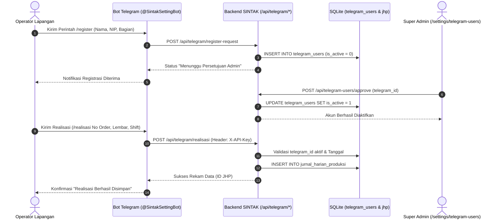

# DOKUMEN ARSITEKTUR TEKNIS SINTAK: SPESIFIKASI API, INTEGRASI SCRAPER & BOT TELEGRAM
> **Sistem Informasi & Manajemen Terpadu Percetakan — PT Buya Barokah**  
> Status Dokumen: *Resmi, Lengkap & Tervalidasi* | Framework: `Next.js App Router (TypeScript)` | Direktori API: `src/app/api/`

---

## DAFTAR ISI
1. [Standar Protokol, Autentikasi & Format Data](#1-standar-protokol-autentikasi--format-data)
2. [Integrasi Bot Telegram & Webhook (@SintakSettingBot)](#2-integrasi-bot-telegram--webhook-sintaksettingbot)
   - [2.1 Alur Registrasi & Otorisasi Akun Operator](#21-alur-registrasi--otorisasi-akun-operator)
   - [2.2 Endpoint Transaksi Pelaporan Realisasi Kerja Lapangan](#22-endpoint-transaksi-pelaporan-realisasi-kerja-lapangan)
   - [2.3 Endpoint Manajemen & Verifikasi Bot Telegram](#23-endpoint-manajemen--verifikasi-bot-telegram)
3. [Mesin Pencerminan & Scraper ERP Digit (21 Endpoints)](#3-mesin-pencerminan--scraper-erp-digit-21-endpoints)
   - [3.1 Protokol Koneksi & Session Caching ERP Digit](#31-protokol-koneksi--session-caching-erp-digit)
   - [3.2 Katalog Endpoint Scraper Pengadaan / Pembelian](#32-katalog-endpoint-scraper-pengadaan--pembelian)
   - [3.3 Katalog Endpoint Scraper Penjualan & Piutang](#33-katalog-endpoint-scraper-penjualan--piutang)
   - [3.4 Katalog Endpoint Scraper Manufaktur Produksi Digit](#34-katalog-endpoint-scraper-manufaktur-produksi-digit)
   - [3.5 Katalog Endpoint Scraper Master Stok, Akuntansi & Log](#35-katalog-endpoint-scraper-master-stok-akuntansi--log)
   - [3.6 Mekanisme Idempotensi, Batch Insert & Penguncian Periode](#36-mekanisme-idempotensi-batch-insert--penguncian-periode)
4. [API Operasional Native SINTAK (Core Workflow)](#4-api-operasional-native-sintak-core-workflow)
   - [4.1 Modul Jurnal Harian Produksi (JHP)](#41-modul-jurnal-harian-produksi-jhp)
   - [4.2 Modul Laporan Pekerjaan (7 Divisi Lapangan)](#42-modul-laporan-pekerjaan-7-divisi-lapangan)
   - [4.3 Modul SOPd & Penjadwalan Antrean Order](#43-modul-sopd--penjadwalan-antrean-order)
   - [4.4 Modul Simulator Pricelist & Master Nilai HPP](#44-modul-simulator-pricelist--master-nilai-hpp)
   - [4.5 Modul SDM & Catat Kesalahan (Infractions)](#45-modul-sdm--catat-kesalahan-infractions)
   - [4.6 Modul Pelacakan Terpadu (Tracking Manufaktur)](#46-modul-pelacakan-terpadu-tracking-manufaktur)
5. [API Tata Kelola, Hak Akses (RBAC) & Audit Trail](#5-api-tata-kelola-hak-akses-rbac--audit-trail)
   - [5.1 Otentikasi Sesi & Profil Pengguna Aktif](#51-otentikasi-sesi--profil-pengguna-aktif)
   - [5.2 Audit Trail Activity Logs & Rollback Revert](#52-audit-trail-activity-logs--rollback-revert)
   - [5.3 Pengaturan Parameter Global & Web Push Notification](#53-pengaturan-parameter-global--web-push-notification)
6. [API Agregasi Dashboard & Metrik Eksekutif](#6-api-agregasi-dashboard--metrik-eksekutif)
7. [API Sinkronisasi Batch & Cron Jobs Server](#7-api-sinkronisasi-batch--cron-jobs-server)

---

## 1. STANDAR PROTOKOL, AUTENTIKASI & FORMAT DATA

Seluruh endpoint backend SINTAK dibangun menggunakan spesifikasi **Next.js 14+ App Router Route Handlers** (`src/app/api/**/route.ts`).

### Standar Format Data:
- **Format Pertukaran Data**: `application/json; charset=utf-8`.
- **Kompresi Data**: Endpoint dengan respon berukuran besar (seperti `/api/laporan-pekerjaan`) menerapkan kompresi gzip server-side menggunakan pustaka bawaan Node.js `zlib.gzipSync` dengan header `Content-Encoding: gzip`.
- **Standar Kode Respon HTTP**:
  - `200 OK`: Permintaan berhasil diproses.
  - `400 Bad Request`: Parameter query atau payload body tidak valid / field wajib tidak terisi.
  - `401 Unauthorized`: Kredensial tidak valid / sesi login telah berakhir / API key salah.
  - `403 Forbidden`: Akun belum disetujui atau tidak memiliki wewenang modul (RBAC).
  - `404 Not Found`: Rekaman data yang diminta tidak ditemukan di database.
  - `500 Internal Server Error`: Terjadi kesalahan penanganan database atau server runtime.

### Tiga Tingkat Autentikasi Sistem:
```
+-------------------+-------------------------------+------------------------------------------+
| Lapisan           | Mekanisme Kredensial          | Peruntukan / Konsumen                    |
+-------------------+-------------------------------+------------------------------------------+
| 1. Web UI Client  | Cookie: session (Signed Token)| Pengguna antarmuka web peramban (RBAC)   |
| 2. Bot Telegram   | Header: X-API-Key (Env Secret)| Bot obrolan operator (@SintakSettingBot) |
| 3. Scraper Digit  | Bearer Secret / Sesi Terpadu  | Mesin sinkronisasi data ke ERP Digit     |
+-------------------+-------------------------------+------------------------------------------+
```

1. **Autentikasi Pengguna Web UI**:
   - Memvalidasi cookie sesi browser menggunakan pustaka `src/lib/session.ts` (`getSession()`).
   - Melakukan pengecekan hak akses modular terhadap tabel `role_permissions` menggunakan konstanta `MODULE_REGISTRY` dan helper `requireApiPermission()` (`src/lib/api-guard.ts`).
2. **Autentikasi Bot Telegram**:
   - Setiap permintaan masuk wajib menyertakan header `X-API-Key: process.env.SCRAPER_API_KEY`.
   - Menguji apakah ID Telegram terdaftar dan berstatus aktif (`is_active = 1`) pada tabel `telegram_users`.
3. **Autentikasi Mesin Scraper & Background Cron**:
   - Setiap endpoint `/api/scrape-*` diproteksi secara terpusat oleh `requireScraperAuth(request)` (`src/lib/api-guard.ts`).
   - Mengizinkan permintaan jika menyertakan header `Authorization: Bearer <CRON_SECRET>` (timing-safe via `verifyBearerToken`) ATAU cookie sesi terotentikasi pengguna aktif.
   - Untuk koneksi keluar ke server ERP Digit, scraper melakukan handshake awal ke `https://buyapercetakan.mdthoster.com/il/v1/auth/login` dengan header `X-Bismillah-Api-Key: process.env.SCRAPER_API_KEY` dan menyimpan cookie sesi terotentikasi dalam cache memori (`src/lib/session-cache.ts`).
---

## 2. INTEGRASI BOT TELEGRAM & WEBHOOK (@SintakSettingBot)

SINTAK menyediakan kanal input data lapangan alternatif berbasis pesan obrolan melalui bot Telegram resmi (**`@SintakSettingBot`**). Kanal ini memungkinkan teknisi mesin dan operator shift melaporkan realisasi produksi langsung dari smartphone tanpa harus membuka antarmuka komputer.

### 2.1 Alur Registrasi & Otorisasi Akun Operator
Sebelum dapat menginput data, operator wajib melalui alur persetujuan (*two-step verification*):



---

### 2.2 Endpoint Transaksi Pelaporan Realisasi Kerja Lapangan

#### `POST /api/telegram/realisasi`
Merekam data realisasi pengerjaan mesin dari operator bot Telegram ke dalam tabel `jurnal_harian_produksi`.

- **Headers**:
  - `Content-Type: application/json`
  - `X-API-Key: <SCRAPER_API_KEY>` (Wajib)
- **Aturan Validasi**:
  1. `telegram_id` wajib terdaftar di tabel `telegram_users` dengan `is_active = 1`.
  2. Batasan tanggal (*backdate check*): Maksimal **7 hari ke belakang** dari hari ini, dan tidak boleh tanggal masa depan.
  3. Pembersihan format angka: Karakter titik pemisah ribuan otomatis dinormalisasi menjadi integer murni.
- **Payload Request**:
```json
{
  "telegram_id": "123456789",
  "tgl": "2026-10-05",
  "shift": "1",
  "no_order_2": "PRD0012604280001",
  "nama_order_2": "Buku Panduan Doa",
  "jenis_pekerjaan_2": "Cetak Naik Mesin SM52",
  "realisasi": 5000,
  "inscheet_2": 50,
  "rijek_2": 25,
  "jam_mulai_2": "08:00",
  "jam_selesai_2": "16:00",
  "keterangan_2": "Selesai cetak cover dan isi"
}
```
- **Contoh Respon Sukses (200 OK)**:
```json
{
  "success": true,
  "message": "Data realisasi berhasil disimpan",
  "data": {
    "id": 198271,
    "no_order": "PRD0012604280001",
    "nama_karyawan": "Ahmad Dani",
    "realisasi": 5000,
    "created_at": "2026-10-05 14:30:00"
  }
}
```
- **Contoh Respon Error (403 Forbidden)**:
```json
{
  "error": "Akun Anda belum disetujui admin. Tunggu persetujuan terlebih dahulu."
}
```

---

#### `GET /api/telegram/validate-order`
Memvalidasi apakah nomor pesanan (faktur SPK atau nomor SOPd) terdaftar dan valid di sistem.
- **Query Params**: `no_order` (string)
- **Respon Sukses (200 OK)**:
```json
{
  "valid": true,
  "order": {
    "faktur": "PRD0012604280001",
    "nama_prd": "Buku Panduan Doa",
    "nama_pelanggan": "Yayasan Amanah",
    "qty": 5000
  }
}
```

---

#### `GET /api/telegram/validate-karyawan`
Memvalidasi identitas karyawan berdasarkan nama atau NIP sebelum mengaitkan akun Telegram.
- **Query Params**: `name` (string)
- **Respon Sukses (200 OK)**:
```json
{
  "valid": true,
  "employee": {
    "id": 14,
    "name": "Ahmad Dani",
    "employee_no": "EMP-2024-014",
    "department": "CETAK",
    "position": "Operator Mesin"
  }
}
```

---

#### `GET /api/telegram/history`
Mengambil riwayat pengerjaan terakhir yang pernah diinputkan oleh ID Telegram yang bersangkutan.
- **Query Params**: `telegram_id` (string), `limit` (opsional, default 5)
- **Headers**: `X-API-Key: <SCRAPER_API_KEY>`

---

### 2.3 Endpoint Manajemen & Verifikasi Bot Telegram

| Method | Endpoint | Wewenang | Parameter / Payload | Fungsi Bisnis |
| :---: | :--- | :---: | :--- | :--- |
| `POST` | `/api/telegram/register-webhook` | Server | `{ "url": "https://domain/api/telegram/webhook" }` | Mendaftarkan URL Webhook resmi SINTAK ke Telegram Bot API server |
| `POST` | `/api/telegram/register-request` | Publik | `{ "telegram_id", "telegram_username", "nama_karyawan", "bagian" }` | Pendaftaran akun operator baru dari bot obrolan |
| `GET` | `/api/telegram/check-status` | Publik | `?telegram_id=...` | Memeriksa apakah status akun sudah disetujui (`is_active = 1`) |
| `GET` | `/api/telegram-users/list` | Admin | `?page=1&limit=50&status=pending` | Daftar antrean persetujuan akun bot Telegram di panel admin |
| `POST` | `/api/telegram-users/approve` | Admin | `{ "telegram_id": "..." }` | Super Admin mengaktifkan akun bot operator (`is_active = 1`) |
| `POST` | `/api/telegram-users/reject` | Admin | `{ "telegram_id": "..." }` | Menolak pendaftaran akun operator |
| `GET` | `/api/telegram-users/pending-count` | Admin | — | Mengambil jumlah angka lencana (*badge*) akun menunggu verifikasi |

---

## 3. MESIN PENCERMINAN & SCRAPER ERP DIGIT (21 ENDPOINTS)

SINTAK menghubungkan ekosistem internalnya dengan ERP Digit melalui **21 modul backend scraper** yang beroperasi secara terjadwal maupun sesuai permintaan (*on-demand*).

### 3.1 Protokol Koneksi & Session Caching ERP Digit
Seluruh scraper mengimplementasikan pola autentikasi tunggal terpusat via `src/lib/session-cache.ts`:
1. **Target Server ERP**: `https://buyapercetakan.mdthoster.com/il/`
2. **Handshake Login**: `POST /v1/auth/login` mengirimkan kredensial `SCRAPER_EMAIL`, `SCRAPER_PASSWORD`, dan header keamanan `X-Bismillah-Api-Key`.
3. **Session Re-use**: Token sesi dan cookie jar disimpan dalam memori RAM server Next.js. Jika sesi kedaluwarsa (HTTP 401), helper secara transparan melakukan re-login (*auto retry*).

---

### 3.2 Katalog 21 Endpoint Scraper ERP Digit

Setiap endpoint scraper menerima parameter query standar:
- **`start`**: Tanggal awal pencarian format `YYYY-MM-DD` (contoh: `2026-10-01`).
- **`end`**: Tanggal akhir pencarian format `YYYY-MM-DD` (contoh: `2026-10-05`).
*(Jika tidak dikirim, scraper otomatis menggunakan tanggal hari ini)*.

> **Keamanan & Otorisasi Endpoint**: Seluruh endpoint `/api/scrape-*` wajib melewati guard `requireScraperAuth()` (`src/lib/api-guard.ts`). Akses ditolak (HTTP 401 Unauthorized) jika tidak menyertakan Bearer `CRON_SECRET` atau cookie sesi login aktif.
| No | Endpoint Scraper | Tabel Target Lokal | Entitas Data Digit | Peruntukan Bisnis di SINTAK |
| :-: | :--- | :--- | :--- | :--- |
| **1** | `GET /api/scrape-pr` | `purchase_requests` | Purchase Request (RQ...) | Permohonan kebutuhan bahan cetak |
| **2** | `GET /api/scrape-spph-out` | `spph_out` | SPPH Keluar (SQ...) | Permintaan penawaran ke rekanan vendor |
| **3** | `GET /api/scrape-sph-in` | `sph_in` | SPH Masuk (QI...) | Penawaran harga dari vendor terpilih |
| **4** | `GET /api/scrape-purchase-orders` | `purchase_orders` | Purchase Order (PO...) | Kontrak pesanan pembelian bahan baku |
| **5** | `GET /api/scrape-penerimaan-pembelian` | `penerimaan_pembelian` | Penerimaan Barang (RI...) | Verifikasi kedatangan fisik barang di gudang |
| **6** | `GET /api/scrape-rekap-pembelian-barang` | `rekap_pembelian_barang` | Faktur Pembelian (PB...) | Dasar pengakuan hutang & referensi tarif Pricelist |
| **7** | `GET /api/scrape-pelunasan-hutang` | `pelunasan_hutang` | Pelunasan Hutang (PH...) | Bukti bayar kas/bank tagihan pembelian vendor |
| **8** | `GET /api/scrape-sph-out` | `sph_out` | SPH Keluar (QO...) | Penawaran harga resmi kepada pelanggan |
| **9** | `GET /api/scrape-sales-orders` | `sales_orders` | Sales Order (SO...) | Surat pesanan penjualan dari konsumen |
| **10** | `GET /api/scrape-sales` | `sales_reports` | Laporan Penjualan (SI...) | Faktur realisasi penjualan & penagihan piutang |
| **11** | `GET /api/scrape-pengiriman` | `pengiriman` | Surat Jalan (SJ...) | Ekspedisi armada & status terkirim barang |
| **12** | `GET /api/scrape-pelunasan-piutang` | `pelunasan_piutang` | Pelunasan Piutang (PT...) | Bukti pembayaran kas/transfer dari pelanggan |
| **13** | `GET /api/scrape-bom` | `bill_of_materials` | Bill of Material (BM...) | Resep formula kertas, plat, dan biaya pengerjaan |
| **14** | `GET /api/scrape-orders` | `orders` | Order Produksi (PRD...) | Poros SPK pesanan produksi cetak pabrik |
| **15** | `GET /api/scrape-bahan-baku` | `bahan_baku` | Pemakaian Bahan (BBB) | Konsumsi kertas dan tinta riil di mesin cetak |
| **16** | `GET /api/scrape-barang-jadi` | `barang_jadi` | Hasil Produksi Digit | Serah terima fisik produk cetak ke gudang jadi |
| **17** | `GET /api/scrape-produksi-selesai` | `produksi_selesai` | Status Order Selesai | Validasi penyelesaian administratif order di Digit |
| **18** | `GET /api/scrape-master-barang` | `stok_master_barang` | Katalog Master Stok | Kode, barcode, satuan, dan saldo akhir material |
| **19** | `GET /api/scrape-rek-akuntansi` | `rek_akuntansi` | Bagan Akun COA | Daftar nomor rekening, akun kas, dan laba rugi |
| **20** | `GET /api/scrape-jurnal-umum` | `jurnal_umum` | Mutasi Jurnal Umum | Transaksi debit/kredit pembukuan akuntansi |
| **21** | `GET /api/scrape-usr-log` | `usr_log` | Audit Trail Digit | Jejak aktivitas pengguna di software Digit ERP |

---

### 3.3 Struktur Respon Standar Scraper
Contoh respon saat memanggil `GET /api/scrape-orders?start=2026-10-01&end=2026-10-05`:
```json
{
  "status": "success",
  "message": "Scrape Order Produksi berhasil",
  "meta": {
    "totalScraped": 48,
    "inserted": 12,
    "updated": 36,
    "durationMs": 1420,
    "range": {
      "start": "2026-10-01",
      "end": "2026-10-05"
    }
  }
}
```

---

### 3.4 Mekanisme Idempotensi & Penguncian Periode
1. **Idempotensi Batch Insert**:
   - Seluruh baris data hasil scraping diproses menggunakan klausa SQL `INSERT INTO ... ON CONFLICT(faktur) DO UPDATE SET ...` atau `INSERT OR REPLACE INTO ...`.
   - Menjamin eksekusi ulang pada rentang tanggal yang sama tidak menghasilkan duplikasi data (*duplicate key safe*).
2. **Perekaman Stempel Periode Scraped**:
   - Setiap keberhasilan sinkronisasi dicatat pada `system_settings` via helper `src/lib/server-scraped-period.ts`.
   - Antarmuka web pengguna secara visual menampilkan lencana status (*Last Updated Badge*) dan rentang tanggal data yang tersinkronisasi.
3. **Perekaman Jejak Audit**:
   - Setiap eksekusi scraper secara otomatis merekam entri baru ke `activity_logs` dengan aksi `SCRAPE_DIGIT` untuk memonitor stabilitas sistem.

---

## 4. API OPERASIONAL NATIVE SINTAK (CORE WORKFLOW)

Kelompok API ini menangani seluruh alur kerja operasional aktif percetakan yang dibuat dan dimanipulasi langsung oleh pengguna SINTAK.

---

### 4.1 Modul Jurnal Harian Produksi (JHP)

Modul ini adalah jantung operasional pabrik yang mengelola penugasan target shift, pencatatan hasil lembar jadi, rijek afdruk/jalan, inscheet, dan kendala mesin.

#### `GET /api/jurnal-harian-produksi`
Mengambil daftar entri JHP dengan paginasi, pencarian token-based, dan filter multi-kriteria.
> **Otorisasi**: Wajib memiliki salah satu izin: `produksi_jhp`, `produksi_jhp_target`, atau `produksi_jhp_sopd` (`requireApiPermission`).
- **Query Params**:
  - `page` (number, default: 1), `limit` (number, default: 50)
  - `search` (string): Token-based AND search memindai nama karyawan, nomor order, jenis pekerjaan, dan catatan manual.
  - `startDate`, `endDate` (string, format `YYYY-MM-DD`): Filter rentang tanggal kerja.
  - `bagian` (string): Filter divisi/bagian (contoh: 'CETAK', 'FINISHING').
  - `namaKaryawan` (string): Filter nama operator mesin.
  - `noOrder` (string): Filter nomor pesanan / SPK.
  - `belumRealisasi` (boolean string: `'true'`): Menampilkan antrean target yang belum diisi realisasinya.
- **Contoh Respon (200 OK)**:
```json
{
  "data": [
    {
      "id": 198270,
      "tgl": "2026-10-05",
      "shift": "1",
      "nama_karyawan": "Budi Santoso",
      "no_order": "PRD0012604280002",
      "nama_order": "Buku Yasin Hardcover",
      "jenis_pekerjaan": "Cetak Mesin Komori",
      "target": 10000,
      "realisasi": 9800,
      "rijek": 50,
      "inscheet": 100,
      "kendala": "Ganti rol air 15 menit",
      "jam_mulai": "08:00",
      "jam_selesai": "16:00"
    }
  ],
  "pagination": { "page": 1, "limit": 50, "total": 198270, "totalPages": 3966 }
}
```

#### `POST /api/jurnal-harian-produksi`
Membuat entri jadwal target shift baru atau mencatat realisasi langsung dari antarmuka web.
- **Payload Request**:
```json
{
  "tgl": "2026-10-05",
  "shift": "2",
  "nama_karyawan": "Slamet Riyadi",
  "no_order": "PRD0012604280005",
  "nama_order": "Majalah Bulanan",
  "jenis_pekerjaan": "Potong Kertas Plano",
  "target": 5000,
  "realisasi": 0
}
```

#### `PUT /api/jurnal-harian-produksi`
Memperbarui realisasi kerja operator (jam mulai, jam selesai, lembar jadi, rijek, inscheet, dan kendala).
- **Payload Request**:
```json
{
  "id": 198270,
  "realisasi": 5100,
  "rijek": 20,
  "inscheet": 50,
  "jam_mulai": "16:00",
  "jam_selesai": "23:30",
  "kendala": "Lancar tanpa hambatan"
}
```

#### `DELETE /api/jurnal-harian-produksi`
Melakukan *soft delete* entri JHP ke tabel trash (dapat dipulihkan sewaktu-waktu).
- **Query Params**: `id` (number)

#### Sub-Endpoints Pendukung JHP:
- **`GET /api/jurnal-harian-produksi/analisa?no_order=...`**: Rekapitulasi kronologis seluruh tahap pengerjaan (Setting $
ightarrow$ Cetak $
ightarrow$ Finishing) untuk satu nomor pesanan tertentu.
- **`GET /api/jurnal-harian-produksi/options`**: Mengambil daftar unik opsi dropdown untuk bagian, mesin, dan shift.
- **`POST /api/jurnal-harian-produksi/copy-jadwal`**: Menyalin susunan penugasan operator dan mesin dari shift kemarin ke tanggal hari ini (Otorisasi: `requireApiPermission('produksi_jhp')`).
- **`POST /api/jurnal-harian-produksi/copy-jadwal/revert`**: Membatalkan aksi salin jadwal terakhir jika terjadi kesalahan plotting.
- **`GET /api/jurnal-harian-produksi/trash`**: Melihat daftar entri yang telah dihapus beserta tombol Restore dan Delete Permanen.
- **`GET /api/master-pekerjaan` & `/api/master-pekerjaan-jurnal-produksi`**: Katalog master pekerjaan dan relasinya (Otorisasi: `requireApiPermission('produksi_jhp')`).

---

### 4.2 Modul Laporan Pekerjaan (7 Divisi Lapangan)

Modul manajemen lembar kerja tugas mandiri untuk 7 divisi pabrik: `SETTING`, `QC`, `CETAK`, `FINISHING`, `GUDANG`, `TEKNISI`, dan `MESIN`.

#### `GET /api/laporan-pekerjaan`
Mengambil daftar tugas lembar kerja. Respon secara otomatis dikompresi dengan gzip.
- **Query Params**:
  - `pic` (string): Filter nama penanggung jawab tugas.
  - `bagian` (string): Filter nama divisi.
  - `status` (string): Filter status ('BELUM DIKERJAKAN', 'IN PROGRESS', 'SELESAI', 'CANCEL').
  - `from`, `to` (string, `YYYY-MM-DD`): Filter rentang tanggal tugas.
  - `search` (string): Pencarian teks bebas pada task, project, atau note.
- **Contoh Respon (200 OK)**:
```json
{
  "tasks": [
    {
      "id": 5194,
      "task": "Pembuatan Plat CTP Cover dan Isi",
      "project": "Buku Yasin Barokah",
      "division": "SETTING",
      "bagian": "SETTING",
      "pic": "Muhammad Adi Saputra",
      "priority": "Urgent",
      "start_date": "2026-10-04",
      "end_date": "2026-10-05",
      "work_days": 1,
      "status": "SELESAI",
      "note": "4 keping plate CTP ukuran 650x550 mm"
    }
  ]
}
```

#### `POST /api/laporan-pekerjaan`
Menambahkan tugas kerja baru ke antrean divisi.
- **Payload**:
```json
{
  "task": "Pengecekan Register Cetak & Akurasi Warna",
  "project": "Kalender Dinding 2027",
  "division": "QC",
  "bagian": "QC",
  "pic": "Rikza Musthofa",
  "priority": "High",
  "start_date": "2026-10-05",
  "status": "IN PROGRESS"
}
```

#### `PUT /api/laporan-pekerjaan`
Memperbarui progres tugas atau mengubah status siklus hidup tugas:
- **Transisi Status**: `'BELUM DIKERJAKAN'` $\longrightarrow$ `'IN PROGRESS'` $\longrightarrow$ `'SELESAI'` (atau `'CANCEL'`).
- **Payload**: `{ "id": 5194, "status": "SELESAI", "end_date": "2026-10-05", "work_days": 1 }`.

---

### 4.3 Modul SOPd & Penjadwalan Antrean Order

#### `GET /api/sopd`
Menggabungkan data SPK pesanan cetak dari `orders` Digit (2025+) dengan data arsip Excel masa lalu `sopd` ($\le$ 2024), diperkaya dengan estimasi harga dan status selesai dari `sopd_harga`.
> **Otorisasi**: `requireApiPermission(['produksi_jhp_sopd', 'produksi_jhp', 'produksi_jhp_target'])`. Untuk `POST /api/sopd` dilindungi izin `produksi_jhp_sopd`.
- **Query Params**: `page`, `limit`, `search`, `filterStatus` ('finished', 'pending', 'active').

#### `PUT /api/sopd`
Memperbarui metadata komersial dan operasional pesanan di tabel `sopd_harga`.
- **Payload**:
```json
{
  "no_sopd": "PRD0012604280001",
  "perkiraan_harga": 15500000,
  "deadline_date": "2026-10-15",
  "finished_date": "2026-10-12",
  "pending_produksi": 0,
  "alasan_pending": ""
}
```

#### `POST /api/sopd/upload`
Mengunggah berkas Excel antrean cetak SOPd untuk diurai (*parse*) dan diimpor ke database SQLite.

---

### 4.4 Modul Simulator Pricelist & Master Nilai HPP

#### `POST /api/pricelist`
Menghitung simulasi biaya cetak untuk 20+ kategori produk percetakan (Buku Soft/Hard Cover, Kalender, Dus Kemasan, Brosur, Stopmap, dll.) berdasarkan 4 komponen biaya:
$$	ext{Total Harga} = (	ext{Biaya Kertas} + 	ext{Ongkos Cetak Mesin} + 	ext{Ongkos Finishing}) 	imes (1 + 	ext{Markup Profit})$$

#### `GET /api/pricelist/rekap-lookup`
Mengambil histori harga beli riil kertas plano dari tabel `rekap_pembelian_barang` untuk dijadikan acuan biaya material terkini di kalkulator.
- **Query Params**: `q` (nama bahan, contoh: "Art Paper 150gr")

#### `GET /api/pricelist/saved-calculations` & `POST /api/pricelist/saved-calculations`
Membaca dan menyimpan riwayat kalkulasi kustom pengguna ke dalam tabel `pricelist_saved_calculations`.

#### `GET, PUT /api/hpp-kalkulasi`
Mengelola master nilai rupiah HPP per pesanan produksi di tabel `hpp_kalkulasi`.

#### `POST /api/hpp-kalkulasi/sync-from-orders`
Menarik otomatis nama-nama produk pesanan baru yang belum ada di master HPP dari tabel `orders` (`SELECT DISTINCT nama_prd FROM orders`).

---

### 4.5 Modul SDM & Catat Kesalahan (Infractions)

#### `GET /api/employees` & `POST /api/employees`
Mengambil dan mendaftarkan master data karyawan (NIP, Nama, Jabatan, Departemen, Status Aktif).

#### `POST /api/employees/import-raw`
Mengunggah file Excel master pegawai untuk pembaruan batch data personalia.

#### `GET /api/infractions`
Mengambil daftar catatan kesalahan kerja lapangan terikat nomor pesanan produksi.
> **Otorisasi**: Memerlukan izin `catat_kesalahan` (`requireApiPermission('catat_kesalahan')`).
- **Query Params**: `page`, `limit`, `employee_id`, `severity` ('Low', 'Medium'), `search`.

#### `POST /api/infractions`
Mencatat insiden kesalahan baru dengan rincian material rusak dan penetapan beban ganti rugi:
> **Otorisasi**: Memerlukan izin `catat_kesalahan` (`requireApiPermission('catat_kesalahan')`).
- **Payload**:
```json
{
  "employee_id": 14,
  "faktur": "PRD0012604280001",
  "description": "Salah setting pisau potong, terpotong 5 mm dari garis batas",
  "severity": "Medium",
  "date": "2026-10-05",
  "nama_barang": "Art Carton 260gr",
  "jumlah": 500,
  "harga": 2500,
  "recorded_by": "supervisor_finishing"
}
```

#### `GET /api/infractions/next-faktur`
Menghasilkan nomor unik faktur insiden secara otomatis berdasarkan sekuens sistem.

---

### 4.6 Modul Pelacakan Terpadu (Tracking Manufaktur)

#### `GET /api/tracking`
Poros utama mesin pencarian riwayat dokumen operasional multi-arah.
- **Query Params**: `target_faktur` atau `faktur` (string bebas, bisa nomor BOM, Order Produksi, PO, Rekap PB, atau Sales Order).
- **Logika Penelusuran**:
  - Jika input berupa **PO / PB**: Sistem menelusuri maju ke pemakaian bahan baku (`bahan_baku.faktur_pb`), mengaitkannya ke pesanan produksi (`orders`), lalu melacak ke dokumen penjualan (`sales_reports`, `pengiriman`).
  - Jika input berupa **BOM / Order / SO**: Sistem menelusuri ke bawah ke order produksi, mundur ke pengadaan bahan baku, dan maju ke pengiriman logistik.
- **Struktur Respon**:
```json
{
  "root": { "type": "BOM", "faktur": "BM0012604200001" },
  "pembelian": {
    "purchaseOrders": [ ... ],
    "penerimaan": [ ... ],
    "rekapPembelian": [ ... ],
    "pelunasanHutang": [ ... ]
  },
  "produksi": {
    "bom": { ... },
    "orders": [ ... ],
    "bahanBaku": [ ... ],
    "barangJadi": [ ... ]
  },
  "penjualan": {
    "sphOut": { ... },
    "salesOrders": [ ... ],
    "laporanPenjualan": [ ... ],
    "pengiriman": [ ... ],
    "pelunasanPiutang": [ ... ]
  }
}
```

---

## 5. API TATA KELOLA, HAK AKSES (RBAC) & AUDIT TRAIL

Kelompok API ini menangani otentikasi sesi, matriks izin berbasis peran, dan pencatatan audit trail menyeluruh atas seluruh perubahan data.

### 5.1 Otentikasi Sesi & Profil Pengguna Aktif

#### `GET /api/auth/me`
Mengambil data pengguna yang sedang login berdasarkan cookie sesi.
- **Respon Sukses (200 OK)**:
```json
{
  "user": {
    "id": 1,
    "username": "admin",
    "name": "Super Administrator",
    "role": "Super Admin",
    "employee_id": 1,
    "is_active": 1
  },
  "permissions": {
    "dashboard": true,
    "jurnal_harian_produksi": true,
    "tracking_manufaktur": true
  }
}
```

---

### 5.2 Audit Trail Activity Logs & Rollback Revert

#### `GET /api/activity-log`
Mengambil rekaman jejak audit sistem dengan paginasi cepat dan filter multi-kolom.
- **Query Params**: `page`, `limit`, `action_type` ('CREATE', 'UPDATE', 'DELETE', 'SCRAPE'), `table_name`, `username`, `search`.

#### `POST /api/activity-log/revert`
Memulihkan (*rollback*) data yang diubah atau dihapus ke kondisi sebelumnya berdasarkan snapshot `raw_data` atau `changed_data` yang tersimpan di `activity_logs`.
- **Payload**: `{ "log_id": 16885 }`.
- **Wewenang**: Khusus role `Super Admin`.

#### `GET /api/activity-log/trend` & `GET /api/activity-log/filters`
- `/trend`: Mengambil grafik frekuensi aktivitas pengguna per hari untuk evaluasi kepatuhan.
- `/filters`: Mengambil daftar unik nama tabel dan username yang pernah melakukan aktivitas di sistem.

---

### 5.3 Pengaturan Parameter Global & Web Push Notification

| Method | Endpoint | Fungsi Bisnis |
| :---: | :--- | :--- |
| `GET, POST` | `/api/system-settings` | Membaca dan memperbarui parameter global aplikasi (key-value) |
| `POST` | `/api/push/subscribe` | Menyimpan objek langganan Web Push Notification peramban operator |
| `GET` | `/api/push/check` | Memeriksa apakah perangkat saat ini telah berlangganan notifikasi push |

---

## 6. API AGREGASI DASHBOARD & METRIK EKSEKUTIF

Endpoint di bawah ini menyajikan data teragregasi yang dioptimalkan untuk grafik dan kartu statistik ringkasan eksekutif:

| Method | Endpoint | Sumber Data Primer | Metrik yang Disajikan |
| :---: | :--- | :--- | :--- |
| `GET` | `/api/dashboard/akunting-trend` | `jurnal_umum`, `rek_akuntansi` | Tren bulanan total mutasi Debet vs Kredit |
| `GET` | `/api/dashboard/produksi-trend` | `bahan_baku`, `barang_jadi`, `jhp` | Tren bulanan Biaya Bahan Baku vs Nilai Barang Jadi |
| `GET` | `/api/dashboard/infractions-trend` | `infractions` | Tren jumlah insiden kesalahan kerja & nominal ganti rugi |
| `GET` | `/api/dashboard/barang-jadi-warning`| `barang_jadi` | Peringatan dini penumpukan produk selesai di gudang |
| `GET` | `/api/dashboard/orders-count` | `orders` | Total order aktif berjalan & persentase selesai |
| `GET` | `/api/dashboard/jurnal-count` | `jurnal_harian_produksi` | Total lembar realisasi cetak shift hari ini |
| `GET` | `/api/dashboard/karyawan-count` | `employees` | Total karyawan aktif per departemen |
| `GET` | `/api/dashboard/aktivitas-terbaru` | `activity_logs` | Feed 10 aktivitas CRUD terkini di seluruh sistem |

---

## 7. API SINKRONISASI BATCH & CRON JOBS SERVER

Untuk menjaga keselarasan data tanpa membebani server produksi di jam kerja sibuk, SINTAK menyediakan antrean batch dan jadwal cron:

### 7.1 Sinkronisasi Terjadwal (Cron Jobs)
1. **`GET /api/cron/sync-daily`**:
   - Berjalan otomatis via cron server (contoh: setiap pukul 02:00 WIB).
   - Menjalankan scraping sekuensial untuk seluruh 21 modul Digit pada rentang tanggal hari kemarin hingga hari ini.
   - Dilindungi dengan token rahasia: `Authorization: Bearer <CRON_SECRET>`.
2. **`GET /api/cron/archive-logs`**:
   - Berjalan berkala untuk memindahkan rekaman audit log berumur lebih dari 90 hari dari `activity_logs` ke tabel `activity_logs_archive` demi menjaga performa query tabel utama.

### 7.2 Antrean Sinkronisasi Massal (Batch Sync)
- **`POST /api/sync-batch-queue`**: Mendaftarkan antrean penarikan data lintas bulan untuk pemulihan atau inisialisasi awal (*data backfill*).
- **`GET /api/sync-job-status`**: Memeriksa kemajuan persentase penyelesaian antrean batch job yang sedang berjalan di background server.

---

> **Dokumen Resmi Spesifikasi API SINTAK PT Buya Barokah**  
> Terakhir Diperbarui: Oktober 2026 | Tim Pengembang SINTAK
