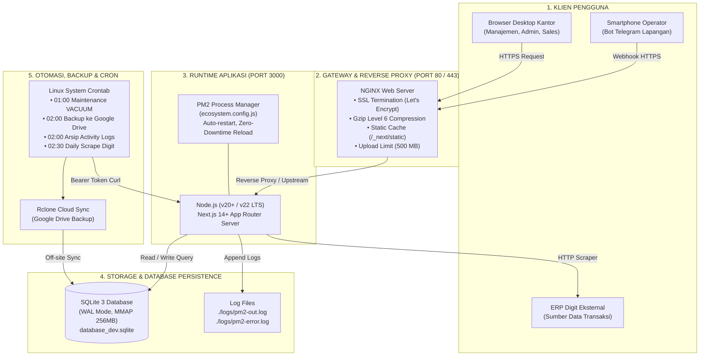
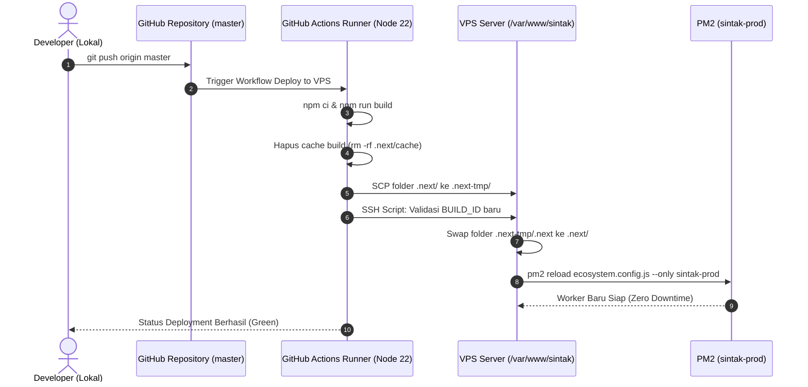

# DOKUMEN ARSITEKTUR INFRASTRUKTUR SINTAK: PANDUAN DEPLOYMENT & ARSITEKTUR SERVER
> **Sistem Informasi & Manajemen Terpadu Percetakan — PT Buya Barokah**  
> Status Dokumen: *Resmi, Lengkap & Siap Produksi* | Target OS: `Ubuntu 22.04+ LTS / Windows Server` | Node.js: `v20+ / v22 LTS`

---

## DAFTAR ISI
1. [Gambaran Topologi Infrastruktur Server](#1-gambaran-topologi-infrastruktur-server)
2. [Konfigurasi Web Server Nginx (Reverse Proxy, SSL & Cache)](#2-konfigurasi-web-server-nginx-reverse-proxy-ssl--cache)
   - [2.1 File Konfigurasi Nginx Produksi](#21-file-konfigurasi-nginx-produksi)
   - [2.2 Konfigurasi Buffer, Kompresi Gzip & Static Assets Cache](#22-konfigurasi-buffer-kompresi-gzip--static-assets-cache)
   - [2.3 Konfigurasi SSL/TLS HTTPS (Certbot Let's Encrypt)](#23-konfigurasi-ssltls-https-certbot-lets-encrypt)
3. [Pengelolaan Proses Produksi dengan PM2 (Process Manager)](#3-pengelolaan-proses-produksi-dengan-pm2-process-manager)
   - [3.1 Konfigurasi ecosystem.config.js](#31-konfigurasi-ecosystemconfigjs)
   - [3.2 Perintah Operasional Harian PM2](#32-perintah-operasional-harian-pm2)
   - [3.3 Mekanisme Zero-Downtime Reload](#33-mekanisme-zero-downtime-reload)
   - [3.4 Konfigurasi Auto-Start on Boot (systemd & Windows)](#34-konfigurasi-auto-start-on-boot-systemd--windows)
4. [Jadwal Cron Jobs & Otomasi Pemeliharaan Server](#4-jadwal-cron-jobs--otomasi-pemeliharaan-server)
   - [4.1 Arsitektur Pengamanan Cron (CRON_SECRET)](#41-arsitektur-pengamanan-cron-cron_secret)
   - [4.2 Timeline Jadwal Otomasi 24 Jam](#42-timeline-jadwal-otomasi-24-jam)
   - [4.3 Skrip Cadangan Database Cloud (sintak-backup.sh)](#43-skrip-cadangan-database-cloud-sintak-backupsh)
5. [Alur Pipeline CI/CD & Deployment Fitur Baru](#5-alur-pipeline-cicd--deployment-fitur-baru)
   - [5.1 Workflow GitHub Actions (.github/workflows/deploy.yml)](#51-workflow-github-actions-githubworkflowsdeployyml)
   - [5.2 Prosedur Deployment Manual di Server VPS](#52-prosedur-deployment-manual-di-server-vps)
   - [5.3 Prosedur Rollback Cepat (Emergency Revert)](#53-prosedur-rollback-cepat-emergency-revert)
6. [Manajemen Environment Variables (.env) & Keamanan](#6-manajemen-environment-variables-env--keamanan)
7. [Panduan Penanganan Masalah & Pemulihan (Troubleshooting)](#7-panduan-penanganan-masalah--pemulihan-troubleshooting)

---

## 1. GAMBARAN TOPOLOGI INFRASTRUKTUR SERVER

Aplikasi SINTAK dirancang untuk berjalan secara andal pada server VPS Linux (Ubuntu LTS) untuk akses publik dan cloud, serta dapat berjalan pada server LAN kantor (Windows Workstation / Local Server) untuk operasional jaringan internal.



### Rekomendasi Spesifikasi Server (VPS):
- **CPU**: 2 vCPU atau lebih (rekomendasi: Dedicated / High-Frequency).
- **RAM**: 4 GB RAM minimum (disarankan 8 GB jika menjalankan proses build di server).
- **Penyimpanan**: 50 GB NVMe SSD (kecepatan disk I/O tinggi penting untuk SQLite MMAP & WAL mode).
- **Sistem Operasi**: Ubuntu 22.04 LTS atau Ubuntu 24.04 LTS.
- **Port Jaringan**:
  - `80` (HTTP - Nginx redirect ke HTTPS)
  - `443` (HTTPS - Nginx Reverse Proxy)
  - `22` (SSH - Manajemen server)
  - `3000` (Node.js internal loopback `127.0.0.1:3000` — ditutup dari internet luar)

---

## 2. KONFIGURASI WEB SERVER NGINX (REVERSE PROXY, SSL & CACHE)

Nginx berfungsi sebagai pintu gerbang utama (*front-facing reverse proxy*) yang menangani terminasi SSL, kompresi berkas, pembatasan ukuran unggahan berkas Excel, dan *caching* aset statis.

### 2.1 File Konfigurasi Nginx Produksi
File konfigurasi pada server Ubuntu disimpan di `/etc/nginx/sites-available/sintak` (atau `/etc/nginx/nginx.conf`):

```nginx
# /etc/nginx/sites-available/sintak

upstream nextjs_upstream {
    server 127.0.0.1:3000;
    keepalive 64;
}

# 1. Redirect HTTP ke HTTPS
server {
    listen 80;
    listen [::]:80;
    server_name sintak-ptbuya.cloud www.sintak-ptbuya.cloud;

    location /.well-known/acme-challenge/ {
        root /var/www/certbot;
    }

    location / {
        return 301 https://$host$request_uri;
    }
}

# 2. Server Blok HTTPS Utama
server {
    listen 443 ssl http2;
    listen [::]:443 ssl http2;
    server_name sintak-ptbuya.cloud www.sintak-ptbuya.cloud;

    # SSL Certificates (Let's Encrypt)
    ssl_certificate /etc/letsencrypt/live/sintak-ptbuya.cloud/fullchain.pem;
    ssl_certificate_key /etc/letsencrypt/live/sintak-ptbuya.cloud/privkey.pem;
    ssl_protocols TLSv1.2 TLSv1.3;
    ssl_ciphers HIGH:!aNULL:!MD5;
    ssl_prefer_server_ciphers on;

    # Upload Limit (Penting: Impor Excel HPP/SOPd berukuran puluhan ribu baris)
    client_max_body_size 500m;

    # Proxy Buffer Tuning
    proxy_buffer_size 128k;
    proxy_buffers 4 256k;
    proxy_busy_buffers_size 256k;

    # Gzip Compression Level 6
    gzip on;
    gzip_vary on;
    gzip_proxied any;
    gzip_comp_level 6;
    gzip_min_length 256;
    gzip_types
        text/plain
        text/css
        text/javascript
        application/javascript
        application/json
        application/xml
        image/svg+xml
        font/woff2;

    # Static Next.js Assets Cache (Served langsung dengan header immutable)
    location /_next/static/ {
        proxy_pass http://nextjs_upstream;
        proxy_cache_valid 200 365d;
        add_header Cache-Control "public, max-age=31536000, immutable";
    }

    # Public Directory Assets (Gambar, Ikon, Favicon)
    location /public/ {
        proxy_pass http://nextjs_upstream;
        expires 30d;
        add_header Cache-Control "public, max-age=2592000";
    }

    # Reverse Proxy Utama ke Next.js
    location / {
        proxy_pass http://nextjs_upstream;
        proxy_http_version 1.1;

        # WebSocket Upgrade Support
        proxy_set_header Upgrade $http_upgrade;
        proxy_set_header Connection "upgrade";

        # Forwarded Headers
        proxy_set_header Host $host;
        proxy_set_header X-Real-IP $remote_addr;
        proxy_set_header X-Forwarded-For $proxy_add_x_forwarded_for;
        proxy_set_header X-Forwarded-Proto $scheme;

        # Timeouts untuk Long-Running Requests (Scraping Batch)
        proxy_connect_timeout 60s;
        proxy_send_timeout 300s;
        proxy_read_timeout 300s;
    }
}
```

### 2.2 Perintah Verifikasi & Reload Nginx
Setiap kali melakukan perubahan konfigurasi Nginx:
```bash
# 1. Uji sintaks konfigurasi (wajib lolos syntax is ok)
sudo nginx -t

# 2. Reload Nginx tanpa memutus koneksi aktif
sudo systemctl reload nginx
```

### 2.3 Konfigurasi SSL/TLS HTTPS (Certbot Let's Encrypt)
Untuk menginstal dan memperbarui sertifikat SSL secara otomatis:
```bash
# Install Certbot dan plugin Nginx
sudo apt update
sudo apt install -y certbot python3-certbot-nginx

# Jalankan penerbitan sertifikat SSL otomatis
sudo certbot --nginx -d sintak-ptbuya.cloud -d www.sintak-ptbuya.cloud

# Uji pembaruan sertifikat otomatis (Dry Run)
sudo certbot renew --dry-run
```

---

## 3. PENGELOLAAN PROSES PRODUKSI DENGAN PM2 (PROCESS MANAGER)

PM2 digunakan sebagai manajer proses produksi agar aplikasi Next.js berjalan terus di latar belakang (*background service*), otomatis bangkit kembali jika terjadi *crash*, dan memungkinkan pembaruan kode tanpa *downtime*.

### 3.1 Konfigurasi ecosystem.config.js
File `ecosystem.config.js` di akar proyek mengatur parameter eksekusi produksi:

```javascript
// ecosystem.config.js
module.exports = {
  apps: [
    {
      name: "sintak-prod",
      script: "node_modules/next/dist/bin/next",
      args: "start -p 3000 -H 0.0.0.0",
      interpreter: "node",
      cwd: "./",
      env: {
        NODE_ENV: "production",
      },
      // Restart otomatis jika terjadi unhandled exception
      autorestart: true,
      // Perlindungan restart-loop: jangan restart jika crash terjadi < 10 detik
      min_uptime: "10s",
      max_restarts: 5,
      // File log output & error
      out_file: "./logs/pm2-out.log",
      error_file: "./logs/pm2-error.log",
      log_date_format: "YYYY-MM-DD HH:mm:ss",
      merge_logs: true,
    },
  ],
};
```

---

### 3.2 Perintah Operasional Harian PM2

| Perintah | Deskripsi & Kegunaan |
| :--- | :--- |
| `pm2 start ecosystem.config.js` | Menjalankan aplikasi untuk pertama kali |
| `pm2 status` | Memeriksa status, memori RAM, CPU, dan uptime proses |
| `pm2 reload sintak-prod` | **Zero-Downtime Reload**: Memuat ulang kode baru tanpa memutus koneksi pengguna |
| `pm2 restart sintak-prod --update-env` | Merestart proses dan menerapkan perubahan baru pada file `.env` |
| `pm2 logs sintak-prod --lines 50` | Memantau 50 baris log output dan error aplikasi terkini |
| `pm2 logs sintak-prod --err` | Hanya menampilkan log error runtime |
| `pm2 monit` | Membuka dashboard monitoring terminal interaktif (CPU & RAM real-time) |
| `pm2 stop sintak-prod` | Menghentikan sementara proses aplikasi |
| `pm2 delete sintak-prod` | Menghapus proses dari daftar manajemen PM2 |

---

### 3.3 Mekanisme Zero-Downtime Reload
Saat pembaruan fitur baru diterapkan di production:
1. Jalankan `npm run build` terlebih dahulu. Selama proses build berlangsung (1–3 menit), PM2 **tetap melayani pengguna kantor** di port 3000 menggunakan build lama.
2. Setelah build tuntas, jalankan:
   ```bash
   pm2 reload sintak-prod
   ```
3. PM2 akan meluncurkan proses *worker* baru dengan kode baru, menunggu hingga proses tersebut siap menerima koneksi, lalu mematikan *worker* lama secara anggun (*graceful shutdown*). Pengguna tidak akan mengalami halaman terputus (*zero-downtime*).

---

### 3.4 Konfigurasi Auto-Start on Boot (Linux & Windows)

#### A. Pada Server Linux VPS (systemd):
Agar PM2 dan aplikasi SINTAK otomatis hidup saat server reboot:
```bash
# 1. Daftarkan service ke systemd
pm2 startup systemd

# 2. Salin dan jalankan perintah yang dihasilkan oleh terminal (contoh: sudo env PATH=$PATH... pm2 startup...)
# 3. Simpan daftar proses aktif saat ini
pm2 save
```

#### B. Pada Server Windows (Workstation Kantor):
Sesuai panduan di `docs/STARTUP_WINDOWS_NOTE.md`:
1. Buat pintasan (*shortcut*) batch file startup ke folder `shell:startup`.
2. Atau gunakan paket pembungkus service Windows:
   ```powershell
   npm install -g pm2-windows-startup
   pm2-startup install
   pm2 save
   ```

---

## 4. JADWAL CRON JOBS & OTOMASI PEMELIHARAAN SERVER

SINTAK mengandalkan crontab tingkat sistem operasi (Linux System Crontab) untuk menjalankan pemeliharaan berkala, pencadangan database ke cloud, dan sinkronisasi malam hari dengan ERP Digit.

### 4.1 Arsitektur Pengamanan Cron (CRON_SECRET)
Seluruh endpoint cron pada Next.js dilindungi menggunakan otentikasi Bearer Token:
- Endpoint internal: `/api/cron/sync-daily`, `/api/cron/archive-logs`, dan `/api/maintenance`.
- Permintaan wajib menyertakan header:
  ```http
  Authorization: Bearer <CRON_SECRET>
  ```
- Jika header tidak sesuai, server langsung menolak dengan status `401 Unauthorized` sebelum mengeksekusi logika apapun.

---

### 4.2 Timeline Jadwal Otomasi 24 Jam

Berikut adalah matriks jadwal cron produksi yang aktif berjalan di server:

| Waktu (WIB) | Waktu (UTC) | Pola Cron | Target / Perintah Eksekusi | Deskripsi & Tindakan |
| :---: | :---: | :--- | :--- | :--- |
| **01:00**<br>*(Setiap Jumat)* | 18:00<br>*(Kamis)* | `0 18 * * 4` | `curl -H "Authorization: Bearer $CRON_SECRET" http://127.0.0.1:3000/api/maintenance` | **Optimasi Database Mingguan**: Menjalankan `VACUUM`, `ANALYZE`, dan `REINDEX` untuk merapikan fragmentasi file SQLite setelah 1 minggu kerja. |
| **02:00**<br>*(Harian)* | 19:00 | `0 19 * * *` | `/usr/local/bin/sintak-backup.sh` | **Backup Cloud Harian**: Checkpoint WAL SQLite, kompresi gzip, unggah ke Google Drive via Rclone, dan rotasi retensi 7 hari. |
| **02:00**<br>*(Harian)* | 19:00 | `0 19 * * *` | `curl -H "Authorization: Bearer $CRON_SECRET" http://127.0.0.1:3000/api/cron/archive-logs` | **Arsip Audit Log**: Memindahkan log aktivitas berumur lebih dari 90 hari dari `activity_logs` ke `activity_logs_archive`. |
| **02:30**<br>*(Harian)* | 19:30 | `30 19 * * *` | `curl -H "Authorization: Bearer $CRON_SECRET" http://127.0.0.1:3000/api/cron/sync-daily` | **Sinkronisasi Otomatis Digit**: Menjalankan scraping batch 21 modul Digit untuk data hari kemarin dan hari ini. |

#### File Crontab Sistem (`/etc/cron.d/sintak-cron` atau `crontab -e`):
```bash
# /etc/cron.d/sintak-cron
SHELL=/bin/bash
PATH=/usr/local/sbin:/usr/local/bin:/sbin:/bin:/usr/sbin:/usr/bin
CRON_SECRET=rahasia_cron_anda_disini

# 1. Pemeliharaan Mingguan Database (Jumat 01:00 WIB)
0 18 * * 4 root curl -s -f -H "Authorization: Bearer $CRON_SECRET" http://127.0.0.1:3000/api/maintenance >> /var/log/sintak-maintenance.log 2>&1

# 2. Backup Database ke Google Drive (Harian 02:00 WIB)
0 19 * * * root /usr/local/bin/sintak-backup.sh >> /var/log/sintak-backup.log 2>&1

# 3. Arsip Audit Trail > 90 Hari (Harian 02:00 WIB)
0 19 * * * root curl -s -f -H "Authorization: Bearer $CRON_SECRET" http://127.0.0.1:3000/api/cron/archive-logs >> /var/log/sintak-archive.log 2>&1

# 4. Sinkronisasi Batch Digit Harian (Harian 02:30 WIB)
30 19 * * * root curl -s -f -H "Authorization: Bearer $CRON_SECRET" http://127.0.0.1:3000/api/cron/sync-daily >> /var/log/sintak-sync-daily.log 2>&1
```

---

### 4.3 Skrip Cadangan Database Cloud (`sintak-backup.sh`)
Skrip cadangan mandiri di `/usr/local/bin/sintak-backup.sh` menjamin integritas data tanpa memutus operasional web:

```bash
#!/bin/bash
# /usr/local/bin/sintak-backup.sh
# Skrip Backup SQLite SINTAK -> Google Drive (via Rclone)

set -e

TIMESTAMP=$(date +"%Y%m%d_%H%M%S")
DB_SOURCE="/var/www/sintak/database.sqlite"
BACKUP_DIR="/var/backups/sintak"
BACKUP_FILE="${BACKUP_DIR}/sintak_db_${TIMESTAMP}.sqlite"
GDRIVE_REMOTE="gdrive:sintak-backups"

mkdir -p "$BACKUP_DIR"

echo "[$(date)] Memulai pencadangan database SINTAK..."

# 1. Checkpoint WAL ke database utama secara aman
sqlite3 "$DB_SOURCE" "PRAGMA wal_checkpoint(TRUNCATE);"

# 2. Ambil snapshot konsisten online menggunakan API backup SQLite
sqlite3 "$DB_SOURCE" ".backup '${BACKUP_FILE}'"

# 3. Kompresi file cadangan dengan gzip
gzip -f "$BACKUP_FILE"
COMPRESSED_FILE="${BACKUP_FILE}.gz"

echo "[$(date)] File cadangan dibuat: ${COMPRESSED_FILE} ($(du -h "$COMPRESSED_FILE" | cut -f1))"

# 4. Unggah ke Google Drive menggunakan Rclone
if command -v rclone &> /dev/null; then
    rclone copy "$COMPRESSED_FILE" "$GDRIVE_REMOTE"
    echo "[$(date)] Berhasil diunggah ke Google Drive: ${GDRIVE_REMOTE}"
else
    echo "[$(date)] PERINGATAN: Rclone tidak terinstal. Lewati unggahan cloud."
fi

# 5. Rotasi: Hapus cadangan lokal yang lebih tua dari 7 hari
find "$BACKUP_DIR" -name "sintak_db_*.sqlite.gz" -mtime +7 -delete
echo "[$(date)] Pembersihan cadangan lokal > 7 hari selesai."
```
*Pastikan hak akses eksekusi diatur: `sudo chmod +x /usr/local/bin/sintak-backup.sh`*.

---

## 5. ALUR PIPELINE CI/CD & DEPLOYMENT FITUR BARU

SINTAK menerapkan alur otomatisasi deployment berbasis **GitHub Actions** yang terhubung langsung ke VPS melalui SSH, serta mendukung alur deployment manual saat diperlukan.

### 5.1 Workflow GitHub Actions (`.github/workflows/deploy.yml`)
Setiap kali ada commit baru yang di-push ke branch `master`:



#### Logika Pengaman di File `.github/workflows/deploy.yml`:
1. **Validasi File Build**: Skrip SSH memeriksa keberadaan file `.next-tmp/.next/BUILD_ID`. Jika build korup atau tidak lengkap, proses swap dibatalkan dan build lama dipertahankan sehingga website tidak pernah mengalami *downtime*.
2. **Maintenance Flag**: Menangani pembersihan flag `.maintenance` jika proses sebelumnya sempat terinterupsi.

---

### 5.2 Prosedur Deployment Manual di Server VPS
Jika deployment dilakukan langsung di server terminal VPS (tanpa GitHub Actions):

```bash
# 1. Pindah ke direktori proyek
cd /var/www/sintak

# 2. Ambil perubahan kode terbaru dari repository
git pull origin master

# 3. Instal dependensi baru jika ada perubahan package.json
npm ci

# 4. Bangun aplikasi Next.js produksi (Server port 3000 tetap melayani user kantor)
npm run build

# 5. Lakukan reload zero-downtime
pm2 reload sintak-prod

# 6. Verifikasi log dan status aplikasi
pm2 status
pm2 logs sintak-prod --lines 20 --nostream
```

---

### 5.3 Prosedur Rollback Cepat (Emergency Revert)
Jika versi baru yang baru saja di-deploy mengalami kendala tak terduga (*critical regression*):

```bash
cd /var/www/sintak

# 1. Kembalikan kode ke commit sebelumnya yang stabil
git log --oneline -n 5
git checkout <commit_hash_stabil>

# 2. Bangun ulang dan reload PM2
npm run build
pm2 reload sintak-prod

# 3. Pastikan website kembali normal di browser
curl -I https://sintak-ptbuya.cloud
```

---

## 6. MANAJEMEN ENVIRONMENT VARIABLES (.env) & KEAMANAN

File `.env` di server produksi menyimpan kredensial sensitif dan **wajib dilindungi hak aksesnya**:

### Daftar Variabel Lingkungan Wajib:
```bash
# /var/www/sintak/.env

# 1. Lingkungan Aplikasi
NODE_ENV=production
PORT=3000

# 2. Kredensial Keamanan Sesi Browser (Wajib string acak minimal 32 karakter)
SESSION_SECRET=kunci_rahasia_sesi_sintak_sangat_panjang_dan_aman_12345

# 3. Kredensial Akses Scraper ke ERP Digit
SCRAPER_EMAIL=nauval
SCRAPER_PASSWORD=password_digit_rahasia
SCRAPER_API_KEY=kunci_api_scraper_internal_sintak

# 4. Kredensial Autentikasi Cron Jobs & Maintenance Server
CRON_SECRET=token_rahasia_bearer_cron_jobs_sintak_2026

# 5. Database File Path (SQLite)
DATABASE_PATH=/var/www/sintak/database.sqlite
```

### Praktik Pengamanan Server:
1. **Hak Akses Berkas `.env`**:
   ```bash
   sudo chmod 600 /var/www/sintak/.env
   sudo chown www-data:www-data /var/www/sintak/.env
   ```
2. **Pembaruan Nilai `.env` pada PM2**:
   Setelah mengubah isi berkas `.env`, PM2 **tidak otomatis** membaca variabel baru hanya dengan `pm2 reload`. Wajib jalankan:
   ```bash
   pm2 restart sintak-prod --update-env
   ```

---

## 7. PANDUAN PENANGANAN MASALAH & PEMULIHAN (TROUBLESHOOTING)

### 1. Error: `502 Bad Gateway` pada Nginx
- **Penyebab**: Aplikasi Next.js pada port 3000 mati atau PM2 mengalami crash.
- **Langkah Penanganan**:
  ```bash
  # Cek status proses PM2
  pm2 status

  # Cek log error penyebab crash
  pm2 logs sintak-prod --err --lines 50

  # Hidupkan kembali jika status 'errored' / 'stopped'
  pm2 restart sintak-prod
  ```

---

### 2. Error: `SQLite Busy / Database is Locked`
- **Penyebab**: Transaksi penulisan scraper memegang kunci file terlalu lama saat lalu lintas pembacaan tinggi.
- **Langkah Penanganan**:
  1. Pastikan mode WAL aktif:
     ```bash
     sqlite3 /var/www/sintak/database.sqlite "PRAGMA journal_mode;"
     # Output wajib: wal
     ```
  2. Paksa checkpoint WAL ke database utama:
     ```bash
     sqlite3 /var/www/sintak/database.sqlite "PRAGMA wal_checkpoint(TRUNCATE);"
     ```
  3. Cek apakah ada proses zombie yang memegang lock:
     ```bash
     sudo lsof /var/www/sintak/database.sqlite
     ```

---

### 3. Error: PM2 Mengalami Restart Loop (`max_restarts exceeded`)
- **Penyebab**: Terdapat sintaks error, variabel `.env` yang hilang, atau port 3000 bentrok dengan proses lain.
- **Langkah Penanganan**:
  ```bash
  # Cek proses yang menduduki port 3000
  sudo lsof -i :3000

  # Hentikan dan jalankan Next.js manual untuk melihat error langsung di terminal
  pm2 stop sintak-prod
  npx next start -p 3000
  ```

---

### 4. Prosedur Pemulihan Database dari Cadangan Cloud (Disaster Recovery)
Jika terjadi kerusakan fatal pada file database:

```bash
# 1. Hentikan aplikasi untuk mencegah penulisan data baru
pm2 stop sintak-prod

# 2. Pindah ke direktori cadangan
cd /var/backups/sintak

# 3. Unduh berkas cadangan terbaru dari Google Drive
rclone ls gdrive:sintak-backups/
rclone copy gdrive:sintak-backups/sintak_db_terbaru.sqlite.gz ./

# 4. Ekstrak file cadangan
gunzip -k sintak_db_terbaru.sqlite.gz

# 5. Ganti database aktif dengan file cadangan
mv sintak_db_terbaru.sqlite /var/www/sintak/database.sqlite
rm -f /var/www/sintak/database.sqlite-wal /var/www/sintak/database.sqlite-shm

# 6. Uji integritas file SQLite
sqlite3 /var/www/sintak/database.sqlite "PRAGMA integrity_check;"
# Output wajib: ok

# 7. Nyalakan kembali aplikasi
pm2 start sintak-prod
pm2 logs sintak-prod --lines 20
```

---

> **Dokumen Resmi Infrastruktur & Deployment SINTAK PT Buya Barokah**  
> Terakhir Diperbarui: Oktober 2026 | Tim Infrastruktur & DevOps SINTAK
