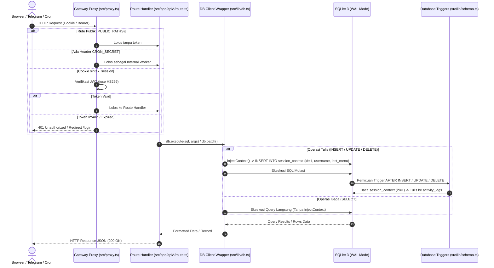
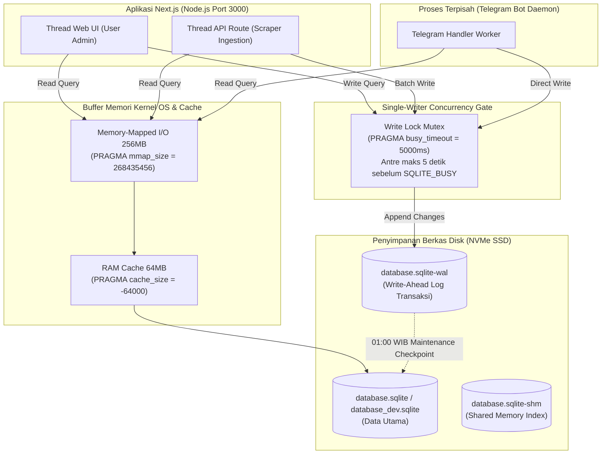
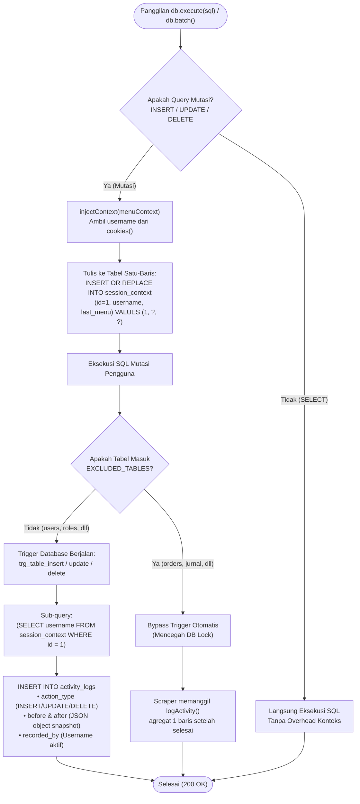
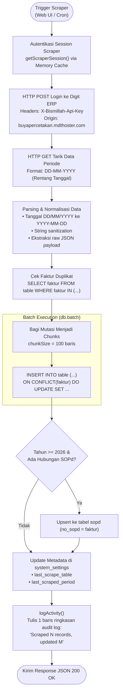
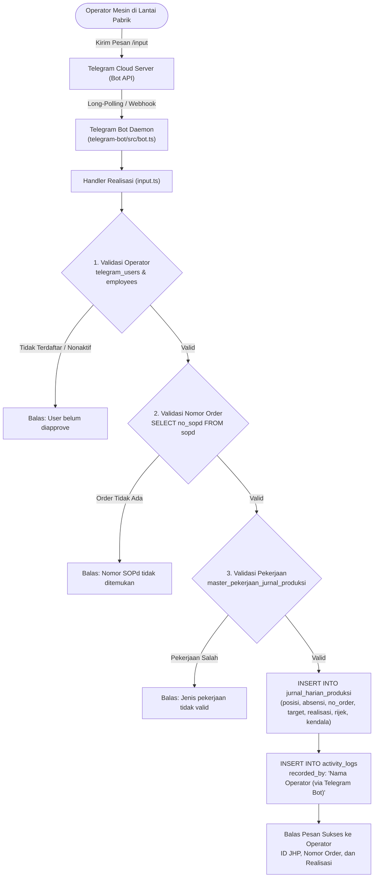
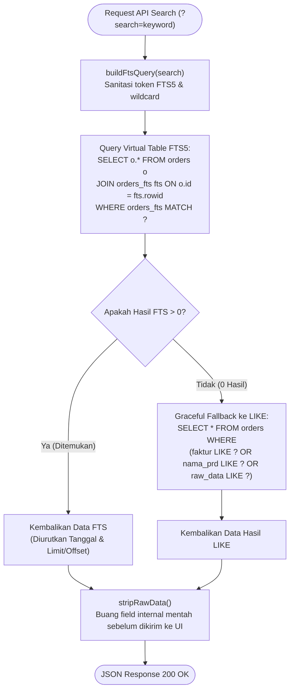

# DOKUMEN SISTEM SINTAK: ALUR DATABASE & ARSITEKTUR API
> **Sistem Informasi Cetak (SINTAK) — PT Buya Barokah**  
> Status Dokumen: *Resmi, Terverifikasi Sumber Kode & Menggunakan Standar Visual Mermaid*  
> Komponen: `Next.js 16 API Routes (132 Endpoints) | libSQL/SQLite 3 (WAL / MMAP) | Telegram Bot Daemon | Scraper Digit`

---

## DAFTAR ISI
1. [Siklus Hidup Request & Gateway Otorisasi](#1-siklus-hidup-request--gateway-otorisasi)
2. [Arsitektur Database Engine (SQLite WAL & Memory-Mapped I/O)](#2-arsitektur-database-engine-sqlite-wal--memory-mapped-io)
3. [Mekanisme Context Injection & Audit Trail Otomatis](#3-mekanisme-context-injection--audit-trail-otomatis)
4. [Pipeline Ingestion Scraper (Digit ERP)](#4-pipeline-ingestion-scraper-digit-erp)
5. [Integrasi Database Langsung Telegram Bot](#5-integrasi-database-langsung-telegram-bot)
6. [Pipeline Pencarian Data & FTS5 Fallback](#6-pipeline-pencarian-data--fts5-fallback)
7. [Matriks Risiko Arsitektur & Langkah Mitigasi](#7-matriks-risiko-arsitektur--langkah-mitigasi)

---

## 1. SIKLUS HIDUP REQUEST & GATEWAY OTORISASI

Setiap permintaan HTTP dari klien (Browser, Bot Telegram, atau Crontab) diproses melalui rantai penyaringan gateway sebelum mencapai Route Handler dan Database.

### Rincian Komponen Otorisasi:
1. **Public Paths Whitelist (`src/proxy.ts:12-27`)**: Rute aset statis, webhook telegram, cron, dan login dikecualikan dari pengecekan sesi.
2. **Machine-to-Machine Secret (`src/proxy.ts:34-37`)**: Header `Authorization: Bearer ${CRON_SECRET}` mengizinkan cron job OS Linux mengeksekusi sinkronisasi dan maintenance harian tanpa token browser.
3. **User Session Verification (`src/proxy.ts:29-51`)**: Validasi token JWT terenkripsi dengan algoritma HS256 dari cookie `sintak_session`.

---

## 2. ARSITEKTUR DATABASE ENGINE (SQLITE WAL & MEMORY-MAPPED I/O)

SINTAK menggunakan SQLite lokal yang dioptimalkan untuk konkurensi tinggi dan *read throughput* maksimal menggunakan konfigurasi level PRAGMA.

### Konfigurasi PRAGMA Utama (`src/lib/schema.ts:9-13`):
* `PRAGMA journal_mode = WAL;`: Mengaktifkan *Write-Ahead Logging*. Pembacaan tidak pernah memblokir penulisan, dan penulisan tidak memblokir pembacaan.
* `PRAGMA mmap_size = 268435456;`: Memetakan 256 MB file database langsung ke virtual address space memori untuk *zero-copy read*.
* `PRAGMA cache_size = -64000;`: Menyediakan 64 MB RAM cache SQLite internal.
* `PRAGMA busy_timeout = 5000;`: Memberi batas toleransi antrean penulisan hingga 5.000 ms sebelum melempar error `SQLITE_BUSY`.

---

## 3. MEKANISME CONTEXT INJECTION & AUDIT TRAIL OTOMATIS

Untuk melacak siapa yang melakukan perubahan data tanpa menulis kode audit manual di setiap fungsi, sistem menggunakan kombinasi **DB Wrapper Interception** dan **SQLite Triggers**.

### Implementasi Teknis:
* **Context Interceptor (`src/lib/db.ts:98-134`)**: Mengekstrak user dari `getSession()` dan menyimpan ke `session_context WHERE id = 1`.
* **Triggers Template (`src/lib/schema.ts:1824-1863`)**: Otomatis membuat snapshot `before` dan `after` menggunakan fungsi native `json_object(...)`.
* **Exclusion List (`src/lib/schema.ts:1760-1770`)**: Tabel bervolume tinggi (`jurnal_umum`, `jurnal_harian_produksi`, `orders`, `bahan_baku`, `barang_jadi`, dll.) dikeluarkan dari trigger agar impor ribuan baris tidak menyebabkan *write amplification*.

---

## 4. PIPELINE INGESTION SCRAPER (DIGIT ERP)

Scraper bertugas menarik data transaksi dari sistem Digit secara periodik atau manual tanpa memicu deadlock pada sistem operasional harian.

### Poin Kritis Ingestion (`src/app/api/scrape-orders/route.ts:154-250`):
1. **Idempotensi `ON CONFLICT`**: Mencegah data ganda jika scraper dijalankan ulang pada rentang tanggal yang sama.
2. **Chunking 100 Baris**: Membatasi ukuran *write transaction* SQLite agar memori tidak melonjak dan tidak memblokir antrean tulis thread lain terlalu lama.
3. **Penyimpanan Metadata**: Status rentang tanggal terakhir yang sukses dicatat ke `system_settings` sehingga UI tahu data terupdate kapan.

---

## 5. INTEGRASI DATABASE LANGSUNG TELEGRAM BOT

Telegram Bot (`telegram-bot/`) tidak memanggil API Next.js melalui HTTP, melainkan terhubung langsung ke berkas database SQLite lokal.

### Keuntungan & Karakteristik Desain:
* **Zero HTTP Overhead**: Akses lokal langsung via `@libsql/client` (`telegram-bot/src/db.ts:14`) memberikan latensi simpan $< 5\text{ ms}$.
* **Audit Trail Mandiri**: Karena `jurnal_harian_produksi` tidak memakai database trigger otomatis, bot bertanggung jawab langsung menyisipkan baris audit di `activity_logs` (`telegram-bot/src/utils/api.ts:301-304`).

---

## 6. PIPELINE PENCARIAN DATA & FTS5 FALLBACK

Untuk menjaga kecepatan respons pencarian faktur dan nama barang di antara ratusan ribu baris data, sistem menggunakan virtual table **SQLite FTS5** dengan *graceful fallback*.

### Mekanisme Resiliensi (`src/app/api/orders/route.ts:27-74`):
1. **FTS5 Index Seek**: Menggunakan pencarian berbasis *inverted index* untuk pencocokan kata instan.
2. **Fallback Robustness**: Jika pengguna mencari teks parsial yang tidak dikenali FTS tokenizer (misal: kode acak di tengah kata), sistem otomatis turun ke query `LIKE %keyword%` parameterized tanpa menimbulkan error.

---

## 7. MATRIKS RISIKO ARSITEKTUR & LANGKAH MITIGASI

Berdasarkan audit alur database dan API, berikut adalah identifikasi risiko dan panduan penanganannya:

| No | Komponen Terkait | Potensi Risiko | Penjelasan & Dampak | Rekomendasi Solusi Teknis |
|:---:|---|---|---|---|
| **1** | `session_context` (`src/lib/db.ts:118`) | **Race Condition pada Audit Log** | `session_context` hanya memiliki 1 baris (`id = 1`). Jika dua user melakukan simpan bersamaan dalam hitungan milidetik, User B bisa menimpa username User A sebelum trigger User A berjalan. | Sertakan `connection/transaction-scoped context` atau teruskan `username` langsung pada statement mutasi. |
| **2** | API Routes (`src/app/api/*/route.ts`) | **IDOR / Bypass Izin Modul** | `src/proxy.ts` hanya memverifikasi login (sesi valid), sedangkan `requirePermission()` hanya dipanggil di Server Component UI (`page.tsx`). User login dengan role apa pun bisa memanggil endpoint API secara langsung via cURL. | Tambahkan pemanggilan `requirePermission()` di awal fungsi handler API mutasi (POST, PATCH, DELETE). |
| **3** | Ingestion vs Bot (`scrape-*/route.ts`) | **Database Lock (`SQLITE_BUSY`)** | SQLite hanya mengizinkan **1 thread penulisan** dalam satu waktu. Jika scraper sedang mengeksekusi batch besar $> 5$ detik, Telegram bot akan timeout dan melempar error *database locked*. | Jaga `chunkSize = 100` pada scraper, sisipkan jeda `await sleep(10)` antar-chunk jika antrean sedang padat. |

---
> *Dokumen ini disinkronkan langsung dari basis kode aktif SINTAK pada 5 Oktober 2026.*
